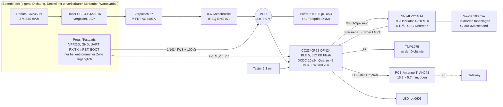
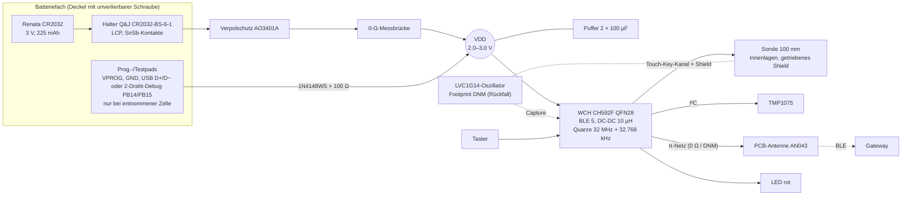
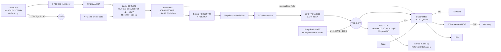

# Tröpfli – Phase 2: Technische Konzepte und Empfehlung

| | |
|---|---|
| Dokument | `docs/concepts/CONCEPTS.md` |
| Version | 0.1 (Entwurf zur Prüfung) |
| Datum | 2026-11-06 |
| Ersteller | Konzeptredaktor im Auftrag des Projektleiters |
| Grundlagen | `docs/requirements/REQUIREMENTS.md` v1.0 (verbindlich), `docs/concepts/research_{elektronik,energie,fertigung,gateway}.md` |
| Rechnungen | `scripts/energy_budget.py` (unverändert), `scripts/concept_energy.py` (Konzeptauswahl + C-WLAN), `scripts/cost_model.py` (belegte JLC-Preise/Versand 2026-11-06 eingetragen), `scripts/concept_costs.py` (BOMs, 2 vs. 4 Lagen) |
| Stücklisten | `docs/concepts/bom/bom_{A,A2,B,B2,B_Osz,C}.csv` (erzeugt mit `concept_costs.py --csv`) |
| Register | neue Teile in `docs/datasheets/_staging/INDEX_konzepte.csv` |
| Status | Entwurf, keine Entscheidung. Entscheid durch Auftraggeber nach Prüfung. |

**Kennzeichnung:** **ANNAHME** = nicht belegt. **PROTOTYP-PRÜFUNG** = erst am Muster nachweisbar.
`Datei, S. x` = PDF-Seite. JLC-Daten (Basic/Extended, Lager, Preis in der Staffel mit 20 Stk) aus der
JLC-Teilesuche (`selectSmtComponentList`), **Abruf 2026-11-06** („JLC 2026-11-06“). Wechselkurs
1 USD = 0.8189 CHF (EZB 2026-11-06, `cost_model.py`). Rechenausgaben sind wörtlich aus den Skripten
übernommen und mit dem Aufruf reproduzierbar.

---

## 0 Kurzfassung

| | **A „Knopf“** | **B „Spar“** | **C „Akku“** | C-WLAN |
|---|---|---|---|---|
| Kern | CC2340R52 + LVC1G14-Oszillator + TMP1075 + CR2450N | CH592F + Touch-Key + TMP1075 + CR2032 | CC2340R52 + FDC2212 + TMP1075 + LiPo 125 mAh | ESP32-C3 + LiPo |
| Stückkosten Serie 15 Stk, 4 Lagen (CHF) | **10.35** | **7.63** | **18.77** | nicht gerechnet |
| Stückkosten Serie 15 Stk, 2 Lagen + Coating (CHF) | **9.07** (A2) | **6.35** (B2) | (17.19 ohne Coating) | – |
| Einmalkosten Prototyp 5 PCB/2 bestückt, 4 L / 2 L (CHF) | 78.63 / 44.23 | 67.56 / 33.98 | 104.45 / – | – |
| Laufzeit 1 min, pess. (REQ-ENE-08) | **82.5 Monate** | **30.3 Monate** | **6.4 Monate/Ladung** | **0.3 Tage** |
| Kopf B × T × H (mm), Soll 35 × 20 × 45 | ≈ 30 × 15–17 × 62 (52 mit Halter hinten) | ≈ 27 × 13–15 × 57 | ≈ 27 × 16 × 46 | grösser als C |
| Muss-Verfehlungen | REQ-FAB-04 mit 4 Lagen um 0.35 CHF verfehlt (mit 2 Lagen + Coating erfüllt, dann REQ-MECH-04 nach Vergleich) | REQ-FW-04 nur mit Eigenbau-Bootloader, REQ-ENE-09 (Schlaf) rechnerisch, REQ-FW-06 unbelegt, REQ-SAF-CC-05 offen | REQ-FAB-04, REQ-SAF-LI-09, REQ-ENE-09 [LI] (Max-Werte), REQ-SAF-03 | REQ-ENE-03 + REQ-SYS-05 |

**Empfehlung: Konzept A „Knopf“** (Begründung Kap. 7); Lagenentscheid 4 L (10.35 CHF, Freigabe
nach Regel 1.2) oder 2 L + Coating (9.07 CHF) über einen Prototyp-Vergleich beider Ausführungen. Gateway für alle Konzepte: **ESP32-S3-Board
(XIAO ESP32-S3 Plus) + gepufferte RTC + Netzteil**, ≈ CHF 30–39 (Kap. 5).

---

## 1 Gemeinsame Festlegungen (alle Konzepte)

| Thema | Festlegung | Beleg |
|---|---|---|
| Funk | BLE im Sensor (REQ-RF-01, Vergleich mit WLAN in Kap. 4.8) | `concept_energy.py` Teil 2 |
| Erreichbarkeit | verbindbares Advertising alle 27.5 / 57.5 / 147.5 s für 1 / 2 / 5 min Reaktionszeit | `energy_budget.py` Kopfzeilen |
| Zeitbasis | 32.768-kHz-Quarz Epson FC-135 (±20 ppm, B = −0.04 ppm/K² max, Alterung ±3 ppm/a). Fehlerbudget 5–45 °C: 20 + 0.04·25² + 3 ≈ **48 ppm** < 58 ppm (±5 min/60 d) bzw. 99 ppm (±2 min/14 d) → REQ-SYS-07 **knapp erfüllt** (Rechnung; Abgleich bei jedem Gateway-Kontakt) | `Epson_Q13FC13500003_Datasheet_LCSC-2018-10.pdf`, S.1 |
| Lastkapazität 32 kHz | CC2340 verlangt **6–12 pF** → 9-pF-Typ C99010 (Extended). Der Basic-Typ C32346 hat **12.5 pF** und passt nur zum CH592 (intern 12–27 pF) | `TI_CC2340R5_Datasheet_SWRS272F.pdf` S.27; `WCH_CH592_Datasheet_V1.9.pdf` S.48 |
| DC/DC-Spule | **Korrektur zur Elektronik-Recherche:** Basic C1035 (SDFL1608) hat nur **3 mA** Nennstrom (JLC-Attribut) und ist als DC/DC-Spule ungeeignet. Gewählt: Sunlord WPN201610H100MT **C89132** (10 µH, Isat 0.80 A, Irms 0.65 A max., Extended). Kein Basic-Leistungsinduktor 10 µH gefunden | `Sunlord_WPN201610H100MT_Datasheet_LCSC-2023-10.pdf` S.2 |
| LED | 1 × rot 0603 KT-0603R (C2286, Basic) mit 470 Ω → ca. 2 mA (wie Modell `led.i`); LED-Anteil am Budget 1.4–1.9 % (≤ 5 %, REQ-UI-03) | `concept_energy.py` 1c |
| Taster | TS-1187A-B-A-B (C318884, Basic, 5.1 × 5.1 mm, 1.6 N, 100 000 Zyklen) | JLC 2026-11-06; `XKB_TS-1187A-B-A-B_Datasheet_LCSC-2023-04.pdf` |
| Rückstromsperre Programmierung | VPROG-Pad → 1N4148WS (C2128) → 100 Ω (C25076) → VDD; UART-Leitungen je 1 kΩ (C11702). Zwei unabhängige Begrenzungen je Quelle (REQ-SAF-CC-03, REQ-SAF-06) | Konzept, Nachweis Phase 3 |
| Strommesspunkt | 0-Ω-Brücke (C17168) hinter dem Verpolschutz, umgeht keine Schutzfunktion (REQ-ENE-07) | Konzept |
| Leiterplatte | 4 Lagen, 1.6 mm, Economic PCBA, einseitig bestückt (Elektroden innen, REQ-MECH-04) | `research_fertigung.md` 1, 3.4 |
| Gehäuse | ASA, Wand 1.5–2 mm; Material ASA **ANNAHME CHF 0.035/g**; Dichtung 0.15, Versiegelung 0.40, Schraube 0.10 CHF (**ANNAHME**) | `concept_costs.py` Kopf |

### 1.1 Kostenbasis und Vorbehalte
- Stückkosten nach `cost_model.py` = PCB-Anteil + Bauteile + Bestückung + MWST-Anteil + lokale Teile
  (Zelle, Gehäusematerial, Dichtung, Versiegelung). Einmalkosten = Setup, Schablone, Extended-Gebühr
  (3.07 USD/Typ), Mindestabnahme-Überschuss, Versand, MWST, Verzollung.
- **PCB-Preise belegt:** „JLCPCB-Rechner, vom Auftraggeber abgelesen 2026-11-06“, 22 × 150 mm, grün,
  LeadFree HASL, Standardoptionen (USD gesamt für 5/10/15/20 Stk): 2 L 1.6 mm 6.9/8.7/10.4/12.3;
  4 L 1.6 mm 32.3/34.5/36.8/39.0; 4 L 2.0 mm 73.8/76.6/79.4/82.1; ENIG +11.9, Epoxy-Vias +20.3
  (4 L, 5 Stk). Eingetragen in `cost_model.py` (`PCB_PRICE_USD`, `PCB_PRICE_2MM_USD`).
- **Versand belegt** (JLC-Seite, Screenshot Auftraggeber 2026-11-06): GSDL 7.63 USD (nur bis 1.5 kg und
  **Warenwert ≤ 65 USD**), DHL Express 23.44, UPS 25.36, FedEx 31.15 USD. Das Modell rechnet GSDL
  nur unterhalb der Grenzen, sonst DHL (Verzollung DHL max(3 CHF; 2 %), Post 16 CHF + 3 %).
  Ergebnis: nur die 2-Lagen-Prototypen fallen unter 65 USD; alle 4-Lagen-Bestellungen gehen per DHL.
- Die frühere Sensitivität ±50 % auf den PCB-Preis entfällt; stattdessen Vergleich 2 vs. 4 Lagen (6.2).
- Weiterhin **ANNAHME**: Gehäusematerial, Dichtung, Versiegelung, Coating (CHF 0.30), LiPo-Preis,
  ENIG/Epoxy bei 2 Lagen, Gewicht.
- Prototyp-Los = kleinste JLC-Menge: **5 Leiterplatten, 2 bestückt** (`research_fertigung.md` 1, 2).
  Zum Vergleich 5/5. Serie = 15/15.

---

## 2 Konzept A „Knopf“ – CC2340R52 + RC-Oszillator + CR2450N

### 2.1 Blockdiagramm

Energiepfad: Zelle → Halter → AO3401A → Messbrücke → VDD (ohne Regler, CC2340 1.71–3.8 V,
`TI_CC2340R5_Datasheet_SWRS272F.pdf` S.18). Messpfad: GPIO speist den Oszillator nur während der
Messung (0 µA im Schlaf), Frequenzzählung per Timer, ratiometrisch gegen C0G-Referenz, zwei
Frequenzen über R f1/f2 (Salz-Diagnose, `research_elektronik.md` 6.3/6.4). Programmierung über den
ROM-UART-Bootloader (`TI_CC23xx_HWDesignGuide_SWRA834A.pdf` S.6–7, Tab. 3-2/3-4); OTA signiert mit
MCUboot über einen **eigenen GATT-Dienst** mit Anwendungsschlüssel (REQ-RF-06, `research_gateway.md` 3.2).

### 2.2 Hauptbauteile

| Funktion | Hersteller / Teil | LCSC | B/E | Lager | USD @20 | Quelle |
|---|---|---|---|---|---|---|
| BLE-SoC | TI CC2340R52E0RGER (VQFN-24) | C20416850 | E | 9 278 | 1.3375 | JLC 2026-11-06; `TI_CC2340R5_Datasheet_SWRS272F.pdf` S.18–20 |
| HF-Quarz 48 MHz | TAITIEN XXHCELNANF-48MHZ | C5160139 | E | 1 804 | 0.143 | JLC 2026-11-06; `TAITIEN_XXHCELNANF-48MHZ_Datasheet_LCSC-2022-10.pdf` |
| 32.768 kHz, 9 pF | Epson Q13FC13500003 (FC-135) | C99010 | E | 33 692 | 0.204 | JLC 2026-11-06; `Epson_Q13FC13500003_Datasheet_LCSC-2018-10.pdf` S.1 |
| DC/DC-Spule 10 µH | Sunlord WPN201610H100MT | C89132 | E | 5 075 | 0.0418 | JLC 2026-11-06; `Sunlord_WPN201610H100MT_Datasheet_LCSC-2023-10.pdf` S.2 |
| HF-Filter | Sunlord SDCL1005C2N7STDF 2.7 nH; FH 0402CG1R5C500NT 1.5 pF (2×); FH 0402CG150J500NT 15 pF | C27123 / C1552 / C1548 | E / E / B | 110 991 / 171 124 / 1 220 654 | 0.0031 / 0.0045 / 0.0026 | TI-Referenz `TI_CC23xx_HWDesignGuide_SWRA834A.pdf` S.5 Abb. 3-1 (2.8 nH → 2.7 nH, **ANNAHME**, Abstimmung PROTOTYP-PRÜFUNG) |
| π-Netz | 0 Ω UNI-ROYAL 0402 (Längsglied), Querglieder DNM | C17168 | B | 14.2 Mio | 0.0011 | JLC 2026-11-06 |
| Abblock/Bulk | Samsung 10 µF 0402 (2×), 100 nF (7×), 1 µF (1×) | C15525 / C1525 / C52923 | B | 9.2 / 34.7 / 11.7 Mio | 0.0258 / 0.0031 / 0.0058 | JLC 2026-11-06; Samsung-Datenblätter LCSC |
| Messoszillator | TI SN74LVC1G14DCKR (SC-70-5) | C35740 | E | 98 074 | 0.0567 | JLC 2026-11-06; `TI_SN74LVC1G14_Datasheet_SCES218AA.pdf` S.6–8 |
| Oszillator-R/C | 2.2 kΩ (f1), 22 kΩ (f2), 22 pF C0G Referenz | C25879 / C25768 / C1555 | B | 3.4 / 1.07 / 1.72 Mio | 0.0011 / 0.0012 / 0.0019 | Werte **ANNAHME** bis Feldsimulation |
| Bodentemperatur | TI TMP1075DSGR (±1 °C max., −40…75 °C) + 2 × 4.7 kΩ | C2870250 / C25900 | E / B | 34 641 / 15.9 Mio | 0.3111 / 0.0017 | `TI_TMP1075_Datasheet_SBOS854F.pdf` S.6 Tab. 6.5 |
| Halter CR2450 | MYOUNG BS-24-B4AA016 (Au, LCP UL94V-0) | C964809 | E | 2 042 | 0.4748 | `MYOUNG_BS-24-B4AA016_Drawing_A0.pdf` S.1 |
| Verpolschutz | AOS AO3401A | C15127 | B | 1.70 Mio | 0.0829 | `AOS_AO3401A_Datasheet_Rev3.1.pdf` S.1–2 |
| Puffer | Samsung CL31A107MQHNNNE 100 µF 1206 (2×) | C15008 | B | 1.60 Mio | 0.1091 | `research_energie.md` 1.5 |
| LED + R | KENTO KT-0603R + 470 Ω | C2286 / C25117 | B | 6.65 / 3.07 Mio | 0.0077 / 0.0010 | `KENTO_KT-0603R_Datasheet_LCSC-2018-10.pdf` |
| Taster | XKB TS-1187A-B-A-B | C318884 | B | 968 165 | 0.0207 | `XKB_TS-1187A-B-A-B_Datasheet_LCSC-2023-04.pdf` |
| Prog.-Schutz | 1N4148WS + 100 Ω; UART 2 × 1 kΩ; nRST 100 kΩ | C2128 / C25076 / C11702 / C25741 | B | 2.9 / 11.9 / 34.0 / 8.4 Mio | 0.0112 / 0.0012 / 0.0013 / 0.0013 | `CJ_1N4148WS_Datasheet_LCSC-2018-10.pdf` |
| Zelle (lokal) | Renata CR2450N, 540 mAh, −40…85 °C | – | – | – | CHF 3.70–4.50 | `Renata_CR2450N_Datasheet_Rev08.pdf` S.1; Preis `research_energie.md` 1.2 |

Summe: **9 Extended-Typen**, 19 Basic-Typen, Bauteile JLC 3.02 USD/Sensor (`concept_costs.py` 1).
Jeder Extended-Typ ist begründet (REQ-FAB-02): SoC, Quarze, Leistungsspule, Oszillator, TMP1075 und
Halter gibt es nicht als Basic; die zwei HF-Filterteile fehlen als Basic in passender Grösse.

### 2.3 Energiebudget (`.venv/bin/python scripts/concept_energy.py`, Modell `energy_budget.py`)

| Konzept | Reaktionszeit | Mittelstrom real [uA] | Mittelstrom pess. A [uA] | Laufzeit real [Monate] | Laufzeit pess. A [Monate] | Schlaf pess. (SoC+Board) [uA] |
|---|---|---|---|---|---|---|
| A Knopf: CC2340R5 + CR2450N | 1 min | 1.64 | 5.49 | >120 | **82.5** | 2.93 |
| A Knopf: CC2340R5 + CR2450N | 2 min | 1.33 | 4.56 | >120 | **95.8** | 2.93 |
| A Knopf: CC2340R5 + CR2450N | 5 min | 1.16 | 4.04 | >120 | **105.2** | 2.93 |

Puffer-Sensitivität (pess. B, Leckstrom = Datenblattgrenze 50 Ω·F):

| Konzept | Puffer nominal | Leckgrenze @3 V [uA] | Mittelstrom pess. B [uA] | Laufzeit pess. B [Monate] |
|---|---|---|---|---|
| A Knopf: CC2340R5 + CR2450N | 100 uF | 6.0 | 12.09 | 41.7 |
| A Knopf: CC2340R5 + CR2450N | 200 uF | 12.0 | 19.29 | 27.0 |

Bewertung: REQ-ENE-02 (≥ 12 Monate pess.) **erfüllt mit grosser Reserve**, auch im Fall B.
REQ-ENE-09 Mittelstrom ≤ 8 µA: pess. A 5.49 µA **erfüllt**; Fall B (Datenblatt-Leckgrenze) nicht –
der reale Leckstrom ist am Muster zu messen (E-01 der Energie-Recherche, PROTOTYP-PRÜFUNG).
Schlaf ≤ 3 µA: pess. 2.93 µA, **knapp erfüllt**. Werkseinstellung Reaktionszeit = **1 min** (REQ-SYS-05).
REQ-ENE-06: Der Puffer braucht pessimistisch 325 µF nominal, realistisch 78 µF (`energy_budget.py`
Tab. 6); bestückt 2 × 100 µF + 1 Footprint DNM, Nachweis per SPICE in Phase 3.

### 2.4 Kosten (`.venv/bin/python scripts/concept_costs.py`)

| Szenario | PCBA | Versand | Stück CHF | PCB-Anteil USD | Einmal CHF | Bestellung total CHF |
|---|---|---|---|---|---|---|
| A 4 L, Prototyp 5 PCB / 2 bestückt | economic | DHL | **13.95** | 6.46 | 78.63 | 106.53 |
| A 4 L, Prototyp 5 PCB / 5 bestückt | economic | DHL | **13.95** | 6.46 | 60.64 | 130.39 |
| A 4 L, Serie 15 / 15 | economic | DHL | **10.35** | 2.45 | 60.50 | 215.80 |
| A2 2 L + Coating, Prototyp 5 / 2 | economic | GSDL | **9.39** | 1.38 | 44.23 | 63.01 |
| A2 2 L + Coating, Prototyp 5 / 5 | economic | GSDL | **9.39** | 1.38 | 40.24 | 87.17 |
| A2 2 L + Coating, Serie 15 / 15 | economic | DHL | **9.07** | 0.69 | 60.50 | 196.60 |

Aufschlüsselung Serie 4 L (`cost_model.py --bom docs/concepts/bom/bom_A.csv --layers 4 --thickness 1.6 --pcb-qty 15 --pcba-qty 15`):
PCB 2.45 USD + Bauteile 3.02 USD + SMT 0.19 USD + MWST 0.38 CHF + lokal 5.28 CHF (Zelle 4.10,
ASA 15 g 0.53, Dichtung 0.15, Versiegelung 0.40, Schraube 0.10) = **10.35 CHF**. Einmalig u. a.
Extended-Gebühr 27.63 USD (9 Typen), DHL 23.44 USD, Verzollung DHL 3.00 CHF.
REQ-FAB-04 (≤ 10 CHF): mit 4 Lagen **um 0.35 CHF verfehlt**, mit 2 Lagen + Coating (A2) **erfüllt**.
Hebel bei 4 Lagen: Zelle ab CHF 3.70 (−0.40 → 9.95 CHF, knapp), zweiten Puffer nur falls SPICE
nötig (−0.09 USD). Der Prototyp-Stückpreis ist wegen des PCB-Mindestpreises (5 Platinen) hoch und für
REQ-FAB-04 nicht massgebend.

### 2.5 Kopfgrösse (Abschätzung)

| Mass | Herleitung | Wert |
|---|---|---|
| Breite | Zelle Ø 24.5 mm quer (Halterkörper 32.8 × 16 mm, Pads 37 mm Spannweite, `MYOUNG_BS-24-B4AA016_Drawing_A0.pdf` S.1) + 2 × 0.5 mm Spiel + 2 × 1.5–2 mm Wand | **29–30 mm** |
| Tiefe | Wand 2 + Halter 7.5 + Andrückelement/Deckelspiel 1 + PCB 1.6 + Rückseite 0.5 + Wand 2 (1.5 mm-Wand: −1) | **14–15 mm** (+ Schraubdom ≈ 2 → 17) |
| Höhe über Erde | Dichtzone 5 (**ANNAHME**) + Halter 37 (37-mm-Achse senkrecht, sonst Breite > 35) + Elektronikband 10 (**ANNAHME**: SoC, Quarze, Oszillator, Taster) + Antenne 5.7 (`TI_AN043_SmallPCBAntenna_SWRA117D.pdf` S.1) + Keepout 2.3 (**ANNAHME**) + Wand 2 | **≈ 62 mm** |
| Variante A-H | Halter auf der Rückseite (Hand-Lötung, Economic PCBA ist einseitig), Elektronik vorne im Halterband | ≈ 30 × 17 × **52 mm** |

REQ-MECH-02 (Soll 35 × 20 × 45 mm): Breite und Tiefe **erfüllt**, Höhe **verfehlt** (+17 mm bzw. +7 mm
bei A-H). Ursache: 37 mm lange Halterachse der CR2450. Gewicht Zelle 5.9 g (REQ-MECH-17 prüfen).

### 2.6 Sicherheit, Vor-/Nachteile, Risiken

| Anforderung | Bewertung |
|---|---|
| REQ-SAF-03 | Primärzelle, keine Ladefunktion → sicherste Variante |
| REQ-SAF-CC-05 / RB-03 | CR2450N −40…85 °C, Rücksprache erst > 70 °C → 65 °C **im Datenblattbereich** (`Renata_CR2450N_Datasheet_Rev08.pdf` S.1) |
| REQ-SAF-CC-01 | AO3401A verpolt: IDSS ≤ 1 µA (25 °C) / 5 µA (55 °C) (`AOS_AO3401A_Datasheet_Rev3.1.pdf` S.2) → 24 h unkritisch; Test PROTOTYP-PRÜFUNG |
| REQ-SAF-CC-02 | vergoldete Kontakte, LCP-Gehäuse führt die Zelle (kein Schrägsitz-Kurzschluss wie bei Clip-Haltern); Falltest PROTOTYP-PRÜFUNG |
| REQ-SAF-CC-03 / -06 | Pads nur bei entnommener Zelle zugänglich (konstruktiv) **und** 1N4148WS + 100 Ω bzw. 1 kΩ je UART-Leitung. Achtung: AO3401A leitet rückwärts (`research_energie.md` E-06) → Konstruktion ist die erste, Diode/Widerstand die zweite Barriere |
| REQ-SAF-CC-04 | Deckel mit unverlierbarer Schraube, Warnsymbol; Halter allein genügt nicht |
| REQ-SAF-05 | Batteriefach separat abdichten (Dichtung um Halterbereich auf PCB/Gehäuse) – konstruktiv anspruchsvoll, PROTOTYP-PRÜFUNG (Flutungstest) |
| REQ-SAF-01/02 | Kurzschlussfall Zelle: Strom durch Zellinnenwiderstand begrenzt; FMEA-light in Phase 3 |
| REQ-FW-04 | MCUboot mit ECDSA-Signatur, Anti-Rollback per Sicherheitszähler (`research_gateway.md` 3.1/3.2) – Konfiguration für CC2340 in Phase 3 belegen |

**Vorteile:** tiefster belegter Schlafstrom, Betrieb bis 1.71 V, ROM-UART-Bootloader (USB-UART-Adapter
≈ 3 CHF, ANNAHME), 512 KB Flash für A/B-Update, hohe Messfrequenz (Salz), Zelle mit Temperaturreserve,
Laufzeit > 6 Jahre pess.
**Nachteile:** höchste Kopfhöhe, mit 4 Lagen 0.35 CHF über dem Kostenziel, 9 Extended-Typen (27.63 USD je Bestellung).
**Risiken:** GPIO-Knappheit QFN24 (12 DIO, Bootloader-Pins laut Tab. 3-2 je Paket prüfen); Funkstrom
unter 2.2 V im GLDO-Betrieb (9 mA) → Pufferbedarf; OTA-Client für TI-MCUboot auf ESP32 selbst schreiben;
LVC1G14-Zählgrenze (ANNAHME 24 MHz); HF-Filter-Abstimmung (2.7 statt 2.8 nH).
**Abweichungen Muss:** REQ-FAB-04 mit 4 Lagen (10.35 CHF) verfehlt, mit 2 Lagen + Coating (9.07 CHF) erfüllt – Lagenentscheid OP-K1.

---

## 3 Konzept B „Spar“ – CH592F + Touch-Key + CR2032

### 3.1 Blockdiagramm

Messprinzip: MCU-internes Touch-Key-Modul (12 Kanäle, 10–100 pF, Shield-Ausgang,
`WCH_CH592_Datasheet_V1.9.pdf` S.132), effektive Messfrequenz ≈ 0.1–1 MHz (**ANNAHME**,
`research_elektronik.md` 6.1) → salzempfindlicher als A. Rückfall: LVC1G14-Footprint (DNM), Option
„B+Osz.“ bestückt kostet +0.06 CHF/Stück und +3 USD je Bestellung.
**Temperaturwahl B: TMP1075** (wie A). Begründung: Ein NTC (C77131, 0.017 USD) spart nur ≈ 0.24 CHF,
der CH592-ADC misst aber gegen eine interne Referenz 1.05 V ± 0.015 V mit begrenztem Eingangsbereich
(S.121–122, Tab. 15-2), ein Fehlerbudget ≤ ±1 °C (REQ-TMP-01, Muss) ist ohne ADC-Genauigkeitsangabe
nicht belegbar; TMP1075 garantiert ±1 °C max. Der NTC bleibt eine Option nach Musterkalibrierung.

### 3.2 Hauptbauteile

| Funktion | Hersteller / Teil | LCSC | B/E | Lager | USD @20 | Quelle |
|---|---|---|---|---|---|---|
| BLE-SoC | WCH CH592F (QFN-28) | C39831287 | E | 27 866 | 0.6696 | JLC 2026-11-06; `WCH_CH592_Datasheet_V1.9.pdf` S.43, S.152–154 |
| HF-Quarz 32 MHz | YXC X322532MOB4SI (12 pF) | C9009 | E | 296 728 | 0.0957 | `YXC_X322532MOB4SI_Datasheet_LCSC-2024-03.pdf`; CH592 intern 10–24 pF (S.48) |
| 32.768 kHz, 12.5 pF | Epson Q13FC13500004 | C32346 | **B** | 483 710 | 0.1715 | `Epson_Q13FC13500004_Datasheet_LCSC-2024-04.pdf`; CH592 intern 12–27 pF (S.48) |
| DC/DC-Spule | Sunlord WPN201610H100MT | C89132 | E | 5 075 | 0.0418 | wie A |
| Abblock | 4.7 µF (VDCID), 10 µF, 5 × 100 nF | C23733 / C15525 / C1525 | B | 1.08 / 9.2 / 34.7 Mio | 0.0118 / 0.0258 / 0.0031 | `research_elektronik.md` 3.3 |
| π-Netz | 0 Ω + DNM | C17168 | B | 14.2 Mio | 0.0011 | CH592 „antenna directly“ (S.5), Footprints **ANNAHME** |
| Bodentemperatur | TMP1075DSGR + 2 × 4.7 kΩ | C2870250 / C25900 | E / B | 34 641 | 0.3111 | wie A |
| Halter CR2032 (günstigster) | Q&J CR2032-BS-6-1 (LCP UL94V-0, Kontakte QSn6.5-0.1 SnSb-plattiert) | C70377 | E | 57 793 | 0.142 | `QJ_CR2032-BS-6-1_Drawing.pdf` S.1 |
| Verpolschutz, Puffer, LED, Taster, Prog.-Schutz | wie A | C15127, C15008 (2×), C2286, C318884, C2128 … | B | – | – | wie A |
| Zelle (lokal) | Renata CR2032 MFR 225 mAh | – | – | – | CHF 2.65–3.00 | `Renata_CR2032MFR_Datasheet_Rev07.pdf` S.1 |

Summe: **5 Extended-Typen**, 15 Basic-Typen, Bauteile JLC 1.84 USD/Sensor.

### 3.3 Energiebudget (`concept_energy.py`)

| Konzept | Reaktionszeit | Mittelstrom real [uA] | Mittelstrom pess. A [uA] | Laufzeit real [Monate] | Laufzeit pess. A [Monate] | Schlaf pess. (SoC+Board) [uA] |
|---|---|---|---|---|---|---|
| B Spar: CH592F + CR2032 | 1 min | 2.94 | 7.13 | 86.8 | **30.3** | 4.59 |
| B Spar: CH592F + CR2032 | 2 min | 2.71 | 6.38 | 93.5 | **33.5** | 4.59 |
| B Spar: CH592F + CR2032 | 5 min | 2.58 | 5.96 | 97.7 | **35.7** | 4.59 |

| Konzept | Puffer nominal | Leckgrenze @3 V [uA] | Mittelstrom pess. B [uA] | Laufzeit pess. B [Monate] |
|---|---|---|---|---|
| B Spar: CH592F + CR2032 | 100 uF | 6.0 | 13.73 | 16.2 |
| B Spar: CH592F + CR2032 | 200 uF | 12.0 | 20.93 | **10.8** |

Bewertung: REQ-ENE-02 pess. A erfüllt (30 Monate); mit 2 × 100 µF und Datenblatt-Leckgrenze **unter
12 Monate** → Leckstrommessung am Muster ist für B entscheidend. REQ-ENE-09 Mittelstrom 7.13 µA
(≤ 8, knapp). **Schlaf pess. 4.59 µA > 3 µA** (Typwert SoC 2.2 µA bei Raumtemperatur „Stichprobe“,
`WCH_CH592_Datasheet_V1.9.pdf` S.43 Tab. 5-3) → REQ-ENE-09 rechnerisch verfehlt, am Muster bei
Raumtemperatur möglich knapp (2.2 + Board). Nur mit RAM2K-Erhalt (1.3 µA) sicher – Stack-Bedarf offen.

### 3.4 Kosten

| Szenario | PCBA | Versand | Stück CHF | PCB-Anteil USD | Einmal CHF | Bestellung total CHF |
|---|---|---|---|---|---|---|
| B 4 L, Prototyp 5 / 2 | economic | DHL | **11.23** | 6.46 | 67.56 | 90.02 |
| B 4 L, Prototyp 5 / 5 | economic | DHL | **11.23** | 6.46 | 49.42 | 105.57 |
| B 4 L, Serie 15 / 15 | economic | DHL | **7.63** | 2.45 | 49.17 | 163.67 |
| B2 2 L + Coating, Prototyp 5 / 2 | economic | GSDL | **6.75** | 1.38 | 33.98 | 47.47 |
| B2 2 L + Coating, Prototyp 5 / 5 | economic | GSDL | **6.75** | 1.38 | 29.85 | 63.58 |
| B2 2 L + Coating, Serie 15 / 15 | economic | DHL | **6.35** | 0.69 | 49.17 | 144.48 |
| B+Osz. 4 L, Serie 15 / 15 | economic | DHL | **7.70** | 2.45 | 52.16 | 167.65 |

REQ-FAB-04 in allen Ausführungen **erfüllt**.
**Untervariante B2** (2 Lagen, Elektroden aussen, Sonde selbst beschichtet, Coating **ANNAHME
CHF 0.30**): spart mit den belegten Preisen **1.28 CHF/Stück** in der Serie (Lagen allein 1.58 CHF)
und beim Prototyp 33.6 CHF Einmalkosten (GSDL statt DHL, kleiner PCB-Preis). Damit ist der
Unterschied **deutlich**. Gegenrisiken: REQ-MECH-04 bevorzugt Innenlagen (2 L nur nach dokumentiertem
Vergleich), REQ-MECH-03 (kein freiliegendes Metall) und REQ-MES-06 (30-Tage-Stabilität) hängen an
der selbst aufgebrachten Beschichtung; JLC-Coating nur mit Standard PCBA (`research_fertigung.md` 1.3).

### 3.5 Kopfgrösse

| Mass | Herleitung | Wert |
|---|---|---|
| Breite | PCB 22 mm bzw. Zelle Ø 20 + Spiel 1 + Wand 3–4 (Halter 31.3 mm senkrecht, `QJ_CR2032-BS-6-1_Drawing.pdf` S.1) | **26–27 mm** |
| Tiefe | Wand 2 + Halter 5.5 + Deckelspiel 1 + PCB 1.6 + 0.5 + Wand 2 | **12–13 mm** (+ Schraubdom → 15) |
| Höhe | Dichtzone 5 + Halter 32 (Pads) + Elektronikband 10 + Antenne/Keepout 8 + Wand 2 | **≈ 57 mm** |
| quer liegend | Halter 32 mm quer: Breite 32 + 1 + 3–4 = **36–37 mm** (> 35), Höhe ≈ 45 | knapp verfehlt |
| Option | TE BAT-HLD-001 (22.9 × 15.3 × 4.2 mm, C7501066, 0.78 USD, Minuspol = PCB-Pad → ENIG) quer: ≈ 28 × 12 × 45 mm | erfüllt REQ-MECH-02, +0.53 CHF + ENIG-Aufpreis (ANNAHME) |

REQ-MECH-02: mit dem günstigsten Halter Höhe **verfehlt** (≈ 57 mm), aber kleiner als A.

### 3.6 Sicherheit, Vor-/Nachteile, Risiken, Abweichungen

| Anforderung | Bewertung |
|---|---|
| **REQ-FW-04 (Muss, Sicherheit)** | Hersteller-OTA ohne Signaturprüfung gefunden (`research_gateway.md` 3.1). Erfüllbar nur mit **eigenem Bootloader** (Ed25519/ECDSA in Software, Anti-Rollback, Swap mit Rückfall). Nach Regel 1.2 darf diese Anforderung **nicht** zugunsten der Kosten gesenkt werden → Eigenbau ist Pflicht, Aufwand und Prüfrisiko hoch |
| REQ-ENE-09 Schlaf ≤ 3 µA | pess. 4.59 µA → **rechnerisch verfehlt**, Messung am Muster |
| REQ-FW-06 Programmierweg | Datenblatt nennt nur „ICP/ISP/IAP“ und 2-Draht-Debug PB14/PB15 per ISP-Tool (`WCH_CH592_Datasheet_V1.9.pdf` S.1, S.9); Schnittstelle des Bootloaders **unbelegt** (ANNAHME USB-ISP bzw. WCH-LinkE ≈ 5 USD) |
| REQ-SAF-CC-05 | Renata CR2032 MFR: **> 60 °C Rücksprache** → 65 °C liegt in dieser Zone (`Renata_CR2032MFR_Datasheet_Rev07.pdf` S.1) → Freigabe Renata oder konstruktive Massnahme nötig |
| REQ-SAF-CC-02 | Kontakte SnSb-plattiert (nicht vergoldet) → Korrosion bei Feuchte im Kopf; LCP-Führung gut. PROTOTYP-PRÜFUNG |
| REQ-SAF-CC-01/03/04, -06 | wie A |
| REQ-MES-11 (Soll) | Touch-Key-Frequenz deutlich tiefer als Oszillator → Salzeinfluss grösser; Becherversuch entscheidet über Rückfall |
| REQ-RF-06 | geschlossener BLE-Stack (Binärbibliothek, S.151) → Anwendungsverschlüsselung selbst |

**Vorteile:** tiefste Kosten (−2.7 CHF gegenüber A bei gleicher Lagenzahl), billigster SoC mit hohem Lager, kleinster
Knopfzellenkopf, niedrige Funkströme mit DC-DC (3.5 mA TX, S.154).
**Nachteile/Risiken:** sicherheitskritischer Eigenbau-Bootloader, Datenblattwerte „for reference
only“ bei 3.3 V, Stack geschlossen, Programmierweg unbelegt, Schlafstrom-Budget, CR2032-Temperaturzone,
65 % weniger Kapazität als A (empfindlicher auf Puffer-Leckstrom).
**Abweichungen Muss:** REQ-FW-04 (nur mit Eigenbau), REQ-ENE-09 Schlaf (rechnerisch), REQ-FW-06
(unbelegt), REQ-SAF-CC-05 (offen).

---

## 4 Konzept C „Akku“ – CC2340R52 + FDC2212 + LiPo

### 4.1 Blockdiagramm

Schutzfunktionen hardwareseitig (REQ-SAF-LI-07): Ladestrom per RISET (KISET 490–590 AΩ →
49–59 mA ≤ 0.5 C = 65 mA, `TI_BQ21040_Datasheet_RevD.pdf` S.5; RISET-Bereich 0.675–10.8 kΩ S.4;
Hinweis: KISET ist erst ab 60 mA spezifiziert), Laden nur 0–45 °C über TS, **237 kΩ TS–GND** gegen
TTDM bei offenem NTC (S.3), OVP, Tiefentladung/Überstrom durch BQ29700, zusätzlich Zellschutz im Pack.
FDC2212: VDD 2.7–3.6 V, 2.1 mA aktiv, Shutdown 0.2 µA typ / 1 µA max, fSENSOR 0.01–10 MHz
(`TI_FDC2212_Datasheet_SNOSCZ5B.pdf` S.7); interner Oszillator (S.12) mit Referenzkanal ratiometrisch.

### 4.2 Hauptbauteile (zusätzlich zum CC2340-Kern aus 2.2)

| Funktion | Hersteller / Teil | LCSC | B/E | Lager | USD @20 | Quelle |
|---|---|---|---|---|---|---|
| Kapazitätswandler | TI FDC2212DNTR (WSON-12) | C968585 | E | **310** | **6.0244** | JLC 2026-11-06; `TI_FDC2212_Datasheet_SNOSCZ5B.pdf` S.7 |
| LC-Tank | Sunlord SDFL1608S100KTF 10 µH (2×), 22 pF C0G (2×) | C1035 / C1555 | B | 418 483 / 1.72 Mio | 0.0279 / 0.0019 | TI-Beispiel 18 µH + 33 pF (S.43); 10 µH + 22 pF → ≈ 6 MHz (Rechnung, Sondenkapazität **ANNAHME** 50 pF) |
| Lader | TI BQ21040DBVR | C202311 | E | 2 346 | 0.4137 | `TI_BQ21040_Datasheet_RevD.pdf` S.3–6 |
| ISET / TS | 10 kΩ; NTC Murata NCP15XH103F03RC; 237 kΩ | C25744 / C77131 / C27001 | B / E / E | 16.5 Mio / 302 510 / 2 437 | 0.0028 / 0.0167 / 0.0032 | `Murata_NCP15XH103F03RC_Datasheet.pdf` |
| Schutz-IC + FET | TI BQ29700DSER + FUXINSEMI FS8205A | C183096 / C908265 | E | 3 239 / 21 975 | 0.4142 / 0.0718 | `TI_BQ2970_Datasheet_RevI.pdf` S.5; `FUXINSEMI_FS8205A_Datasheet.pdf` S.2 |
| LDO 3.0 V | TI TPS7A0230PDBVR | C3747031 | E | 27 756 | 0.28 | `TI_TPS7A02_Datasheet_RevC.pdf` S.5–6 |
| USB-C | SHOU HAN TYPE-C 6P + 2 × 5.1 kΩ | C456012 / C25905 | E / B | 1.0 Mio / 4.6 Mio | 0.039 / 0.0023 | `SHOUHAN_TYPE-C-6P_Datasheet.pdf` S.3 |
| VBUS-Schutz | DOWO PPTC 500 mA/24 V; Littelfuse SMAJ20A | C2984676 / C148209 | E | 10 119 / 2 267 | 0.0901 / 0.1038 | `DOWO_PPTC1206-500mA-24V_Datasheet.pdf` S.1; `Littelfuse_SMAJ_Datasheet.pdf` S.2 |
| Batteriespannung | 2 × 1 MΩ, P-FET AO3401A + N-FET 2N7002 als Schalter (**ANNAHME** Schaltung) | C26083 / C15127 / C8545 | B | 2.8 / 1.7 / 4.2 Mio | 0.0012 / 0.0829 / 0.0171 | `CJ_2N7002_Datasheet_LCSC-2023-04.pdf` |
| Akku (lokal) | Renata ICP401230UPR 125 mAh, Litzen AWG 30 | – | – | – | CHF 4–8 (**ANNAHME**) | `Renata_ICP401230UPR_Datasheet_V02.pdf` S.1 |

Summe: **17 Extended-Typen**, 25 Basic-Typen, Bauteile JLC 9.92 USD/Sensor (FDC2212 allein 6.02 USD).
**Lager FDC2212: 310 Stück** – für Prototyp und Serie ausreichend, aber Abkündigungs-/Lagerrisiko.

### 4.3 Energiebudget (`concept_energy.py`)

| Konzept | Reaktionszeit | Mittelstrom real [uA] | Mittelstrom pess. A [uA] | Laufzeit real [Monate] | Laufzeit pess. A [Monate] | Schlaf pess. (SoC+Board) [uA] |
|---|---|---|---|---|---|---|
| C Akku: CC2340R5 + LiPo 125 mAh | 1 min | 6.80 | 16.37 | 15.1 | **6.4** | 11.99 |
| C Akku: CC2340R5 + LiPo 125 mAh | 2 min | 6.50 | 15.44 | 15.5 | **6.7** | 11.99 |
| C Akku: CC2340R5 + LiPo 125 mAh | 5 min | 6.32 | 14.92 | 15.8 | **6.8** | 11.99 |

Budgetanteil des Li-Pfads (Lader, Schutz-IC, Zellschutz, LDO) pess. **70 %**. REQ-ENE-03 (≥ 3 Monate)
**erfüllt**. REQ-ENE-09 [LI] (Lade-/Schutzschaltung ≤ 5 µA): typ. 4.23 µA, mit Max-Werten **6.56 µA**
(`energy_budget.py` Tab. 7) → nach REQ-ENE-08 **verfehlt**; Zellschutz im Pack ohne Daten.
Der FDC2212 (Shutdown 1 µA max) ist in der Board-ANNAHME 0.5 µA pess. nur teilweise enthalten
(**ANNAHME**, Phase 3 nachführen).

### 4.4 Kosten

| Szenario | PCBA | Versand | Stück CHF | PCB-Anteil USD | Einmal CHF | Bestellung total CHF |
|---|---|---|---|---|---|---|
| Prototyp 5 / 2 | economic | DHL | **22.36** | 6.46 | 104.45 | 149.17 |
| Prototyp 5 / 5 | economic | DHL | **22.36** | 6.46 | 83.84 | 195.64 |
| Serie 15 / 15 | economic | DHL | **18.77** | 2.45 | 83.64 | 365.12 |

Mit 2 Lagen (ohne Coating) 17.19 CHF → REQ-FAB-04 **deutlich verfehlt** (+7 bis +9 CHF). Hauptursachen:
FDC2212 (≈ 5.0 CHF), LiPo (≈ 6 CHF ANNAHME), 17 Extended-Typen (52 USD je Bestellung).

### 4.5 Kopfgrösse

| Mass | Herleitung | Wert |
|---|---|---|
| Breite | PCB 22 + Spiel 1 + Wand 3–4 (Zelle 12.7 mm quer auf der Rückseite) | **26–27 mm** |
| Tiefe | Wand 2 + Bauteile vorne inkl. USB-C ≈ 3.5 (**ANNAHME**) + PCB 1.6 + Zelle 4.5 + Quellraum 0.5 (REQ-SAF-LI-05, 10 %) + Wärmeschutz 1.5 (**ANNAHME**) + Wand 2 | **≈ 16 mm** |
| Höhe | Dichtzone 5 + Zellband 31 (Elektronik vorne im selben Band) + Antenne/Keepout 8 + Wand 2 | **≈ 46 mm** |

REQ-MECH-02: **knapp erfüllt** (Höhe +1 mm). Der Ladeport braucht eine Abdeckung oben/seitlich
ausserhalb der Giesszone (REQ-SAF-LI-06) und konkurriert mit der Antennenlage (REQ-RF-04).

### 4.6 Sicherheit, Vor-/Nachteile, Risiken, Abweichungen

| Anforderung | Bewertung |
|---|---|
| **REQ-SAF-LI-09** | Renata-Packs: Entladen bis **60 °C**, Lagern bis **45 °C**, Laden 0–45 °C (`Renata_ICP401230UPR_Datasheet_V02.pdf` S.1) < 65 °C Kopftemperatur → nur mit nachgewiesener konstruktiver Massnahme zulässig; sonst ist C **nicht zulässig** |
| **REQ-SAF-03** | Die nicht wiederaufladbare Lösung (A) ist sicherer, günstiger und erfüllt die Laufzeit → C darf nicht empfohlen werden |
| REQ-SAF-LI-01…08 | konzeptionell abgedeckt (Zellschutz + BQ29700; BQ21040 mit NTC/OVP/Timer/ISET; PPTC + TVS 20 V; CC 5.1 kΩ = nur 5-V-Senke; BQ21040 IN abs. max 30 V, S.3). Tests (3 Netzteile, Nasstest, NTC offen/kurz) aufwendig |
| REQ-SAF-LI-04 | BQ29700 schaltet bei 2.8 V ab, Renata-Entladeschluss 3.0 V → Firmware-Schwelle ≥ 3.0 V nötig; Sicherheitsagent beurteilt |
| REQ-SAF-05 / -06 | Zellanschlüsse und Schutzschaltung vergiessen; Pads mit Diode/Widerstand |
| REQ-ENE-09 [LI] | Max-Werte 6.56 µA > 5 µA → verfehlt |
| REQ-FAB-04 | 18.77 CHF → verfehlt |

**Vorteile:** kleinster Kopf (≈ 27 × 16 × 46 mm), höchste Messauflösung (28 bit, `research_elektronik.md` 6.2),
keine Batteriewechsel. **Nachteile:** Laden alle ~6 Monate nur beaufsichtigt, viele Schutzteile,
FDC2212 teuer und knapp, Messfrequenz ≤ 10 MHz (kein Vorteil gegenüber A), höchster Prüfaufwand.
**Abweichungen Muss:** REQ-FAB-04, REQ-SAF-LI-09 (offen, wahrscheinlich verfehlt), REQ-ENE-09 [LI], REQ-SAF-03.

### 4.7 Kurzbewertung C-WLAN (ESP32-C3 im Sensor, REQ-RF-01)

Gleicher LiPo-Pfad, ESP32-C3 statt CC2340/BLE. Datenblatt: Deep-sleep 5 µA typ (S.57 Tab. 5-9),
Light-sleep 130 µA, RX 84 mA, TX bis 335 mA Spitze (S.56 Tab. 5-7), VDD **3.0–3.6 V** (S.54 Tab. 5-2)
(`Espressif_ESP32-C3_Datasheet_v2.4.pdf`). Verbindungsaufbau 0.8 s / 2.5 s bei 100 / 130 mA (**ANNAHME**).
Ausgabe `concept_energy.py` Teil 2:

| Strategie | Reaktionszeit | Mittelstrom real [mA] | Mittelstrom pess. [mA] | Laufzeit real [Tage] | Laufzeit pess. [Tage] | REQ-ENE-03 (>= 3 Monate) |
|---|---|---|---|---|---|---|
| deep | 1 min | 2.929 | 14.242 | 1.6 | 0.3 | verfehlt |
| deep | 2 min | 1.411 | 6.843 | 3.3 | 0.6 | verfehlt |
| deep | 5 min | 0.562 | 2.704 | 8.3 | 1.5 | verfehlt |
| light | 1 min | 0.690 | 2.073 | 6.8 | 2.0 | verfehlt |
| deep | keine (nur 8 Messungen/Tag) | 0.020 | 0.060 | 201.7 | 63.8 | verfehlt |

Zusätzlich: TX-Spitze 335 mA → LDO ≥ 500 mA nötig (TPS7A02 hat 200 mA; z. B. RT9080 600 mA,
`Richtek_RT9080_Datasheet_DS9080-05.pdf` S.1, Dropout 0.31 V) → LiPo nur bis ≈ 3.3–3.4 V nutzbar;
Modul ESP32-C3-MINI-1-N4 (C2838502, 2.69 USD, 13.2 × 16.6 × 2.4 mm, `Espressif_ESP32-C3-MINI-1_Datasheet_v2.2.pdf` S.3);
Knopfzelle ausgeschlossen; Firmen-WLAN-Last und Zugangsdaten in 15 Sensoren.
**Ergebnis:** WLAN im Sensor erfüllt REQ-SYS-05 (Reaktionszeit, Muss ≤ 5 min) und REQ-ENE-03 nicht
gleichzeitig; selbst ohne Erreichbarkeit pessimistisch < 3 Monate. **BLE wird gewählt** (REQ-RF-01).

---

## 5 Gateway (für alle Konzepte gleich)

### 5.1 Empfehlung und Vergleich

| Kriterium | **ESP32-S3 (empfohlen)** | Raspberry Pi Zero 2 W (Rückfall) |
|---|---|---|
| Board | Seeed XIAO ESP32-S3 Plus, 16 MB Flash, 8 MB PSRAM, U.FL + Stabantenne, CHF 8.90 [Q17/Q20] | Pi Zero 2 W, CHF 17.15, **nicht an Lager** [Q16] |
| Netzteil (REQ-SAF-DOC-02) | Raspberry Pi 15 W USB-C, CHF 9.90 [Q18] | RPi 5 V/2.5 A Micro-USB, CHF 11.90 [Q16] |
| RTC (REQ-GW-09) | DS3231-Modul gepuffert, CHF 9.90–18.90 [Q17] (Baustein Phase 3) | Adafruit PiRTC DS3231, CHF 18.90 [Q17] |
| Speicher | internes Flash, LittleFS (stromausfallfest) | Industrial-microSD 16 GB CHF 27.90 [Q17] |
| Gehäuse | ASA ≈ 30 g → CHF 1.05 (**ANNAHME**) | dto. |
| **Summe** | **CHF 29.75–38.75** | **CHF 76.90** |
| Leistung (REQ-GW-04 ≤ 2 W) | 0.5–0.8 W (**ANNAHME**, messen) | 0.5–1 W |
| Daten 2 Jahre (REQ-GW-01) | ≈ 3 MB bei 30 Sensoren, 8 Werte/Tag → passt (≈ 8.5 MB Datenpartition) | SQLite auf SD |
| RB-05 | erfüllt (kein Pi) | nur begründet zulässig |
| Entwicklung | C/ESP-IDF, eigener OTA-Client, HTTPS-Server, Backup → hoch | Python (bleak, aiohttp, sqlite3) → niedrig |

Quellen: `research_gateway.md` 2.1–2.5 mit [Qn]-Verweisen dort; Datenblätter
`Espressif_ESP32-S3-WROOM-1_Datasheet_v1.8.pdf`, `RaspberryPi_Zero2W_ProductBrief_2024-04.pdf`.
REQ-FAB-06: Gateway-Kosten separat ausgewiesen (oben), nicht in den Sensorkosten.

### 5.2 HTTPS (REQ-APP-02, REQ-SAF-NET-04) – übernommen aus `research_gateway.md` 4
- Name `troepfli.local` (mDNS); **Einmal-CA mit Name Constraints** (`permitted DNS:troepfli.local`,
  `.troepfli.local`, IP ausgeschlossen), auf dem PC erzeugt; Serverzertifikat ECDSA P-256, ≤ 825 Tage;
  **CA-Schlüssel nach dem Signieren gelöscht** → sicher auch, wenn ein Gerät die Constraints ignoriert.
- Provisionierung per USB am PC (Gateway erzeugt seinen Schlüssel, PC signiert nur den CSR); Profil
  auf iOS mit „Volles Vertrauen“, Android als Benutzer-CA, Desktop OS-Speicher.
- **Firmen-WLAN-Test bestanden** (Auftraggeber 2026-11-06: Geräte sehen sich im WLAN, Gateway im
  Firmen-WLAN in Ordnung) → Risiko Client-Isolation ausgeräumt. Offen bleiben mDNS-Auflösung
  `troepfli.local` auf allen Geräten und NTP (UDP 123) – beim Prototyp prüfen; Rückfall IT-DNS-Name
  bzw. DHCP-Reservierung + IP-SAN.

### 5.3 OTA-Kompatibilität Gateway ↔ Sensor
| Konzept | Bootloader / Signatur | Transport | Gateway-Aufwand |
|---|---|---|---|
| A, C (CC2340) | MCUboot (ECDSA), Anti-Rollback per Sicherheitszähler | **eigener GATT-Dienst**, nur nach authentisiertem Befehl (REQ-RF-06) | eigener Client auf ESP32 (Python-Referenz auf PC zum Testen); kein fertiger Fremd-Client → mittel |
| B (CH592) | **Eigenbau** (WCH-OTA ohne Signatur) | eigener GATT-Dienst | wie A, plus sicherheitskritischer Bootloader im Sensor → hoch |
Da alle Konzepte einen eigenen, anwendungsverschlüsselten GATT-Dienst nutzen, ist das Gateway
unabhängig vom SoC; der Pi bringt hier **keinen** Vorteil (keine fertigen Clients für eigene Dienste)
→ RB-05 spricht für den ESP32-S3.

---

## 6 Vergleich

### 6.1 Vergleichsmatrix (✔ erfüllt · ~ knapp/offen · ✘ verfehlt)

| Anforderung | Prio | A Knopf | B Spar | C Akku | C-WLAN |
|---|---|---|---|---|---|
| REQ-ENE-02/03 Laufzeit pess. | Muss | ✔ 82.5 Mt. | ✔ 30.3 Mt. (~ 10.8 Mt. bei Leckgrenze 200 µF) | ✔ 6.4 Mt. | ✘ 0.3 Tage |
| REQ-ENE-09 Mittelstrom ≤ 8 µA [CC] | Muss | ✔ 5.49 | ~ 7.13 | n/a | n/a |
| REQ-ENE-09 Schlaf ≤ 3 µA [CC] / Li-Pfad ≤ 5 µA [LI] | Muss | ~ 2.93 | ✘ 4.59 (rechnerisch) | ✘ 6.56 (max) | ✘ |
| REQ-ENE-06 Einbruch ≤ 0.2 V | Muss | ~ (SPICE) | ~ (SPICE) | ✔ LDO + Akku | ~ |
| REQ-SYS-05 Reaktionszeit 1 min (Soll) / 5 min (Muss) | Soll/Muss | ✔ | ✔ | ✔ | ✘ |
| REQ-SYS-07 Zeitstempel | Muss | ~ 48 ppm | ~ 48 ppm | ~ 48 ppm | ~ |
| REQ-MES-11 Salz (Soll) | Soll | ~ 1–20 MHz | ✘/~ Touch ≤ 1 MHz | ~ ≤ 10 MHz | – |
| REQ-TMP-01 ±1 °C | Muss | ~ TMP1075 ±1 °C ohne Reserve | ~ dto. | ~ dto. | – |
| REQ-FW-02/03 OTA mit Rückfall | Muss | ✔ MCUboot | ~ Eigenbau | ✔ | ✔ |
| **REQ-FW-04 signierte FW (Sicherheit)** | Muss | ✔ | ✘ ohne / ~ mit Eigenbau | ✔ | ✔ |
| REQ-FW-06 Programmierung ≤ 10 CHF, ohne Laden | Muss | ✔ ROM-UART | ~ unbelegt | ✔ | ✔ |
| REQ-RF-01 Funkvergleich | Muss | ✔ BLE | ✔ BLE | ✔ BLE | ✘ |
| REQ-MECH-02 Kopf 35 × 20 × 45 | Soll | ✘ Höhe 52–62 | ✘ Höhe 57 (✔ mit TE-Halter) | ~ 46 | ✘ |
| REQ-MECH-04 Innenlagen bzw. dok. Vergleich | Muss | ✔ 4 L (A2: ~ nach Vergleich) | ✔ 4 L (B2: ~ nach Vergleich) | ✔ | – |
| REQ-SAF-CC-05 / LI-09 Temperatur 65 °C | Muss | ✔ CR2450N bis 70 °C ohne Rücksprache | ~ CR2032 > 60 °C Rücksprache | ✘ 60/45 °C | ✘ |
| REQ-SAF-CC-02 Kontakte | Muss | ✔ Au | ~ SnSb | n/a | n/a |
| REQ-SAF-CC-03 / -06 keine Ladung | Muss | ✔ konstruktiv + D + R | ✔ | ✔ | ✔ |
| REQ-SAF-03 nicht wiederaufladbar bevorzugt | Muss | ✔ | ✔ | ✘ | ✘ |
| REQ-FAB-02 Basic bevorzugt | Muss | ~ 9 Ext. | ✔ 5 Ext. | ✘ 17 Ext. | – |
| REQ-FAB-04 ≤ 10 CHF (Serie) | Muss | ✘ 10.35 (4 L) / ✔ 9.07 (2 L) | ✔ 7.63 / 6.35 | ✘ 18.77 | ✘ |
| Einmalkosten Prototyp 5/2 (4 L / 2 L) | – | 78.63 / 44.23 CHF | 67.56 / 33.98 CHF | 104.45 CHF | – |
| REQ-UI-03 LED ≤ 5 % | Muss | ✔ 1.9 % | ✔ 1.4 % | ✔ 0.6 % | – |

### 6.2 Vergleich 2 vs. 4 Lagen (belegte JLC-Preise, `concept_costs.py` 3)

Gleiche BOM, ohne Coating-Zuschlag (2 L + Coating: +0.30 CHF ANNAHME), Stückkosten CHF:

| BOM | Prototyp 5/2 4L | Prototyp 5/2 2L | Serie 15/15 4L | Serie 15/15 2L | Differenz Serie |
|---|---|---|---|---|---|
| A | 13.95 | 9.09 | 10.35 | 8.77 | 1.58 |
| B | 11.23 | 6.45 | 7.63 | 6.05 | 1.58 |
| C | 22.36 | 17.80 | 18.77 | 17.19 | 1.58 |

4 Lagen kosten in der Serie 1.58 CHF pro Sensor mehr (36.8 statt 10.4 USD für 15 Platinen, plus MWST)
und beim Prototyp ≈ 25 USD Platinenpreis plus DHL statt GSDL (65-USD-Grenze). 2.0 mm (4 L) kostet
79.4 USD für 15 Stk und erzwingt Standard PCBA → 1.6 mm bleibt gesetzt (REQ-MECH-11).
Der 2-Lagen-Vorteil ist real, setzt aber eine selbst aufgebrachte, 30 Tage dichte Beschichtung der
Sonde voraus (REQ-MECH-03/-04/-07, REQ-MES-06) – ein Aufwand pro Sensor (REQ-FAB-03 ≤ 5 min ohne
Aushärtung) und ein Lebensdauerrisiko.

## 7 Empfehlung

**Konzept A „Knopf“ (CC2340R52 + LVC1G14-Oszillator + TMP1075 + Renata CR2450N), Gateway ESP32-S3.**

1. **Sicherheit (höchste Priorität):** A und B sind Primärzellen ohne Ladefunktion. Nach REQ-SAF-03
   ist die nicht wiederaufladbare Lösung zu empfehlen, weil sie sicherer, günstiger ist und die
   Laufzeit erfüllt → **C scheidet aus** (zusätzlich REQ-SAF-LI-09: 60/45 °C < 65 °C; REQ-FAB-04
   18 CHF). Zwischen A und B entscheidet die Sicherheit für A: signierte Updates (REQ-FW-04) sind bei
   A mit MCUboot vorgesehen, bei B nur mit einem sicherheitskritischen Eigenbau-Bootloader; nach
   Regel 1.2 darf REQ-FW-04 nicht für Kosten gesenkt werden. Die CR2450N liegt bei 65 °C im
   Datenblattbereich, die CR2032 in der Rücksprachezone; A hat vergoldete Kontakte.
2. **Kosten:** A kostet mit 4 Lagen **10.35 CHF** (Serie, belegte JLC-Preise) und verfehlt
   REQ-FAB-04 um 0.35 CHF; mit 2 Lagen + Coating (A2) **9.07 CHF**. B wäre 2.7 CHF günstiger, der
   Preis dafür sind die offenen Muss-Punkte oben. **Lagenentscheid** (REQ-MECH-04 verlangt ihn nach
   dokumentiertem Vergleich): Vorschlag, im Prototyp-Los **beide Ausführungen** zu bestellen
   (4 L 5/2: 106.53 CHF total; 2 L 5/2: 63.01 CHF total) und nach Becherversuch und 30-Tage-Wassertest
   zu entscheiden. Bleibt es bei 4 Lagen, ist die Überschreitung von 0.35 CHF (bzw. −0.05 CHF mit
   Zelle ab CHF 3.70) nach Regel 1.2 dem Auftraggeber zur Freigabe vorzulegen.
3. **Komfort:** Laufzeit pess. > 6 Jahre (Batteriewechsel praktisch entfällt), Reaktionszeit 1 min als
   Werkseinstellung. Schwäche ist die Kopfhöhe (52–62 mm statt 45 mm, Soll) → Designphase:
   Halter auf der Rückseite (A-H, 52 mm) prüfen.

**Rückfall-/Sparoption:** „A-32“ = Konzept A mit CR2032 + TE-Halter (kleinerer Kopf ≈ 28 × 12 × 45 mm,
Laufzeit pess. 38.5 Monate laut `energy_budget.py` Tab. 3, Zelle −1.45 CHF), nur falls Renata 65 °C für
die CR2032 freigibt und der Puffer-Leckstrom am Muster ≤ 1 µA ist. Nicht gerechnet, als Variante für
die Designphase vorgemerkt.

---

## 8 Offene Punkte

| Nr. | Punkt | Wer | Wirkung |
|---|---|---|---|
| OP-K1 | ✅ JLC-PCB-Preise und Versand abgelesen (Auftraggeber 2026-11-06), in `cost_model.py` eingetragen. Neu offen: **Lagenentscheid 2 L + Coating vs. 4 L** (Prototyp-Vergleich, ggf. Freigabe +0.35 CHF nach Regel 1.2); 2-L-Preise für 2.0 mm/ENIG nicht abgelesen | Auftraggeber | REQ-FAB-04, REQ-MECH-04 |
| OP-K2 | Nordic-/SiLabs-Datenblätter manuell laden (Cloudflare/403) – nur nötig, falls nRF52/EFR32BG22 als Alternative zu A geprüft werden soll | Auftraggeber | Alternative SoC |
| OP-K3 | **Salz-Becherversuch** (REQ-MES-11) am ersten Muster: Oszillator f1/f2 vs. Touch-Key | Prototyp | Messprinzip |
| OP-K4 | ✅ Firmen-WLAN-Test bestanden (Geräte sehen sich, Gateway im Firmen-WLAN ok). Rest: mDNS `troepfli.local` auf iOS/Android/Windows und NTP am Gateway-Prototyp prüfen | Prototyp | Gateway |
| OP-K5 | Leckstrom Puffer 100 µF bei 25/50 °C messen (E-01) | Prototyp | REQ-ENE-09, B-Laufzeit |
| OP-K6 | SPICE Spannungseinbruch REQ-ENE-06 mit Stromprofil CC2340 (GLDO < 2.2 V) | Elektronik Phase 3 | Pufferanzahl |
| OP-K7 | Renata anfragen: CR2032 bei 65 °C; LiPo-Schutzschaltungsdaten | Projektleitung | B, A-32, C |
| OP-K8 | CC2340 QFN24: Pinplan (12 DIO) inkl. Bootloader-UART/Trigger-Pin; MCUboot-Anti-Rollback-Konfiguration belegen | Elektronik/Firmware Phase 3 | A |
| OP-K9 | HF-Filter 2.7 nH statt 2.8 nH, π-Netz-Abstimmung, AN043-Keepout im Gehäuse | Prototyp | Reichweite REQ-RF-02/03 |
| OP-K10 | Kopftemperatur 65 °C messen (OP-04) | Prototyp | REQ-SAF-CC-05 |
| OP-K11 | Register: `_staging/INDEX_konzepte.csv` in `INDEX.csv` übernehmen (`scripts/merge_register.py`) | Projektleitung | REQ-FAB-07 |
| OP-K12 | Korrektur an `research_elektronik.md`: C1035 (3 mA) ist keine DC/DC-Spule; 32-kHz-Basic C32346 (12.5 pF) passt nicht zum CC2340 | Elektronik | Stückliste |

## 9 Probleme bei der Erstellung
- Die meisten Kleinteil-Datenblätter gibt es nur als LCSC-Kopie (als solche im Register vermerkt);
  das Epson-Quarzblatt ist eine chinesische Katalogseite.
- PCB-Preise und Versand sind seit 2026-11-06 belegt (Auftraggeber); Gehäusematerial, Dichtung,
  Versiegelung, Coating und LiPo-Preis bleiben ANNAHMEN (zusammen ≈ 1.2 CHF bei A).
- `scripts/cost_model.py` wurde dafür geändert: Preistabellen 1.6/2.0 mm, ENIG/Epoxy-Zuschläge,
  Versandpreise, GSDL-Grenze 65 USD/1.5 kg mit automatischem Rückfall auf DHL.
- Kopfgrössen sind Handabschätzungen (Dichtzone, Elektronikband, Keepout = ANNAHME), kein CAD.
