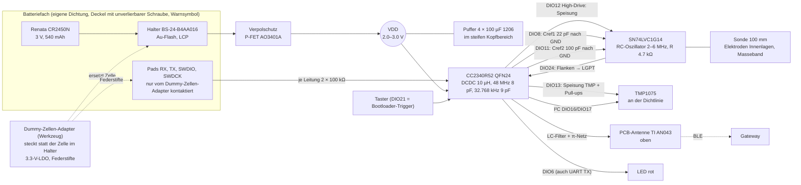
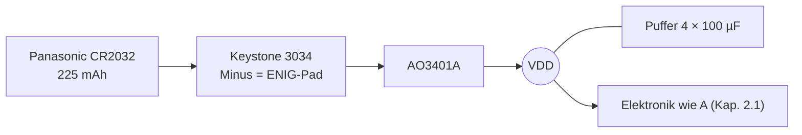
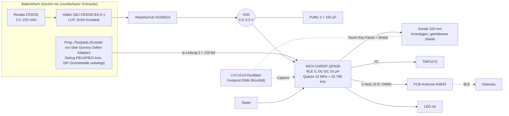
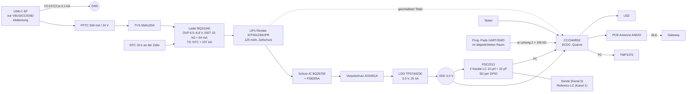

# Tröpfli – Phase 2: Technische Konzepte und Empfehlung

| | |
|---|---|
| Dokument | `docs/concepts/CONCEPTS.md` |
| Version | **0.2** (nach Prüfrunde 1) |
| Datum | 2026-11-06 |
| Ersteller | Konzeptredaktor im Auftrag des Projektleiters |
| Grundlagen | `docs/requirements/REQUIREMENTS.md` v1.0 (verbindlich), `docs/concepts/research_{elektronik,energie,fertigung,gateway}.md`, `docs/requirements/DECISIONS.md` (D-005 Kostendefinition) |
| Prüfberichte | `docs/reviews/phase2_concepts_{sicherheit,fertigung,redteam}.md`; Antworten: `docs/reviews/phase2_concepts_response.md` |
| Rechnungen | `scripts/energy_budget.py` (Modell unverändert), `scripts/concept_energy.py` (Konzeptparameter v0.2, Koexistenz, C-WLAN), `scripts/cost_model.py` (D-005, Staffelpreise, Röntgen, Preferred, Reserve), `scripts/concept_costs.py` (BOMs), `scripts/jlc_price_cache.py` (JLC-Teiledaten → `docs/concepts/bom/jlc_prices.json`) |
| Stücklisten | `docs/concepts/bom/bom_{A,A32,A2,B,C}.csv` (`concept_costs.py --csv`) |
| Register | neue/geänderte Teile in `docs/datasheets/_staging/INDEX_konzepte.csv` (v0.2-Zeilen am Ende) |
| Status | Entwurf zur 2. Prüfrunde, keine Entscheidung |

**Kennzeichnung:** **ANNAHME** = nicht belegt. **PROTOTYP-PRÜFUNG** = erst am Muster nachweisbar.
`Datei, S. x` = PDF-Seite. JLC-Daten aus der JLC-Teilesuche, **Abruf 2026-11-06**. 1 USD = 0.8189 CHF
(EZB 2026-11-06). Tabellen mit Rechenwerten sind wörtlich aus den Skriptausgaben übernommen.

**Änderungen gegenüber v0.1 (Kurz):** Kostendefinition D-005 (PCB fix/Grenzkosten, Vollkosten),
Röntgen, Staffelpreise, Serie 20/16/15; Variante **A-32** voll gerechnet; Programmier-/Ladeschutz neu
(Dummy-Zellen-Adapter, keine VPROG-Leitung, keine Messbrücke; VETO S2-K01); 48-MHz-Quarz ersetzt;
Messkette neu (2–6 MHz, C-Umschaltung per GPIO, ratiometrisch); Pinplan QFN24; TMP1075 geschaltet;
Puffer 4 × 100 µF nach REQ-ENE-06 pessimistisch; Laufzeitnachweis mit Samsung-Leckgrenze;
Gateway-Sicherheit (RTC ohne Ladepfad, Secure Boot, Flash-Verschlüsselung); B2 und A-H entfallen.

---

## 0 Kurzfassung

| | **A (CR2450N)** | **A-32 (Panasonic CR2032)** | B (CH592F) | C (Akku) | C-WLAN |
|---|---|---|---|---|---|
| Stückkosten Serie (20 PCB/16 bestückt/15 Sensoren), CHF | **11.19** | **8.08** | 8.25 | 21.59 | – |
| Vollkosten/Sensor Serie (Total/15), CHF | 16.93 | 14.54 | 13.43 | 28.85 | – |
| Prototyp 5/5: Stück / Vollkosten / Total, CHF | 12.74 / 29.66 / 148.29 | 9.56 / 28.62 / 143.09 | 9.70 / 24.94 / 124.71 | 21.76 / 43.23 / 216.17 | – |
| Laufzeit pess. DS (Puffer-Leck = Datenblattgrenze), 1 min | **27.5 Monate** | **11.9 Monate** (2 min: 12.5) | 13.2 Monate | 6.5 Mt./Ladung | 0.3 Tage |
| dto. mit 50 % Koexistenzverlust am Gateway | 22.5 Monate | 9.7 Monate | 11.0 Monate | 5.4 Mt. | – |
| Kopf B × T × H (mm), Soll 35 × 20 × 45 | ≈ 30 × 15–17 × 62 | ≈ 28 × 12–14 × 45 | ≈ 27 × 13 × 57 | ≈ 27 × 16 × 46 | – |
| Muss-Verfehlungen | REQ-FAB-04 (+1.19 CHF) | REQ-ENE-02 bei 1 min mit DS-Leckgrenze (−0.1 Mt.) | REQ-FW-04 (Eigenbau), REQ-ENE-09, REQ-FW-06, SAF-CC-05 | REQ-FAB-04, SAF-LI-09, SAF-03 | ENE-03 + SYS-05 |

**Empfehlung: Konzept A im CR2450-Format** (CC2340R52, 4 Lagen 1.6 mm) – Begründung Kap. 7. Die
Kostenüberschreitung (+1.19 CHF) entsteht fast ganz durch den Zellpreis; sie verschwindet bei einem
Zellpreis ≤ CHF 2.97 (z. B. Panasonic CR2450, Bezug offen) und ist sonst nach Regel 1.2 dem
Auftraggeber vorzulegen. **A-32** bleibt Rückfallvariante für einen kleinen Kopf, falls der am Muster
gemessene Puffer-Leckstrom die Laufzeit bei 1 min sichert. Gateway: **ESP32-S3** (Kap. 5).
**VETO S2-K01:** Lösung im Konzept umgesetzt (Kap. 2.7), Aufhebung durch den Sicherheits-Agenten offen
(Renata-Rückstromwert fehlt).

---

## 1 Gemeinsame Festlegungen

| Thema | Festlegung | Beleg |
|---|---|---|
| Funk | BLE im Sensor (REQ-RF-01, WLAN-Vergleich Kap. 4.7) | `concept_energy.py` Teil 2 |
| Erreichbarkeit | verbindbares Advertising alle 27.5 / 57.5 / 147.5 s (1 / 2 / 5 min); mit 50 % Koexistenzverlust 7.9 s bei 1 min | `energy_budget.py`; `concept_energy.py` 1b |
| Zeitbasis | 32.768 kHz Epson FC-135 9 pF (±20 ppm, B ≤ −0.04 ppm/K², ±3 ppm/a): Budget 5–45 °C ≈ 48 ppm < 58 ppm (60 d) bzw. 99 ppm (14 d); konservativ mit 25 K Abstand zum Umkehrpunkt (RT k-7), Offset beim Gateway-Kontakt kalibrierbar | `Epson_Q13FC13500003_Datasheet_LCSC-2018-10.pdf` S.1 |
| 48-MHz-Quarz | **HCI XC32M4-48.000-F08NLDT, C2925606** (8 pF laut JLC/Bestellcode, ESR < 40 Ω, ±10 ppm). CC2340: CL 5–9 pF (typ 7), ESR ≤ 60 Ω (6–9 pF). v0.1-Teil C5160139 hatte 20 pF → verworfen | `TI_CC2340R5_Datasheet_SWRS272F.pdf` S.26 Tab. 7.20.3.1; `HCI_XC32M4-48.000-F08NLDT_Datasheet_LCSC-2022-05.pdf` S.1 |
| DC/DC-Spule | Sunlord WPN201610H100MT C89132 (Isat 0.80 A max, Irms 0.65 A) | `Sunlord_WPN201610H100MT_Datasheet_LCSC-2023-10.pdf` S.2 |
| Batteriestand | interner Batteriemonitor des CC2340 (kein Teiler, 0 µA) für REQ-ENE-05 | `TI_CC2340R5_Datasheet_SWRS272F.pdf` S.19 Tab. 7.7 (RT k-5) |
| Taster | interner Pull-up 39–109 µA bei gedrücktem Taster (S.31): Firmware schaltet nach > 30 s Dauerdruck den Pull-up ab und prüft zyklisch (RT k-3) | dto. S.31 |
| Leiterplatte | **4 Lagen, 1.6 mm**, Economic PCBA, einseitig, HASL (A-32: ENIG wegen Minus-Pad) | D-005, Kap. 6.2 |
| Kosten | D-005: Stückkosten = alles pro Sensor (inkl. PCB-Grenzkosten, Röntgen, Reserveboard 16/15, lokaler Ausschuss 5 % **ANNAHME**); Vollkosten = Total/Sensoren. PCB 4 L 1.6 mm: 30.05 USD fix + 0.448 USD/Platine | `cost_model.py`; DECISIONS D-005 |
| Lokale Teile (ANNAHME) | ASA CHF 0.035/g + 4 g AMS-Spülung, **2 Dichtungen** je 0.15, Versiegelung 0.40, Schraube 0.10 + Gewindeeinsatz 0.10 | `concept_costs.py` Kopf |
| Offener Kostenposten | „Pre-reflow soldering 0.016 USD/Lötstelle“ (JLC) unklar: +1.93 CHF/Sensor bei A, falls er gilt (Kap. 6.3) | Prüfbericht Fertigung W-2 |

---

## 2 Konzept A – CC2340R52 + RC-Oszillator + CR2450N

### 2.1 Blockdiagramm

Energiepfad: Zelle → Halter → AO3401A → VDD, ohne Regler (CC2340 1.71–3.8 V, S.18). **Keine
Messbrücke** mehr (S2-W04): Den Strom für REQ-ENE-07 misst man mit einem **Mess-Zwischenadapter** im
Halter (Zelle ausserhalb, Amperemeter in Serie) – Messpunkt vor dem Verpolschutz, umgeht keine
Schutzfunktion, kein Speisepunkt auf der Platine. OTA signiert mit MCUboot über einen eigenen,
anwendungsverschlüsselten GATT-Dienst (REQ-RF-06, `research_gateway.md` 3.2).

### 2.2 Pinplan CC2340R52 QFN24 (RGE) – RT W-3

Nutzbare DIO auf RGE: DIO3/DIO4 (32-kHz-Quarz), DIO6, 8, 11, 12, 13, 16, 17, 20, 21, 24
(`TI_CC2340R5_Datasheet_SWRS272F.pdf` S.7 Abb. 6-2, S.9–12 Tab. 6-1) → **10 frei verwendbare DIO**.
High-Drive: DIO12, DIO16, DIO17, DIO24 (S.7). ROM-Bootloader auf nicht-QFN40-Gehäusen:
serialIoCfgIndex 0 → UART RX **DIO20**, TX **DIO6**; Trigger-Pin Standard **DIO21**, aktiv low
(`TI_CC23xx_TechnicalReferenceManual_SWCU193A.pdf` S.464 Tab. 8-38, S.465).

| Pin | DIO | Funktion im Betrieb | Programmierung/Debug | Begründung (Quelle) |
|---|---|---|---|---|
| 5 | DIO12 | **OSZ_PWR**: Speisung LVC1G14 + 100 nF | – | High-Drive, VOH ≥ 2.47 V bei 10 mA (S.31) |
| 12 | DIO24 | **OSZ_IN**: Oszillatorflanken → LGPT (T1C0 bzw. Prescaler-Eingang T0PE, Pin-Mux S.11) | – | Timer-Eingang; Zählart in Phase 3 belegen |
| 3 | DIO8 | **CREF1**: 22 pF C0G per Ausgang-low zuschalten, sonst hochohmig | – | beliebiger GPIO |
| 4 | DIO11 | **CREF2**: 100 pF C0G (f2, Salzdiagnose) | – | beliebiger GPIO |
| 6 | DIO13 | **TMP_PWR**: VDD TMP1075 + I²C-Pull-ups + 100 nF | – | Standard-Drive 2 mA genügt (TMP ≤ 85 µA + Pull-ups) |
| 7 | DIO16 | **I²C SDA** | SWDIO-Pad | I2C0SDA auf DIO16 (S.10) |
| 8 | DIO17 | **I²C SCL** | SWDCK-Pad | I2C0SCL auf DIO17 (S.10) |
| 19 | DIO6 | **LED** (470 Ω) | **UART TX** (Bootloader) | TX ist Ausgang, LED stört nicht (blinkt beim Programmieren) |
| 9 | DIO20 | frei (Reserve, z. B. Feuchteindikator-Test) | **UART RX** (Bootloader) | vom Adapter getrieben, im Betrieb Eingang mit Pull-down |
| 10 | DIO21 | **Taster** (nach GND, interner Pull-up) | Bootloader-Trigger (low) | Taster beim Einschalten gedrückt = Bootloader (Entwicklung) |
| 13 | RSTN | 100 kΩ Pull-up, **kein Pad** | Reset = Spannung aus/ein über Adapter | ein Pad weniger, keine Rückstromquelle |
| 14/15 | DIO3/DIO4 | 32.768-kHz-Quarz | – | S.12 |

Ergebnis: **passt ohne QFN40** (QFN40 C5914214 nur 283 Stk Lager). Einschränkungen: SWD-Debug geht
nur, wenn die Firmware TMP_PWR hochzieht (sonst ziehen die Pull-ups SWD auf GND) und nur langsam
(2 × 100 kΩ Serie, **ANNAHME** ≤ 50 kHz SWD-Takt); Reservepin nur DIO20.

### 2.3 Messkette neu (RT K-1)

| Punkt | Auslegung v0.2 | Beleg |
|---|---|---|
| Zählgrenze | LGPT-Eingänge werden mit 48 MHz synchronisiert → theoretisch < 24 MHz, sicher ≈ ≤ 10–12 MHz (**ANNAHME** RT). Arbeitsbereich **2–6 MHz** → Faktor ≥ 2 Reserve | TRM S.481 Abschn. 10.3.4 |
| Frequenz | T ≈ 0.95·R·C (Mittelwerte VT± bei 3 V, `research_elektronik.md` 6.3); R = 4.7 kΩ (C25900, Basic): C = 40 pF (Luft: 30 pF Sonde **ANNAHME** + 10 pF Pin/Leitung) → **5.6 MHz**; +Cref1 22 pF → 3.6 MHz; nass 110 pF → **2.0 MHz**; +Cref2 100 pF → ≈ 1.6 MHz (f2) | Rechnung; Sondenkapazität **ANNAHME** bis Feldsimulation |
| Speisung | **ratiometrisch aus VDD** über High-Drive-Pin DIO12 + 100 nF am Gatter. Ein geregeltes Rail (z. B. TPS7A0218, C3748843) wurde verworfen: 1.8-V-Ausgangspegel < VIH = 0.8·VDDS (S.31) des Zähleingangs; Pegelwandler wäre ein weiteres Teil | S.31; JLC 2026-11-06 |
| Ratiometrie | Die Schaltschwellen skalieren mit der Speisung; die Steigung k = R·a wird je Messung aus zwei Messungen (ohne / mit Cref1) bestimmt: C_Sonde = C_ref1 · T₀/(T₁ − T₀) − C_par → VDD-, Temperatur- und Exemplareinfluss von R und VT± kürzt sich (REQ-MES-07) | Rechnung |
| Laufzeit tpd | addiert sich: 2·tpd = 3–9 ns bei 3.3 V (1.5–4.6 ns), bis 6–20 ns bei 1.8 V (LVC S.8) → 2–5 % der Periode bei 5.6 MHz. Kompensation: (1) Zwei-Punkt-Kalibrierung absorbiert den Konstantanteil; (2) Restanteil als Funktion von VDD (Batteriemonitor) und Temperatur (TMP1075) per Korrekturtabelle; Koeffizienten am Prototyp bestimmen (**PROTOTYP-PRÜFUNG**) | `TI_SN74LVC1G14_Datasheet_SCES218AA.pdf` S.8 |
| Umschaltung | Cref1/Cref2 je **von Sondenknoten nach GPIO**: GPIO = Ausgang low → C wirkt; GPIO hochohmig → nur Pin-Kapazität. Kein Analogschalter nötig (Analogschalter TS3A4751 C128399 1.42 USD verworfen) | JLC 2026-11-06 |
| Auflösung | Reziprokzählung: N Oszillatorperioden mit 48-MHz-Timer messen; 1 ms Torzeit bei 3.6 MHz ≈ 48 000 Takte → 0.002 % – weit unter REQ-MES-03 (1 %) | Rechnung |
| Strom | ≈ (Cpd 22 pF + C)·V·f ≈ (22 + 62) pF · 3 V · 3.6 MHz ≈ **0.9 mA** während der Messung (Cpd LVC S.8); 3 Konfigurationen × 16 Mittelungen × 1 ms ≈ 50 ms/Messung → < 0.02 µA im Tagesmittel (RT 2) | Rechnung |
| Bauteile | SN74LVC1G14DCKR C35740 (E), 4.7 kΩ C25900 (B), 22 pF C1555 (B), 100 pF C1546 (B), 100 nF C1525 (B) | `jlc_prices.json` |
| Salz (REQ-MES-11, Soll) | 2–6 MHz liegt unter den 10–20 MHz aus v0.1 → Salzeinfluss grösser (ε''/ε' bei 0.05 S/m und 5 MHz ≈ 7, `phase2_salt_loss.py`); f2-Messung dient der Erkennung. Becherversuch am ersten Muster entscheidet (OP-K3) | `research_elektronik.md` 6.4 |

### 2.4 Hauptbauteile (v0.2)

| Funktion | Teil | LCSC | Kat. | Lager | USD Staffel 1 / 10+ | Quelle |
|---|---|---|---|---|---|---|
| BLE-SoC | TI CC2340R52E0RGER | C20416850 | E | 9 278 | 1.5864 / 1.3375 | `TI_CC2340R5_Datasheet_SWRS272F.pdf` |
| 48 MHz | HCI XC32M4-48.000-F08NLDT | C2925606 | E | 8 817 | 0.0993 | Kap. 1 |
| 32.768 kHz | Epson Q13FC13500003 (9 pF) | C99010 | E | 33 692 | 0.204 | S.1 |
| DC/DC-Spule | Sunlord WPN201610H100MT | C89132 | E | 5 075 | 0.0418 | S.2 |
| HF-Filter | 2.7 nH C27123 (E), 1.5 pF C1552 (**Preferred**, gebührenfrei), 15 pF C1548 (B), π-Netz 0 Ω C17168 (B) | – | – | – | – | `TI_CC23xx_HWDesignGuide_SWRA834A.pdf` S.5 |
| Abblock | 10 µF C15525 (2×), 100 nF C1525 (7×), 1 µF C52923 | – | B | Mio. | – | Samsung-Datenblätter |
| Messkette | Kap. 2.3 | – | – | – | – | – |
| Temperatur | TMP1075DSGR C2870250 (E) + 2 × 4.7 kΩ, an TMP_PWR | C2870250 | E | 34 641 | 0.3995 / 0.3111 | `TI_TMP1075_Datasheet_SBOS854F.pdf` S.6–7 |
| Halter | MYOUNG BS-24-B4AA016 | C964809 | E | 2 042 | 0.5845 / 0.4748 | Zeichnung S.1 |
| Verpolschutz | AO3401A (Drain = Zelle+, Source = VDD, Gate = GND) | C15127 | B | 1.70 Mio | 0.0829 | `AOS_AO3401A_Datasheet_Rev3.1.pdf` S.1–2 |
| Puffer | Samsung CL31A107MQHNNNE 100 µF 1206 **4×** | C15008 | B | 1.60 Mio | 0.1091 | Kap. 2.5 |
| LED, Taster | KT-0603R + 470 Ω; TS-1187A | C2286, C25117, C318884 | B | – | – | wie v0.1 |
| Pad-Serie | 100 kΩ 0402, **8×** (2 je Pad, 4 Pads) + nRST-Pull-up | C25741 | B | 8.4 Mio | 0.0013 | Kap. 2.7 |
| Zelle (lokal) | Renata CR2450N | – | – | – | CHF 3.70–4.50 | `Renata_CR2450N_Datasheet_Rev08.pdf` S.1 |

Summe: **8 Extended-, 1 Preferred-, 14 Basic-Typen** (Duplikate zusammengefasst, Fertigung k-2).
Entfallen gegenüber v0.1: 1N4148WS (C2128), 0-Ω-Messbrücke, 1-kΩ-UART-Widerstände, 2.2/22-kΩ-Oszillator-R.

### 2.5 Energiebudget (`.venv/bin/python scripts/concept_energy.py`)

Parameter v0.2: TMP1075 samt Pull-ups an GPIO (0 µA im Schlaf statt 0.37 typ/0.65 max µA, TMP1075 S.7);
Board-Rest 0.05/0.2 µA (GPIO-Leck **ANNAHME**); **Puffer 4 × 100 µF** (REQ-ENE-06 pessimistisch 325 µF
nominal bei 50 % DC-Bias-**ANNAHME**, `energy_budget.py` Tab. 6); Leckgrenze **Samsung** ≥ 100 MΩ·µF
(`Samsung_CL31A107MQHNNNE_Catalog_2015-11.pdf` S.53) → 12 µA bei 400 µF/3 V (RT k-1). Nach
Dauerprüfung nennt Samsung nur 25 bzw. 12.5 MΩ·µF (S.55) – Hinweis, nicht gerechnet.
**pess. A** = REQ-ENE-08 mit Puffer-Leck **ANNAHME** 0.5 µA (Orientierung für REQ-ENE-09, Nachweis am
Prototyp); **pess. DS** = Leck an der Datenblattgrenze (**Nachweis REQ-ENE-02**).

| Konzept | Reaktionszeit | Mittel real [uA] | Mittel pess. A [uA] | Mittel pess. DS [uA] | Laufzeit real [Mt.] | Laufzeit pess. A [Mt.] | **Laufzeit pess. DS [Mt.]** | Schlaf pess. A [uA] |
|---|---|---|---|---|---|---|---|---|
| A: CC2340 + CR2450N, 4 x 100 uF | 1 min | 1.64 | 5.13 | 18.93 | >120 | 87.2 | **27.5** | 2.63 |
| A: CC2340 + CR2450N, 4 x 100 uF | 2 min | 1.33 | 4.20 | 18.00 | >120 | 102.1 | **28.9** | 2.63 |
| A: CC2340 + CR2450N, 4 x 100 uF | 5 min | 1.16 | 3.68 | 17.48 | >120 | 112.9 | **29.7** | 2.63 |

Koexistenz-Sensitivität (Gateway verpasst 50 % der Fenster → Advertising alle 7.9 s, RT W-2/W-6):
pess. A 9.59 µA / 51.3 Monate, **pess. DS 23.39 µA / 22.5 Monate**.

Bewertung: **REQ-ENE-02 erfüllt** in allen Fällen (≥ 22.5 Monate). **REQ-ENE-09** Mittelstrom ≤ 8 µA:
pess. A 5.13 µA, mit DS-Leckgrenze nicht (18.9 µA) → Nachweis durch **Messung am Prototyp** (OP-K5).
Schlaf ≤ 3 µA: pess. A 2.63 µA. **REQ-ENE-06:** 4 × 100 µF = 400 µF nominal ≥ 325 µF (pess.),
SPICE-Nachweis Phase 3. Budgetanteile pess. A: Schlaf SoC 42.7 %, Erreichbarkeit 34.7 %, MLCC 11.7 %,
LED 2.0 % (REQ-UI-03 ≤ 5 % erfüllt).

### 2.6 Kosten (`.venv/bin/python scripts/concept_costs.py`)

| Szenario | Versand | Stück CHF | Einmal CHF | Bestellung total CHF | Vollkosten/Sensor CHF | Warenwert USD (GSDL ≤ 65) | Abgaben CHF (frei ≤ 5) |
|---|---|---|---|---|---|---|---|
| Prototyp 5 PCB / 2 bestückt | DHL | **12.74** | 86.31 | 111.79 | 55.89 | 84.5 | 7.16 |
| Prototyp 5 PCB / 5 bestückt (Empfehlung DFM) | DHL | **12.74** | 84.59 | 148.29 | 29.66 | 105.3 | 8.54 |
| Serie 20 PCB / 16 bestückt / 15 Sensoren | DHL | **11.19** | 86.09 | 254.01 | 16.93 | 156.8 | 11.96 |

Aufschlüsselung Serie (`cost_model.report`): pro Board PCB-Grenzkosten 0.45 + Bauteile 3.19 + SMT 0.20
+ **Röntgen 1.64** (2 leadless × 0.82 USD) = 5.48 USD + MWST 0.36 CHF = 4.92 CHF; × 16/15 Boards;
+ lokal 5.95 CHF (Zelle 4.10, ASA 19 g 0.67, 2 Dichtungen 0.30, Versiegelung 0.40, Schraube + Einsatz
0.20; × 1.05 Ausschuss) = **11.19 CHF**. Einmalig: PCB-Fixanteil 30.05, Reserveplatinen 1.79,
Mindestabnahme 2.57, Setup 8.18, Schablone 1.53, Extended 24.56 (8 Typen), Confirm 0.45, DHL 23.44 USD
+ MWST 6.14 + DHL-Gebühr 3.00 CHF = 86.09 CHF.

**REQ-FAB-04 (≤ 10 CHF): um 1.19 CHF verfehlt.** Hebel: Zellpreis (−1.05 CHF Stückkosten je CHF
Zellpreis) → Ziel erreicht bei Zelle ≤ **CHF 2.97**. Kandidat: Panasonic CR2450 (620 mAh, −30…85 °C,
Rücksprache ab 70 °C, `Panasonic_CR2450_Datasheet_2026-02.pdf` S.1); Preis nur aus einem
Suchergebnis (digitec.ch 300er-Pack CHF 0.63/Stk, 2026-11-06, unbestätigt) → OP-K13. Falls „Pre-reflow“
gilt (W-2): +1.93 CHF.

### 2.7 Lade- und Programmierschutz (VETO S2-K01, S2-W04) – neu

**Konzept:**
1. **Kein Speisepfad von Pads nach VDD.** Die VPROG-Leitung (v0.1) und die Messbrücke entfallen.
2. **Programmieren nur mit Dummy-Zellen-Adapter:** ein Werkzeug in CR2450-Form, das **statt der Zelle**
   im Halter steckt und die Platine über die Halterkontakte mit 3.3 V speist (LDO XC6206P332 aus USB
   5 V, Basic C5446, `Torex_XC6206_Datasheet_ETR0305-004b.pdf`; Aufbau **ANNAHME**, Werkzeug CHF ≈ 10).
   Federstifte im Adapter kontaktieren die Pads RX/TX/SWDIO/SWDCK neben dem Halter. **Zelle und Adapter
   belegen denselben Halter und schliessen sich physisch aus (Barriere 1).**
3. **Jede Signalleitung zu einem Pad hat 2 × 100 kΩ in Serie** (Barriere 2, auch bei kurzgeschlossenem
   Einzelwiderstand noch 100 kΩ). Wert: UART-Bootloader mit Autobaud (TRM S.464); mit 200 kΩ und
   ≈ 10 pF (**ANNAHME** Pin + Pad) ist τ ≈ 2 µs → bis **57 600 Baud** (Bitzeit 17 µs ≈ 8.7 τ) sicher,
   115 200 Baud knapp. SWD nur langsam (**ANNAHME** ≤ 50 kHz).
4. **Kein nRST-Pad, kein BOOT-Pad:** Reset durch Aus/Ein am Adapter; Bootloader-Trigger = Taster DIO21.
5. **Strommessung** (REQ-ENE-07) über Mess-Zwischenadapter im Halter, nicht über Pads.
6. Anleitung: nur Adapter mit 3.3 V, Zelle entnommen; Silkscreen „keine Speisung an Pads“.

**Worst-Case-Rechnung** (Quelle 5.5 V an einem Pad, Zelle 2.0 V, ESD-Diode des Pins nach VDDS mit 0 V
angesetzt → konservativ; Zelle eingesetzt, Deckel offen):

| Fall | Strom in die Zelle |
|---|---|
| 1 Pad, beide Widerstände intakt | (5.5 − 2.0) / 200 kΩ = **17.5 µA** |
| 1 Pad, ein Widerstand kurzgeschlossen (Einzelfehler) | (5.5 − 2.0) / 100 kΩ = **35 µA** |
| alle 4 Pads gleichzeitig auf 5.5 V, ein Widerstand kurz | 3 × 17.5 + 35 = **87.5 µA** |
| Dummy-Adapter-Speisung | **0** – nur ohne Zelle steckbar (Barriere 1); falsch gepolt: AO3401A sperrt |
| v0.1 zum Vergleich (VPROG, Diode kurz) | 13–22 mA |

Grenzwert: **Renata nennt für die CR2450N keinen zulässigen Rückstrom** (`Renata_CR2450N_Datasheet_Rev08.pdf`
S.1); Anfrage durch den Auftraggeber (OP-K7). Bis dahin ist der Nachweis „≤ Herstellerangabe“ offen.
Pin-Spannung 5.5 V über 100 kΩ liegt über „VDDS + 0.3 V“ (S.18 Tab. 7.1); der Strom wird von der
ESD-Struktur geführt, ein Injektionsstrom-Grenzwert steht nicht im Datenblatt (**ANNAHME** unkritisch
bei ≤ 35 µA, PROTOTYP-PRÜFUNG). Testplan: Rückstrom je Pad bei 3.3/5 V mit überbrücktem Einzelwiderstand.
Status: Konzept umgesetzt, **Aufhebung des Vetos durch den Sicherheits-Agenten offen**.

### 2.8 Firmware-Sicherheit REQ-FW-04 (S2-W05) – recherchiert

| Punkt | Befund | Quelle | Bewertung |
|---|---|---|---|
| ROM-Seriell-Bootloader | „doesn't support security functions“ | TRM S.419 | Restrisiko |
| Bootloader sperren | CCFG.bootCfg.pBldrVtor = **FORBID** (0xFFFFFFFC) → kein Bootloader; oder Zeiger auf **MCUboot** als User-Bootloader → ROM-Bootloader wird nicht aufgerufen; alternativ bldrEnabled = 0 | TRM S.460 Tab. 8-35, S.465 | belegt |
| Flash-Schreibschutz | CCFG.permissions.allowFlashProgram „normally not allowed after initial programming“; WEPRA/WEPRB-Sektorschutz „sticky“ (MCUboot-Sektoren schützen) | TRM S.426, S.379–380 | belegt |
| SWD | allowDebugPort = FORBID + debugCfg = DBGFORBID sperrt jeden Debugzugang; Variante „Debug mit Passwort“ für Wiederherstellung | TRM S.425, S.234 Tab. 5-3 | belegt |
| Signatur | MCUboot ECDSA; CC2340 hat nur AES/RNG-Hardware und SHA-256 im ROM → ECDSA in Software (Bootzeit/Energie Phase 3 messen) | DS S.45 | ~ |
| Anti-Rollback | **kein Hardware-Monotonzähler im TRM gefunden** (Suche „rollback/monotonic“ nur DEVICEID). Lösung: MCUboot-Sicherheitszähler im schreibgeschützten Flash bzw. Downgrade-Prävention (Software) – Konfiguration mit Rückfall (REQ-FW-03) **unbelegt** | TRM S.769; `research_gateway.md` 3.1 | **~** |

Vorschlag Serie: Erstprogrammierung (MCUboot + App) per ROM-UART → CCFG setzt pBldrVtor auf MCUboot,
allowFlashProgram verboten, MCUboot-Sektoren gesperrt, SWD nur mit Passwort. Restrisiko „physischer
Zugang + Passwort = Neuprogrammierung“ dokumentiert. Wirksamkeit **PROTOTYP-PRÜFUNG**.

### 2.9 Kopfgrösse

| Mass | Herleitung | Wert |
|---|---|---|
| Breite | Zelle Ø 24.5 quer + 2 × 0.5 Spiel + 2 × 1.5–2 Wand (Halter 32.8 × 16, Pads 37 mm, `MYOUNG_BS-24-B4AA016_Drawing_A0.pdf` S.1) | **29–30 mm** |
| Tiefe | Wand 2 + Halter 7.5 + Andrückelement 1 + PCB 1.6 + 0.5 + Wand 2 | **14–15 mm** (+ Schraubdom → 17) |
| Höhe | Dichtzone 5 + Halter 37 (senkrecht) + Elektronikband 10 + Antenne 5.7 + Keepout 2.3 + Wand 2 (**ANNAHMEN** Dichtzone, Band, Keepout) | **≈ 62 mm** |

Varianten (RT W-4, DFM W-4): **A-H (Halter hinten) entfällt** – Economic PCBA bestückt nur eine Seite
(`JLCPCB_NOTES.md` Tab. 2). Kompakte CR2450-Halter Keystone 3008TR (SMT, 25.4 × 22.6 mm, Katalog
`Keystone_3034_Catalog_M65.pdf` S.1) bzw. 3009 (THM): JLC-Lager **4 bzw. 21 Stück** (C238100/C238101,
2026-11-06) → nicht serientauglich. **A-F (Zellentasche im Gehäuse, Minus = ENIG-Pad, Plus = Federkontakt)**
ergäbe ≈ 29 × 15 × 41–45 mm; Federkontakt noch nicht gewählt, Kurzschluss-/Falltest und Sicherheits-
prüfung nötig → Designphase (CAD). Platinenlänge bei A ≈ 5 + 62 + 100 ≈ 167 mm > 150 mm im
PCB-Preis → Preis für 22 × 170 mm ablesen (OP-K1b).

### 2.10 Sicherheit (Kap. 6 der Anforderungen)

| Anforderung | Bewertung v0.2 |
|---|---|
| REQ-SAF-03 | Primärzelle, kein Ladepfad → sicherste Variante |
| REQ-SAF-CC-05 / -01 (a) | CR2450N bis 85 °C, Rücksprache > 70 °C → 65 °C im Datenblatt (S.1). **Fehlerreserve nur 5 K** bis 70 °C (S2-W01) → **~** bis Renata-Antwort (65 °C Dauer, Kurzschlusstemperatur) bzw. Kurzschlussversuch mit ΔT_Zelle (PROTOTYP-PRÜFUNG) |
| REQ-SAF-CC-01 | AO3401A Drain = Zelle+, Source = VDD, Gate = GND; verpolt V_GS ≈ 0, Body-Diode sperrt, I_DSS ≤ 1/5 µA (25/55 °C, S.2); bei BS-24 hat eine verkehrte Zelle vermutlich keinen Minuskontakt (S2-L01). Pinbelegung im Schaltplan-Review prüfen; Verpoltest 24 h |
| REQ-SAF-CC-02 | LCP-Führung, Kontakte nur Au-Flash 1 µ″ über Ni (Zeichnung S.1) → Falltest, schräges Einsetzen, Korrosion am Muster (S2-L02) |
| **REQ-SAF-CC-03 / -06** | Kap. 2.7: Barriere 1 physisch (Dummy-Adapter), Barriere 2 je 2 × 100 kΩ; Worst-Case 35 µA je Pad; **~ bis Renata-Grenzwert, VETO-Aufhebung offen** |
| REQ-SAF-CC-04 | Deckel mit unverlierbarer Schraube + Gewindeeinsatz, Warnsymbol (AMS); Ausführung UL 4200A Phase 4 (S2-L03) |
| REQ-SAF-05 | Dichtregeln (S2-W03): keine Vias und Bauteile in der Dichtzone; im Batteriefach nur Halter-Pads und Pads auf der Oberseite, **keine Vias im Fach** (sonst epoxy-gefüllt, +20.3 USD fix); Platinenkante im Elektronikraum oder umlaufend gedichtet; Flutung beider Räume 24 h mit Zellstrommessung |
| REQ-SAF-01 (MLCC) | 4 × 1206-MLCC an der Zelle: Biegeriss = Kurzschluss (S2-W02) → Platzierung im steifen Kopfbereich, weit weg von Sondenwurzel und Schraubdom, Längsachse parallel zur Biegelinie; Soft-Termination-Typ in Phase 3 suchen (Datenblatt nötig); FMEA-Eintrag |
| REQ-FW-04 | Kap. 2.8: Signatur ✔, ROM-Bootloader sperrbar ✔, Anti-Rollback **~** |
| RB-03 | Renata empfiehlt keine direkte Sonne (`Renata_3VLithium_SafetyGuidelines.pdf` S.1) → helles Gehäuse, Hinweis in Anleitung (S2-L05) |

---

## 2A Variante A-32 – Konzept A mit Panasonic CR2032 (RT W-1)

Elektronik, Pinplan, Messkette, Schutzkonzept **identisch mit A**. Unterschiede: Zelle **Panasonic
CR2032** (225 mAh, −30…85 °C, Rücksprache **ab 70 °C** → 65 °C ohne Rücksprache,
`Panasonic_CR2032_Datasheet_2026-02.pdf` S.1); Halter **Keystone 3034TR** (C5213768, Extended, Lager 664,
0.3618 USD @10; A 21.2 / L 16.1 / W 23.1 / H 4.1 mm, Minuspol = Leiterplattenpad, vernickelt,
`Keystone_3034_Catalog_M65.pdf` S.1) → **ENIG** (+11.9 USD fix). Zellpreis Panasonic CR2032 CHF 0.54–1.38
(galaxus.ch, Suchergebnis 2026-11-06; gerechnet konservativ 1.38).

| Grösse | A-32 | Quelle |
|---|---|---|
| Stückkosten Serie 20/16/15 | **8.08 CHF** (Vollkosten 14.54; Einmal 96.77; Total 218.04) | `concept_costs.py` 2 |
| Prototyp 5/5 / 5/2 | Stück 9.56; total 143.09 / 116.12 CHF | dto. |
| Laufzeit pess. DS, 4 × 100 µF | **11.9 / 12.5 / 12.9 Monate** (1/2/5 min); mit 50 % Koexistenz 9.7 | `concept_energy.py` 1, 1b |
| Laufzeit pess. DS, 2 × 100 µF | 18.9 / 20.4 / 21.4 Monate – dann aber REQ-ENE-06 pess. nicht erfüllt (200 < 325 µF) | dto. |
| Laufzeit pess. A (Leck-ANNAHME 0.5 µA) | 41.0 / 49.0 / 55.1 Monate | dto. |
| Kopf | Breite 23.1 + 1 + 3–4 = **27–28 mm**; Tiefe 2 + 4.1 + 1 + 1.6 + 0.5 + 2 ≈ **12 mm** (+ Schraubdom 14); Höhe 5 + 20 (Zelle) + 10 + 8 + 2 = **45 mm** | Rechnung |
| Sicherheit | Clip-Halter: Minuspol als Pad, schräg eingesetzte Zelle kann Clip und Pad berühren (S2-L06) → Kurzschlussgefahr höher als beim LCP-Halter; Nickelkontakte; 65 °C im Datenblatt (5 K Reserve wie A) | Zeichnung/Katalog S.1 |

Bewertung: REQ-FAB-04 und REQ-MECH-02 erfüllt. **REQ-ENE-02 nur knapp**: mit Datenblatt-Leckgrenze
bei 1 min 11.9 Monate (< 12), Werkseinstellung müsste nach REQ-SYS-05 auf 2 min gehen (Soll 1 min
verfehlt); mit Koexistenzverlust auch das nicht. Erfüllt mit grosser Reserve, sobald der gemessene
Puffer-Leckstrom ≤ 1 µA ist (pess. A: 41 Monate).

---

## 3 Konzept B „Spar“ – CH592F + Touch-Key + CR2032

### 3.1 Blockdiagramm

Messprinzip: MCU-internes Touch-Key-Modul (12 Kanäle, 10–100 pF, Shield-Ausgang,
`WCH_CH592_Datasheet_V1.9.pdf` S.132), effektive Messfrequenz ≈ 0.1–1 MHz (**ANNAHME**,
`research_elektronik.md` 6.1) → salzempfindlicher als A. Rückfall: LVC1G14-Footprint (DNM), Option
„B+Osz.“ bestückt kostet +0.06 CHF/Stück und +3 USD je Bestellung.
**Temperaturwahl B: TMP1075** (wie A). Begründung: Ein NTC (C77131, 0.017 USD) spart nur ≈ 0.24 CHF,
der CH592-ADC misst aber gegen eine interne Referenz 1.05 V ± 0.015 V mit begrenztem Eingangsbereich
(S.121–122, Tab. 15-2), ein Fehlerbudget ≤ ±1 °C (REQ-TMP-01, Muss) ist ohne ADC-Genauigkeitsangabe
nicht belegbar; TMP1075 garantiert ±1 °C max. Der NTC bleibt eine Option nach Musterkalibrierung.

### 3.2 Hauptbauteile

| Funktion | Hersteller / Teil | LCSC | B/E | Lager | USD @20 | Quelle |
|---|---|---|---|---|---|---|
| BLE-SoC | WCH CH592F (QFN-28) | C39831287 | E | 27 866 | 0.6696 | JLC 2026-11-06; `WCH_CH592_Datasheet_V1.9.pdf` S.43, S.152–154 |
| HF-Quarz 32 MHz | YXC X322532MOB4SI (12 pF) | C9009 | E | 296 728 | 0.0957 | `YXC_X322532MOB4SI_Datasheet_LCSC-2024-03.pdf`; CH592 intern 10–24 pF (S.48) |
| 32.768 kHz, 12.5 pF | Epson Q13FC13500004 | C32346 | **B** | 483 710 | 0.1715 | `Epson_Q13FC13500004_Datasheet_LCSC-2024-04.pdf`; CH592 intern 12–27 pF (S.48) |
| DC/DC-Spule | Sunlord WPN201610H100MT | C89132 | E | 5 075 | 0.0418 | wie A |
| Abblock | 4.7 µF (VDCID), 10 µF, 5 × 100 nF | C23733 / C15525 / C1525 | B | 1.08 / 9.2 / 34.7 Mio | 0.0118 / 0.0258 / 0.0031 | `research_elektronik.md` 3.3 |
| π-Netz | 0 Ω + DNM | C17168 | B | 14.2 Mio | 0.0011 | CH592 „antenna directly“ (S.5), Footprints **ANNAHME** |
| Bodentemperatur | TMP1075DSGR + 2 × 4.7 kΩ | C2870250 / C25900 | E / B | 34 641 | 0.3111 | wie A |
| Halter CR2032 (günstigster) | Q&J CR2032-BS-6-1 (LCP UL94V-0, Kontakte QSn6.5-0.1 SnSb-plattiert) | C70377 | E | 57 793 | 0.142 | `QJ_CR2032-BS-6-1_Drawing.pdf` S.1 |
| Verpolschutz, Puffer, LED, Taster, Pad-Serienwiderstände | wie A (v0.2) | C15127, C15008 (3×), C2286, C318884, C25741 (8×) | B | – | – | wie A |
| Zelle (lokal) | Renata CR2032 MFR 225 mAh | – | – | – | CHF 2.65–3.00 | `Renata_CR2032MFR_Datasheet_Rev07.pdf` S.1 |

Summe (v0.2): **5 Extended-Typen**, 12 Basic-Typen (`concept_costs.py` 1).

### 3.3 Energiebudget (`concept_energy.py`)

Parameter v0.2 wie A (TMP1075 geschaltet, Puffer 3 × 100 µF für 245 µF pess., Leckgrenze Samsung):

| Konzept | Reaktionszeit | Mittel real [uA] | Mittel pess. A [uA] | Mittel pess. DS [uA] | Laufzeit real [Mt.] | Laufzeit pess. A [Mt.] | **Laufzeit pess. DS [Mt.]** | Schlaf pess. A [uA] |
|---|---|---|---|---|---|---|---|---|
| B: CH592F + CR2032, 3 x 100 uF | 1 min | 2.89 | 6.77 | 16.97 | 88.2 | 31.8 | **13.2** | 4.29 |
| B: CH592F + CR2032, 3 x 100 uF | 2 min | 2.66 | 6.02 | 16.22 | 95.1 | 35.4 | **13.8** | 4.29 |
| B: CH592F + CR2032, 3 x 100 uF | 5 min | 2.53 | 5.60 | 15.80 | 99.5 | 37.8 | **14.2** | 4.29 |

Koexistenz-Sensitivität (50 % verpasste Fenster, 1 min): pess. DS **11.0 Monate** (< 12).
Bewertung: REQ-ENE-02 knapp (13.2 Monate pess. DS), mit Koexistenzproblem verfehlt. **Schlaf pess.
4.29 µA > 3 µA** (SoC-Typwert 2.2 µA „Stichprobe“, `WCH_CH592_Datasheet_V1.9.pdf` S.43 Tab. 5-3) →
REQ-ENE-09 rechnerisch verfehlt; nur mit RAM2K-Erhalt (1.3 µA) sicher – Stack-Bedarf offen.

### 3.4 Kosten

Kostendefinition D-005 (`concept_costs.py` 2):

| Szenario | Versand | Stück CHF | Einmal CHF | Bestellung total CHF | Vollkosten/Sensor CHF |
|---|---|---|---|---|---|
| Prototyp 5 PCB / 2 bestückt | DHL | **9.70** | 78.12 | 97.52 | 48.76 |
| Prototyp 5 PCB / 5 bestückt | DHL | **9.70** | 76.21 | 124.71 | 24.94 |
| Serie 20 PCB / 16 bestückt / 15 Sensoren | DHL | **8.25** | 77.61 | 201.39 | 13.43 |

REQ-FAB-04 **erfüllt** (8.25 CHF; mit Pre-reflow-Posten 9.80 CHF). Die frühere Untervariante B2 entfällt:
4 Lagen kosten nach D-005 pro Stück nur ≈ 0.09 USD mehr (6.2), und Acryl-Coating taugt nicht für
30 Tage Wasser (Red Team W-5).

### 3.5 Kopfgrösse

| Mass | Herleitung | Wert |
|---|---|---|
| Breite | PCB 22 mm bzw. Zelle Ø 20 + Spiel 1 + Wand 3–4 (Halter 31.3 mm senkrecht, `QJ_CR2032-BS-6-1_Drawing.pdf` S.1) | **26–27 mm** |
| Tiefe | Wand 2 + Halter 5.5 + Deckelspiel 1 + PCB 1.6 + 0.5 + Wand 2 | **12–13 mm** (+ Schraubdom → 15) |
| Höhe | Dichtzone 5 + Halter 32 (Pads) + Elektronikband 10 + Antenne/Keepout 8 + Wand 2 | **≈ 57 mm** |
| quer liegend | Halter 32 mm quer: Breite 32 + 1 + 3–4 = **36–37 mm** (> 35), Höhe ≈ 45 | knapp verfehlt |
| Option | Keystone 3034TR (C5213768) wie A-32 (Kap. 2A): ≈ 28 × 12 × 45 mm | erfüllt REQ-MECH-02, Minuspol = ENIG-Pad |

REQ-MECH-02: mit dem günstigsten Halter Höhe **verfehlt** (≈ 57 mm), aber kleiner als A.

### 3.6 Sicherheit, Vor-/Nachteile, Risiken, Abweichungen

| Anforderung | Bewertung |
|---|---|
| **REQ-FW-04 (Muss, Sicherheit)** | Hersteller-OTA ohne Signaturprüfung gefunden (`research_gateway.md` 3.1). Erfüllbar nur mit **eigenem Bootloader** (Ed25519/ECDSA in Software, Anti-Rollback, Swap mit Rückfall). Nach Regel 1.2 darf diese Anforderung **nicht** zugunsten der Kosten gesenkt werden → Eigenbau ist Pflicht, Aufwand und Prüfrisiko hoch |
| REQ-ENE-09 Schlaf ≤ 3 µA | pess. 4.59 µA → **rechnerisch verfehlt**, Messung am Muster |
| REQ-FW-06 Programmierweg | Datenblatt nennt nur „ICP/ISP/IAP“ und 2-Draht-Debug PB14/PB15 per ISP-Tool (`WCH_CH592_Datasheet_V1.9.pdf` S.1, S.9); Schnittstelle des Bootloaders **unbelegt** (ANNAHME USB-ISP bzw. WCH-LinkE ≈ 5 USD) |
| REQ-SAF-CC-05 | Renata CR2032 MFR: **> 60 °C Rücksprache** → 65 °C liegt in dieser Zone (`Renata_CR2032MFR_Datasheet_Rev07.pdf` S.1) → Freigabe Renata oder konstruktive Massnahme nötig |
| REQ-SAF-CC-02 | Kontakte SnSb-plattiert (nicht vergoldet) → Korrosion bei Feuchte im Kopf; LCP-Führung gut. PROTOTYP-PRÜFUNG |
| REQ-SAF-CC-01/03/04, -06 | wie A |
| REQ-MES-11 (Soll) | Touch-Key-Frequenz deutlich tiefer als Oszillator → Salzeinfluss grösser; Becherversuch entscheidet über Rückfall |
| REQ-RF-06 | geschlossener BLE-Stack (Binärbibliothek, S.151) → Anwendungsverschlüsselung selbst |

**Vorteile:** tiefe Kosten (8.25 CHF; A-32 mit 8.08 CHF ist gleich günstig), billigster SoC mit hohem Lager, kleinster
Knopfzellenkopf, niedrige Funkströme mit DC-DC (3.5 mA TX, S.154).
**Nachteile/Risiken:** sicherheitskritischer Eigenbau-Bootloader, Datenblattwerte „for reference
only“ bei 3.3 V, Stack geschlossen, Programmierweg unbelegt, Schlafstrom-Budget, CR2032-Temperaturzone,
65 % weniger Kapazität als A (empfindlicher auf Puffer-Leckstrom).
**Abweichungen Muss:** REQ-FW-04 (nur mit Eigenbau), REQ-ENE-09 Schlaf (rechnerisch), REQ-ENE-02 knapp
(13.2 Monate pess. DS, 11.0 mit Koexistenz), REQ-FW-06 (unbelegt), REQ-SAF-CC-05 (offen). Da A-32 bei
gleichen Kosten diese Punkte nicht hat, ist **B in v0.2 nicht mehr konkurrenzfähig**.

---

## 4 Konzept C „Akku“ – CC2340R52 + FDC2212 + LiPo

### 4.1 Blockdiagramm

Schutzfunktionen hardwareseitig (REQ-SAF-LI-07): Ladestrom per RISET (KISET 490–590 AΩ →
49–59 mA ≤ 0.5 C = 65 mA, `TI_BQ21040_Datasheet_RevD.pdf` S.5; RISET-Bereich 0.675–10.8 kΩ S.4;
Hinweis: KISET ist erst ab 60 mA spezifiziert), Laden nur 0–45 °C über TS, **237 kΩ TS–GND** gegen
TTDM bei offenem NTC (S.3), OVP, Tiefentladung/Überstrom durch BQ29700, zusätzlich Zellschutz im Pack.
FDC2212: VDD 2.7–3.6 V, 2.1 mA aktiv, Shutdown 0.2 µA typ / 1 µA max, fSENSOR 0.01–10 MHz
(`TI_FDC2212_Datasheet_SNOSCZ5B.pdf` S.7); interner Oszillator (S.12) mit Referenzkanal ratiometrisch.

### 4.2 Hauptbauteile (zusätzlich zum CC2340-Kern aus 2.4)

| Funktion | Hersteller / Teil | LCSC | B/E | Lager | USD @20 | Quelle |
|---|---|---|---|---|---|---|
| Kapazitätswandler | TI FDC2212DNTR (WSON-12) | C968585 | E | **310** | **6.0244** | JLC 2026-11-06; `TI_FDC2212_Datasheet_SNOSCZ5B.pdf` S.7 |
| LC-Tank | Sunlord SDFL1608S100KTF 10 µH (2×), 22 pF C0G (2×) | C1035 / C1555 | B | 418 483 / 1.72 Mio | 0.0279 / 0.0019 | TI-Beispiel 18 µH + 33 pF (S.43); 10 µH + 22 pF → ≈ 6 MHz (Rechnung, Sondenkapazität **ANNAHME** 50 pF) |
| Lader | TI BQ21040DBVR | C202311 | E | 2 346 | 0.4137 | `TI_BQ21040_Datasheet_RevD.pdf` S.3–6 |
| ISET / TS | 10 kΩ; NTC Murata NCP15XH103F03RC; 237 kΩ | C25744 / C77131 / C27001 | B / E / E | 16.5 Mio / 302 510 / 2 437 | 0.0028 / 0.0167 / 0.0032 | `Murata_NCP15XH103F03RC_Datasheet.pdf` |
| Schutz-IC + FET | TI BQ29700DSER + FUXINSEMI FS8205A | C183096 / C908265 | E | 3 239 / 21 975 | 0.4142 / 0.0718 | `TI_BQ2970_Datasheet_RevI.pdf` S.5; `FUXINSEMI_FS8205A_Datasheet.pdf` S.2 |
| LDO 3.0 V | TI TPS7A0230PDBVR | C3747031 | E | 27 756 | 0.28 | `TI_TPS7A02_Datasheet_RevC.pdf` S.5–6 |
| USB-C | SHOU HAN TYPE-C 6P + 2 × 5.1 kΩ | C456012 / C25905 | E / B | 1.0 Mio / 4.6 Mio | 0.039 / 0.0023 | `SHOUHAN_TYPE-C-6P_Datasheet.pdf` S.3 |
| VBUS-Schutz | DOWO PPTC 500 mA/24 V; Littelfuse SMAJ20A | C2984676 / C148209 | E | 10 119 / 2 267 | 0.0901 / 0.1038 | `DOWO_PPTC1206-500mA-24V_Datasheet.pdf` S.1; `Littelfuse_SMAJ_Datasheet.pdf` S.2 |
| Batteriespannung | 2 × 1 MΩ, P-FET AO3401A + N-FET 2N7002 als Schalter (**ANNAHME** Schaltung) | C26083 / C15127 / C8545 | B | 2.8 / 1.7 / 4.2 Mio | 0.0012 / 0.0829 / 0.0171 | `CJ_2N7002_Datasheet_LCSC-2023-04.pdf` |
| Akku (lokal) | Renata ICP401230UPR 125 mAh, Litzen AWG 30 | – | – | – | CHF 4–8 (**ANNAHME**) | `Renata_ICP401230UPR_Datasheet_V02.pdf` S.1 |

Summe: **17 Extended-Typen**, 25 Basic-Typen, Bauteile JLC 9.92 USD/Sensor (FDC2212 allein 6.02 USD).
**Lager FDC2212: 310 Stück** – für Prototyp und Serie ausreichend, aber Abkündigungs-/Lagerrisiko.

### 4.3 Energiebudget (`concept_energy.py`)

| Konzept | Reaktionszeit | Mittel real [uA] | Mittel pess. [uA] | Laufzeit real [Mt.] | Laufzeit pess. [Mt.] | Schlaf pess. [uA] |
|---|---|---|---|---|---|---|
| C: CC2340 + LiPo 125 mAh | 1 min | 6.64 | 16.01 | 15.3 | **6.5** | 11.69 |
| C: CC2340 + LiPo 125 mAh | 2 min | 6.34 | 15.08 | 15.8 | **6.8** | 11.69 |
| C: CC2340 + LiPo 125 mAh | 5 min | 6.17 | 14.56 | 16.1 | **7.0** | 11.69 |

Budgetanteil des Li-Pfads (Lader, Schutz-IC, Zellschutz, LDO) pess. **70 %**. REQ-ENE-03 (≥ 3 Monate)
**erfüllt**. REQ-ENE-09 [LI] (Lade-/Schutzschaltung ≤ 5 µA): typ. 4.23 µA, mit Max-Werten **6.56 µA**
(`energy_budget.py` Tab. 7) → nach REQ-ENE-08 **verfehlt**; Zellschutz im Pack ohne Daten.
Der FDC2212 (Shutdown 1 µA max) ist in der Board-ANNAHME 0.5 µA pess. nur teilweise enthalten
(**ANNAHME**, Phase 3 nachführen).

### 4.4 Kosten

| Szenario | Versand | Stück CHF | Einmal CHF | Bestellung total CHF | Vollkosten/Sensor CHF |
|---|---|---|---|---|---|
| Prototyp 5 PCB / 2 bestückt | DHL | **24.70** | 112.06 | 161.46 | 80.73 |
| Prototyp 5 PCB / 5 bestückt | DHL | **21.76** | 107.38 | 216.17 | 43.23 |
| Serie 20 PCB / 16 bestückt / 15 Sensoren | DHL | **21.59** | 108.86 | 432.71 | 28.85 |

REQ-FAB-04 **deutlich verfehlt** (+11.6 CHF). Hauptursachen: FDC2212 (≈ 5.0 CHF), LiPo (≈ 6 CHF
ANNAHME), 16 Extended-Typen. 48-MHz-Quarz in v0.2 korrigiert (C2925606, wie A).

### 4.5 Kopfgrösse

| Mass | Herleitung | Wert |
|---|---|---|
| Breite | PCB 22 + Spiel 1 + Wand 3–4 (Zelle 12.7 mm quer auf der Rückseite) | **26–27 mm** |
| Tiefe | Wand 2 + Bauteile vorne inkl. USB-C ≈ 3.5 (**ANNAHME**) + PCB 1.6 + Zelle 4.5 + Quellraum 0.5 (REQ-SAF-LI-05, 10 %) + Wärmeschutz 1.5 (**ANNAHME**) + Wand 2 | **≈ 16 mm** |
| Höhe | Dichtzone 5 + Zellband 31 (Elektronik vorne im selben Band) + Antenne/Keepout 8 + Wand 2 | **≈ 46 mm** |

REQ-MECH-02: **knapp erfüllt** (Höhe +1 mm). Der Ladeport braucht eine Abdeckung oben/seitlich
ausserhalb der Giesszone (REQ-SAF-LI-06) und konkurriert mit der Antennenlage (REQ-RF-04).

### 4.6 Sicherheit, Vor-/Nachteile, Risiken, Abweichungen

| Anforderung | Bewertung |
|---|---|
| **REQ-SAF-LI-09** | Renata-Packs: Entladen bis **60 °C**, Lagern bis **45 °C**, Laden 0–45 °C (`Renata_ICP401230UPR_Datasheet_V02.pdf` S.1) < 65 °C Kopftemperatur → nur mit nachgewiesener konstruktiver Massnahme zulässig; sonst ist C **nicht zulässig** |
| **REQ-SAF-03** | Die nicht wiederaufladbare Lösung (A) ist sicherer, günstiger und erfüllt die Laufzeit → C darf nicht empfohlen werden |
| REQ-SAF-LI-01…08 | konzeptionell abgedeckt (Zellschutz + BQ29700; BQ21040 mit NTC/OVP/Timer/ISET; PPTC + TVS 20 V; CC 5.1 kΩ = nur 5-V-Senke; BQ21040 IN abs. max 30 V, S.3). Tests (3 Netzteile, Nasstest, NTC offen/kurz) aufwendig |
| REQ-SAF-LI-04 | BQ29700 schaltet bei 2.8 V ab, Renata-Entladeschluss 3.0 V → Firmware-Schwelle ≥ 3.0 V nötig; Sicherheitsagent beurteilt |
| REQ-SAF-05 / -06 | Zellanschlüsse und Schutzschaltung vergiessen; Pads mit Diode/Widerstand |
| REQ-ENE-09 [LI] | Max-Werte 6.56 µA > 5 µA → verfehlt |
| REQ-FAB-04 | 18.77 CHF → verfehlt |

**Vorteile:** kleinster Kopf (≈ 27 × 16 × 46 mm), höchste Messauflösung (28 bit, `research_elektronik.md` 6.2),
keine Batteriewechsel. **Nachteile:** Laden alle ~6 Monate nur beaufsichtigt, viele Schutzteile,
FDC2212 teuer und knapp, Messfrequenz ≤ 10 MHz (kein Vorteil gegenüber A), höchster Prüfaufwand.
**Abweichungen Muss:** REQ-FAB-04, REQ-SAF-LI-09 (offen, wahrscheinlich verfehlt), REQ-ENE-09 [LI], REQ-SAF-03.

### 4.7 Kurzbewertung C-WLAN (ESP32-C3 im Sensor, REQ-RF-01)

Gleicher LiPo-Pfad, ESP32-C3 statt CC2340/BLE. Datenblatt: Deep-sleep 5 µA typ (S.57 Tab. 5-9),
Light-sleep 130 µA, RX 84 mA, TX bis 335 mA Spitze (S.56 Tab. 5-7), VDD **3.0–3.6 V** (S.54 Tab. 5-2)
(`Espressif_ESP32-C3_Datasheet_v2.4.pdf`). Verbindungsaufbau 0.8 s / 2.5 s bei 100 / 130 mA (**ANNAHME**).
Ausgabe `concept_energy.py` Teil 2:

| Strategie | Reaktionszeit | Mittelstrom real [mA] | Mittelstrom pess. [mA] | Laufzeit real [Tage] | Laufzeit pess. [Tage] | REQ-ENE-03 (>= 3 Monate) |
|---|---|---|---|---|---|---|
| deep | 1 min | 2.929 | 14.242 | 1.6 | 0.3 | verfehlt |
| deep | 2 min | 1.411 | 6.843 | 3.3 | 0.6 | verfehlt |
| deep | 5 min | 0.562 | 2.704 | 8.3 | 1.5 | verfehlt |
| light | 1 min | 0.690 | 2.073 | 6.8 | 2.0 | verfehlt |
| deep | keine (nur 8 Messungen/Tag) | 0.020 | 0.060 | 201.7 | 63.8 | verfehlt |

Zusätzlich: TX-Spitze 335 mA → LDO ≥ 500 mA nötig (TPS7A02 hat 200 mA; z. B. RT9080 600 mA,
`Richtek_RT9080_Datasheet_DS9080-05.pdf` S.1, Dropout 0.31 V) → LiPo nur bis ≈ 3.3–3.4 V nutzbar;
Modul ESP32-C3-MINI-1-N4 (C2838502, 2.69 USD, 13.2 × 16.6 × 2.4 mm, `Espressif_ESP32-C3-MINI-1_Datasheet_v2.2.pdf` S.3);
Knopfzelle ausgeschlossen; Firmen-WLAN-Last und Zugangsdaten in 15 Sensoren.
**Ergebnis:** WLAN im Sensor erfüllt REQ-SYS-05 (Reaktionszeit, Muss ≤ 5 min) und REQ-ENE-03 nicht
gleichzeitig; selbst ohne Erreichbarkeit pessimistisch < 3 Monate. **BLE wird gewählt** (REQ-RF-01).

---

## 5 Gateway (für alle Konzepte gleich)

### 5.1 Empfehlung und Vergleich

| Kriterium | **ESP32-S3 (empfohlen)** | Raspberry Pi Zero 2 W (Rückfall) |
|---|---|---|
| Board | Seeed XIAO ESP32-S3 Plus, 16 MB Flash, 8 MB PSRAM, U.FL + Stabantenne, CHF 8.90 [Q17/Q20] | Pi Zero 2 W, CHF 17.15, nicht an Lager [Q16] |
| Netzteil (REQ-SAF-DOC-02) | Raspberry Pi 15 W USB-C, CHF 9.90 [Q18] (geprüft, CE) | RPi 5 V/2.5 A, CHF 11.90 [Q16] |
| RTC (REQ-GW-09) | **ohne Ladepfad und ohne lose Knopfzelle** (S2-W06): bevorzugt RTC mit Superkondensator-Pufferung, z. B. Micro Crystal RV-3028-C7 (JLC C3019759, Lager 0; Datenblatt lokal **nicht vorhanden**, Download aus WSL schlug fehl) auf Modul oder eigenem Mini-PCB; alternativ Modul mit Primärzelle **nur** mit lokal abgelegtem Schaltplan ohne Ladepfad, Zelle hinter Schraube. Budget **ANNAHME CHF 10–20** | dto. |
| Speicher | internes Flash, LittleFS | Industrial-microSD CHF 27.90 [Q17] |
| Gehäuse | ASA ≈ 30 g → CHF 1.05 (**ANNAHME**) | dto. |
| Option BLE-Koprozessor (RT W-6) | ESP32-C3-Board als BLE-Central über UART, **ANNAHME CHF 5–8**, nur falls der Koexistenztest scheitert | – |
| **Summe** | **CHF 29.85–39.85**, mit Koprozessor bis ≈ CHF 48 | ≈ CHF 77 |
| Leistung (REQ-GW-04 ≤ 2 W) | 0.5–0.8 W (**ANNAHME**, messen) | 0.5–1 W |
| Firmware-Schutz (S2-W07) | **Secure Boot** (RSA-PSS, Hardware-Vertrauensanker) und **Flash-Verschlüsselung** (XTS-AES) verfügbar (`Espressif_ESP32-S3_Datasheet_v2.2.pdf` S.48 Abschn. 4.1.4.4, S.49 Abschn. 4.1.4.7). Festlegung: Gateway-Updates über die PWA nur **signiert** (Signierschlüssel nur offline/PC); Flash- bzw. NVS-Verschlüsselung für WLAN-Zugangsdaten, Sensorschlüssel, TLS-Schlüssel; Abwägung irreversibler eFuses vs. Wiederherstellung in Phase 3 | Linux-Image; Verschlüsselung SD aufwendig |
| Entwicklung | C/ESP-IDF, eigener OTA-Client → hoch | Python → niedrig |

Quellen [Qn]: `research_gateway.md` (Abruf 2026-11-06). REQ-FAB-06: separat ausgewiesen.

**Koexistenz WLAN/BLE (RT W-6, Recherche R2):** Das ESP32-S3 teilt ein Radio. Bei 50 % verpassten
Advertising-Fenstern sinkt die Sensorlaufzeit A (pess. DS) von 27.5 auf 22.5 Monate (Kap. 2.5);
A-32 und B fallen unter 12 Monate. **Koexistenztest am Gateway-Muster zuerst** (1000 „Jetzt messen“
unter WLAN-Last, 95-%-Quantil). `P_MISS` und die Werkseinstellung der Reaktionszeit werden danach
festgelegt. Rückfall: BLE-Koprozessor oder LAN-Variante (c2).

### 5.2 HTTPS (REQ-APP-02, REQ-SAF-NET-04)
- `troepfli.local` (mDNS) + **Einmal-CA mit Name Constraints** (`permitted DNS:troepfli.local`,
  `.troepfli.local`, IP ausgeschlossen); Serverzertifikat ECDSA P-256, ≤ 825 Tage; Gateway erzeugt
  seinen Schlüssel, der PC signiert nur den CSR (`research_gateway.md` 4).
- **CA-Schlüssel nur im RAM bzw. auf tmpfs erzeugen** und nach dem Signieren verwerfen (S2-L04) – kein
  „Löschen“ auf SSD.
- Der Rückfall „IP-SAN“ **entfällt** (widerspricht `excluded IP`). Falls mDNS im Netz scheitert: neue
  Einmal-CA mit **genau einem** IT-DNS-Namen (kein Wildcard, keine Domain) – nie ein ganzer Bereich.
- Erneuerung nach ≤ 825 Tagen mit Anleitung (PWA warnt 60 Tage vorher).
- Firmen-WLAN-Test bestanden (Auftraggeber 2026-11-06); mDNS und NTP am Prototyp prüfen.

### 5.3 OTA-Kompatibilität

| Konzept | Bootloader / Signatur | Transport | Gateway-Aufwand |
|---|---|---|---|
| A, A-32, C (CC2340) | MCUboot (ECDSA, Software); Anti-Rollback per MCUboot-Sicherheitszähler (~, Kap. 2.8) | eigener GATT-Dienst, nur nach authentisiertem Befehl | eigener ESP32-Client; Gateway prüft die Signatur vor dem Verteilen zusätzlich |
| B (CH592) | Eigenbau | eigener GATT-Dienst | zusätzlich sicherheitskritischer Sensor-Bootloader |

---

## 6 Vergleich

### 6.1 Vergleichsmatrix (✔ erfüllt · ~ knapp/offen · ✘ verfehlt)

| Anforderung | Prio | **A (CR2450N)** | **A-32** | B | C | C-WLAN |
|---|---|---|---|---|---|---|
| REQ-ENE-02/03 Laufzeit, pess. DS (1 min) | Muss | ✔ 27.5 Mt. (Koex. 22.5) | ~ 11.9 Mt. (2 min 12.5; Koex. 9.7) | ~ 13.2 (Koex. 11.0) | ✔ 6.5 Mt. | ✘ |
| REQ-ENE-09 Mittel ≤ 8 µA (pess. A / DS) | Muss | ~ 5.13 / 18.9 → Messung | ~ 5.13 / 18.9 | ~ 6.77 / 17.0 | n/a | n/a |
| REQ-ENE-09 Schlaf ≤ 3 µA / Li-Pfad ≤ 5 µA | Muss | ✔ 2.63 (pess. A) | ✔ 2.63 | ✘ 4.29 | ✘ 6.56 max | ✘ |
| REQ-ENE-06 Einbruch ≤ 0.2 V (pess.) | Muss | ✔ 400 ≥ 325 µF (SPICE offen) | ✔ dto. | ✔ 300 ≥ 245 µF | ✔ | ~ |
| REQ-SYS-05 Reaktionszeit (Soll 1 / Muss 5 min) | Soll/Muss | ✔ | ~ (Werks­einstellung 2 min) | ~ | ✔ | ✘ |
| REQ-SYS-07 Zeitstempel | Muss | ~ 48 ppm | ~ | ~ | ~ | ~ |
| REQ-MES-03/07 Auflösung, Exemplarstreuung | Muss/Soll | ✔ ratiometrisch (Kap. 2.3) | ✔ | ~ | ✔ | – |
| REQ-MES-11 Salz | Soll | ~ 2–6 MHz | ~ | ✘/~ | ~ | – |
| REQ-TMP-01 ±1 °C | Muss | ~ (±1 °C ohne Reserve) | ~ | ~ | ~ | – |
| REQ-FW-02/03 OTA mit Rückfall | Muss | ✔ MCUboot | ✔ | ~ | ✔ | ✔ |
| **REQ-FW-04 signiert + Anti-Rollback** | Muss | **~** (Signatur ✔, Anti-Rollback unbelegt) | ~ | ✘/~ | ~ | ~ |
| REQ-FW-06 Programmierung ≤ 10 CHF, ohne Laden | Muss | ✔ ROM-UART + Dummy-Adapter | ✔ | ~ | ✔ | ✔ |
| REQ-RF-01 | Muss | ✔ BLE | ✔ | ✔ | ✔ | ✘ |
| REQ-MECH-02 Kopf | Soll | ✘ 62 mm (A-F ≈ 41–45 offen) | ✔ 45 mm | ✘ 57 | ✔ 46 | ✘ |
| REQ-MECH-04 Innenlagen | Muss | ✔ 4 L | ✔ 4 L | ✔ | ✔ | – |
| REQ-SAF-01 (a) Temperaturreserve Fehlerfall | Muss | ~ 5 K bis 70 °C | ~ 5 K | ~ (> 60 °C) | ✘ | ✘ |
| REQ-SAF-CC-02 Halter/Kontakte | Muss | ✔ LCP, Au-Flash | ~ Clip, Ni, Pad-Minus | ~ SnSb | n/a | n/a |
| **REQ-SAF-CC-03 / -06 keine Ladung** | Muss | **~** Konzept umgesetzt, Renata-Grenzwert offen, VETO offen | ~ dto. | ~ dto. | ✔ (LI-Regeln) | – |
| REQ-SAF-CC-05 / LI-09 65 °C | Muss | ✔ | ✔ (Panasonic ≥ 70 °C) | ~ | ✘ | ✘ |
| REQ-SAF-05 getrenntes Fach | Muss | ~ Dichtregeln, Test offen | ~ | ~ | ~ | – |
| REQ-SAF-03 | Muss | ✔ | ✔ | ✔ | ✘ | ✘ |
| REQ-FAB-02 Basic bevorzugt | Muss | ~ 8 Ext. + 1 Pref. | ~ | ✔ 5 Ext. | ✘ 16 | – |
| **REQ-FAB-04 ≤ 10 CHF** (D-005) | Muss | ✘ 11.19 (✔ bei Zelle ≤ 2.97 CHF) | ✔ 8.08 | ✔ 8.25 | ✘ 21.59 | ✘ |
| REQ-UI-03 LED ≤ 5 % | Muss | ✔ 2.0 % | ✔ | ✔ | ✔ | – |

### 6.2 Lagenentscheid 2 vs. 4 Lagen (D-005, `concept_costs.py` 5)

| Lagen (BOM A, ohne Coating) | Stück CHF | Einmal CHF | Vollkosten/Sensor CHF |
|---|---|---|---|
| 4 L | 11.19 | 86.09 | 16.93 |
| 2 L | 11.11 | 63.37 | 15.33 |

Pro Sensor kosten 4 Lagen nur **0.08 CHF** mehr (Grenzkosten 0.448 statt 0.358 USD); der Unterschied
liegt im Fixanteil (30.05 statt 5.10 USD je Bestellung). Für 2 Lagen bräuchte die Sonde eine dichte
Beschichtung; Acryl-Schutzlack taugt nicht für 30 Tage Wasser (RT W-5), Epoxid-Tauchen kostet
**ANNAHME** 0.60 CHF/Sensor und Arbeitszeit (REQ-FAB-03) und streut in der Schichtdicke (REQ-MES-07).
→ **Basis 4 Lagen 1.6 mm.** A2 (2 L + Epoxid: 11.74 CHF Serie) bleibt nur dokumentierte
Vergleichsvariante für REQ-MECH-04. **Option:** zusätzliche 2-Lagen-Prototypbestellung A2
5/2: **68.63 CHF total** (GSDL, unter beiden Freigrenzen: 59.1 USD ≤ 65 USD, Abgaben 0); A2 5/5:
128.64 CHF (DHL). 2.0 mm bleibt ausgeschlossen (Standard PCBA, 71.05 USD fix).

### 6.3 Offener Kostenposten „Pre-reflow“ (Fertigung W-2)

| Konzept | ohne | mit 0.016 USD/Lötstelle | Differenz |
|---|---|---|---|
| A | 11.19 | 13.12 | +1.93 |
| A-32 | 8.08 | 10.03 | +1.95 |
| B | 8.25 | 9.80 | +1.55 |
| C | 21.59 | 24.59 | +3.00 |

Klärung durch ein reales JLC-Angebot (Warenkorb mit Dummy-Gerber/BOM/CPL), zusammen mit Röntgen,
65-USD-Grenze (mit/ohne Versand) und PCB-Preis für ≈ 22 × 170 mm (OP-K1).

---

## 7 Empfehlung

**Konzept A (CC2340R52, RC-Oszillator 2–6 MHz, TMP1075, Zelle im CR2450-Format, 4 Lagen 1.6 mm,
Economic PCBA), Gateway ESP32-S3.**

**A gegen A-32** (Prioritäten Sicherheit > Kosten > Komfort):
1. **Sicherheit:** Beide sind Primärzellen mit gleichem Schutzkonzept (Kap. 2.7) und erlauben 65 °C
   laut Datenblatt (je 5 K Reserve bis zur Rücksprachegrenze 70 °C). Der LCP-Halter von A führt die
   Zelle; der Clip-Halter von A-32 hat den Minuspol als Pad und das bekannte Schrägsitz-Kurzschluss-
   risiko (S2-L06). → leichter Vorteil **A**.
2. **Laufzeit (Muss REQ-ENE-02):** A hält mit Datenblatt-Leckgrenze und Koexistenzverlust ≥ 22.5 Monate;
   A-32 verfehlt bei 1 min knapp (11.9 Monate) und mit Koexistenzverlust deutlich (9.7). Der Puffer
   lässt sich bei A-32 nicht verkleinern, ohne REQ-ENE-06 zu verfehlen. → **A** robust, A-32 hängt an
   einer Messung.
3. **Kosten (Muss REQ-FAB-04):** A-32 8.08 CHF erfüllt; A 11.19 CHF verfehlt um 1.19 CHF. Ursache ist
   fast nur der Zellpreis (Renata CR2450N CHF 4.10). Mit einer CR2450 ≤ CHF 2.97 (z. B. Panasonic CR2450,
   620 mAh, 65 °C im Datenblatt, Bezugspreis offen) erfüllt auch A das Ziel. Gelingt das nicht, legt
   der Projektleiter die Überschreitung nach Regel 1.2 dem Auftraggeber vor (Mehrkosten 1.19 CHF/Sensor
   = 17.85 CHF für 15 Sensoren).
4. **Komfort:** A-32 hat den kleineren Kopf (45 statt 62 mm, REQ-MECH-02 Soll); A-F (Zellentasche) kann
   die Höhe von A auf ≈ 41–45 mm bringen, ist aber noch nicht konstruiert.

**Vorgehen:** Prototyp-Los A 5/5 (148.29 CHF total). Am Muster den Puffer-Leckstrom messen (25/50 °C,
OP-K5) und den Koexistenztest am Gateway machen. Ergibt die Messung ≤ 1 µA je 100 µF und besteht
die Koexistenz, ist **A-32** für die Serie gleichwertig und billiger; die Platine unterscheidet sich nur
im Halter-Footprint und in der Oberfläche (ENIG). Sonst bleibt A mit günstigerer CR2450.
B ist gegenüber A-32 nicht mehr konkurrenzfähig (gleiche Kosten, offene Muss-Punkte, Eigenbau-Bootloader);
C bleibt nach REQ-SAF-03/-LI-09 ausgeschlossen.

---

## 8 Offene Punkte

| Nr. | Punkt | Wer | Wirkung |
|---|---|---|---|
| OP-K1 | **Reales JLC-Angebot** (Warenkorb, A 4 L, 2 und 16 Stk): Pre-reflow-Posten, Röntgen (welche Teile), 65-USD-Grenze mit/ohne Versand; **OP-K1b** PCB-Preis für ≈ 22 × 170 mm (Platine A ≈ 167 mm lang) | Auftraggeber | REQ-FAB-04 (±2 CHF) |
| OP-K2 | Nordic-/SiLabs-Datenblätter nur bei Bedarf (Alternativ-SoC) | Auftraggeber | – |
| OP-K3 | Salz-Becherversuch am ersten Muster (f1/f2, REQ-MES-11); Zählversuch LGPT bis 6 MHz | Prototyp | Messkette |
| OP-K5 | Puffer-Leckstrom 4 × 100 µF bei 25/50 °C messen → REQ-ENE-09-Nachweis, Entscheid A vs. A-32 | Prototyp | Laufzeit |
| OP-K6 | SPICE Spannungseinbruch REQ-ENE-06 mit 400 µF und GLDO-Stromprofil | Elektronik Phase 3 | Pufferanzahl |
| OP-K7 | **Renata-Anfrage** (Auftraggeber): zulässiger Rückstrom CR2450N (Dauer/Fehlerfall), 65 °C Dauerbetrieb, Temperatur bei Kurzschluss; analog Panasonic für A-32 | Auftraggeber | **VETO S2-K01**, SAF-01 (a) |
| OP-K8 | MCUboot auf CC2340: Anti-Rollback mit Rückfall (REQ-FW-03/-04), ECDSA-Bootzeit, CCFG-Sperren am Muster | Firmware Phase 3 | REQ-FW-04 |
| OP-K9 | HF-Filter-Abstimmung (2.7 statt 2.8 nH), AN043-Keepout im Gehäuse | Prototyp | REQ-RF-02/03 |
| OP-K10 | Kopftemperatur 65 °C messen (OP-04) | Prototyp | SAF-CC-05 |
| OP-K11 | Register `_staging/INDEX_konzepte.csv` (v0.2-Zeilen) in `INDEX.csv` übernehmen | Projektleitung | REQ-FAB-07 |
| OP-K12 | Koexistenztest Gateway (zuerst), danach `P_MISS` und Werkseinstellung Reaktionszeit festlegen | Software/Prototyp | REQ-SYS-05, ENE-02 |
| OP-K13 | Zellbezug CR2450 ≤ CHF 2.97 (Panasonic CR2450 oder Renata in Menge) belegen; Panasonic-Preise vor Bestellung prüfen | Auftraggeber/Projektleitung | REQ-FAB-04 bei A |
| OP-K14 | RTC für Gateway ohne Ladepfad wählen, Datenblatt/Schaltplan lokal ablegen (RV-3028-C7: Download fehlgeschlagen) | Gateway Phase 3 | S2-W06 |
| OP-K15 | A-F (Zellentasche, Federkontakt) im CAD prüfen; Federkontakt auswählen; Sicherheitsprüfung | Mechanik Phase 4 | REQ-MECH-02 |
| OP-K16 | Soft-Termination-MLCC 100 µF 1206 suchen (Datenblatt), Platzierung im steifen Kopfbereich | Elektronik Phase 3 | S2-W02 |

## 9 Probleme und Hinweise
- Die Röntgengebühr (pro leadless Bauteil) und die Reserveplatine machen A in der Serie um ≈ 1.6 CHF
  teurer als in v0.1; ob JLC Röntgen für WSON/VQFN zwingend verrechnet, klärt nur das Angebot (OP-K1).
- Zellpreise (Panasonic) nur aus Suchergebnis-Auszügen; Shopseiten blockieren automatisierte Abrufe.
- Kleinteil-Datenblätter nur als LCSC-Kopie (Register vermerkt); 48-MHz-Quarz: Lastkapazität 8 pF aus
  JLC-Attribut und Bestellcode, das Seriendatenblatt nennt „6–32 pF, please specify“.
- Kopfgrössen sind Handabschätzungen, kein CAD.
