# fluidi – Phase 3: Designvorschläge Sensorkopf, Gateway, Logo

Stand 2026-11-07, Version 0.2 (Industriedesign): Auswahlrunde (Kap. 0–9, Version 0.1) und Verfeinerung 1 von P3 (neues Kapitel unten).
Grundlage: D-006 (Konzept A-32), D-007 (Designvorgabe „schöne harte Formen, schlichte schöne einfache
Logos, aber auch etwas verspielt“), `docs/requirements/REQUIREMENTS.md` v1.0, `docs/concepts/CONCEPTS.md` v0.3.

Alle Renderings: Blender 4.0.2, Cycles CPU **ohne Denoiser**, 256 Samples (adaptiv), Szene vollständig per
Skript (`renders/gen/fluidi_lib.py`, `renders/gen/render_phase3.py`), Massstab 1:1 in Metern, Geometrie
mm-genau. Neu erzeugen:

```
blender -b --factory-startup --python renders/gen/batch_render.py -- p1 p2 p3 p4 family gateway
python3 docs/design/logo/gen_logo.py      # Logo-SVGs
```

---

## P3 fluidi – Verfeinerung 1 (2026-11-07, neu)

Der Auftraggeber hat **P3 „Stele“** gewählt, mit Änderungen (D-009), und den Namen **fluidi** festgelegt (D-008). Die Verfeinerung ist
vollständig in **`docs/design/P3_FLUIDI.md`** beschrieben, PDF: **`docs/design/P3_fluidi_v1.pdf`**. Die Kapitel 0–9 unten
sind der frühere Stand der Auswahlrunde (noch mit Batteriedeckel hinten und Logo „Tröpfli“) und bleiben als Verlauf erhalten.

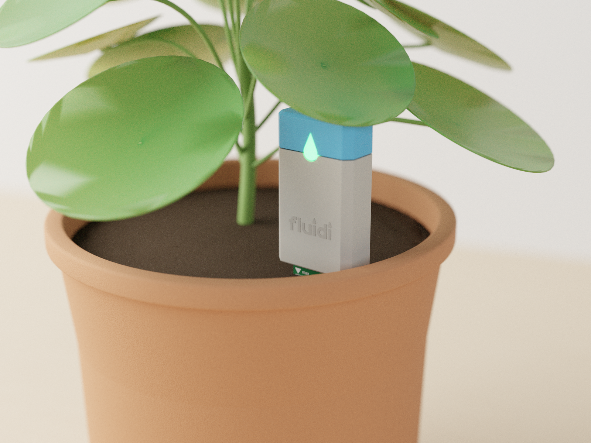
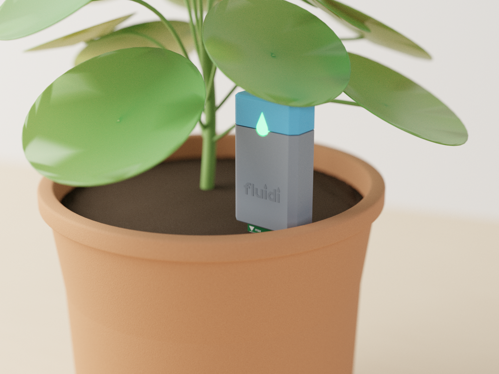
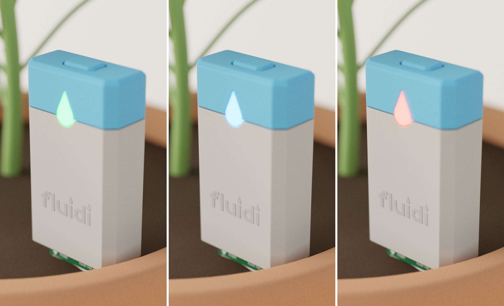
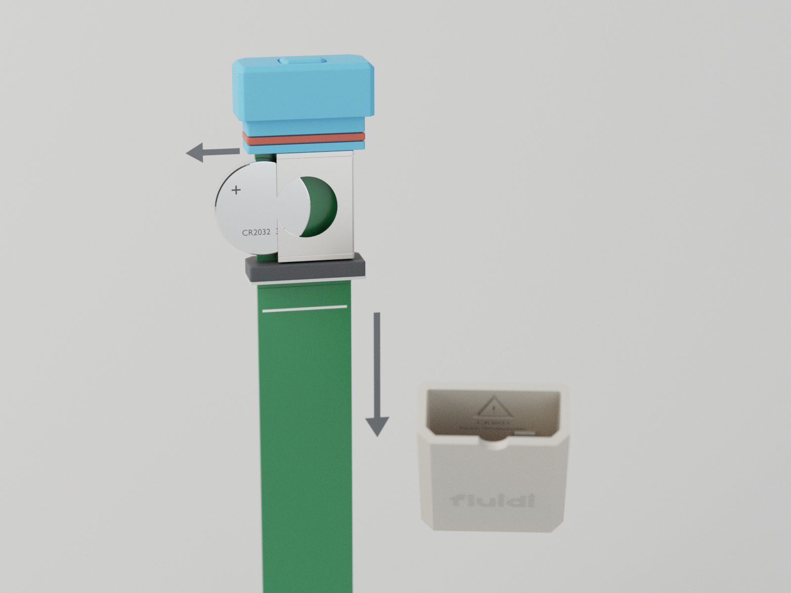
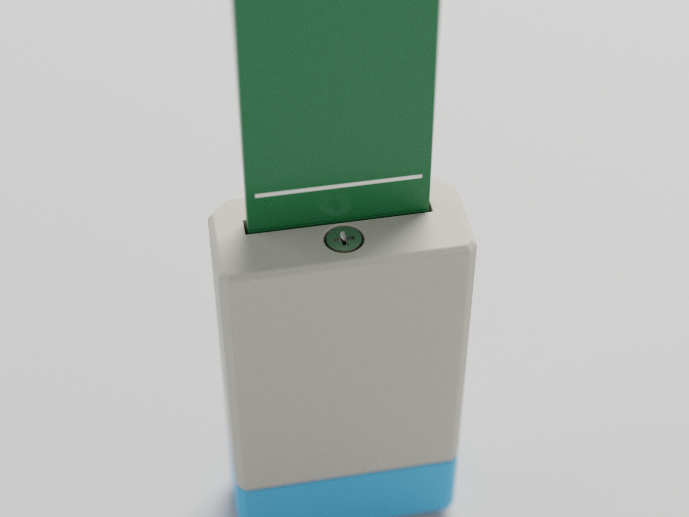
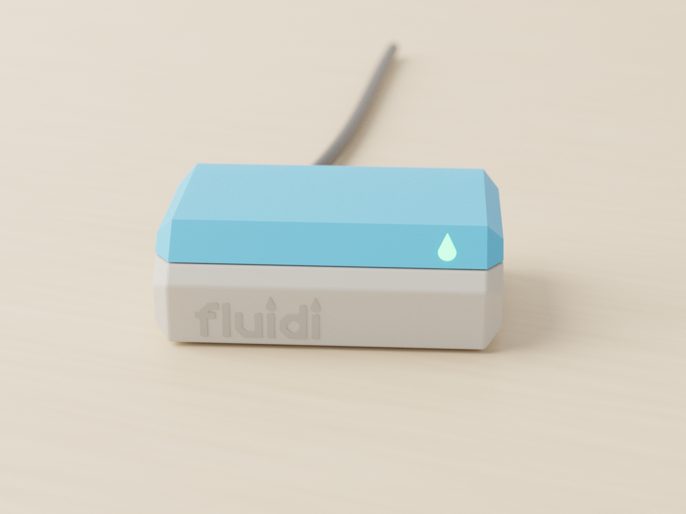
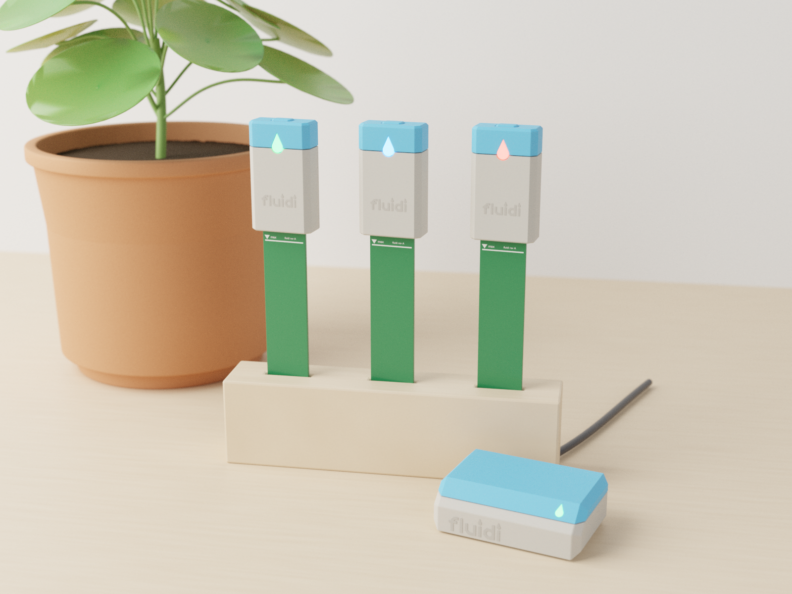
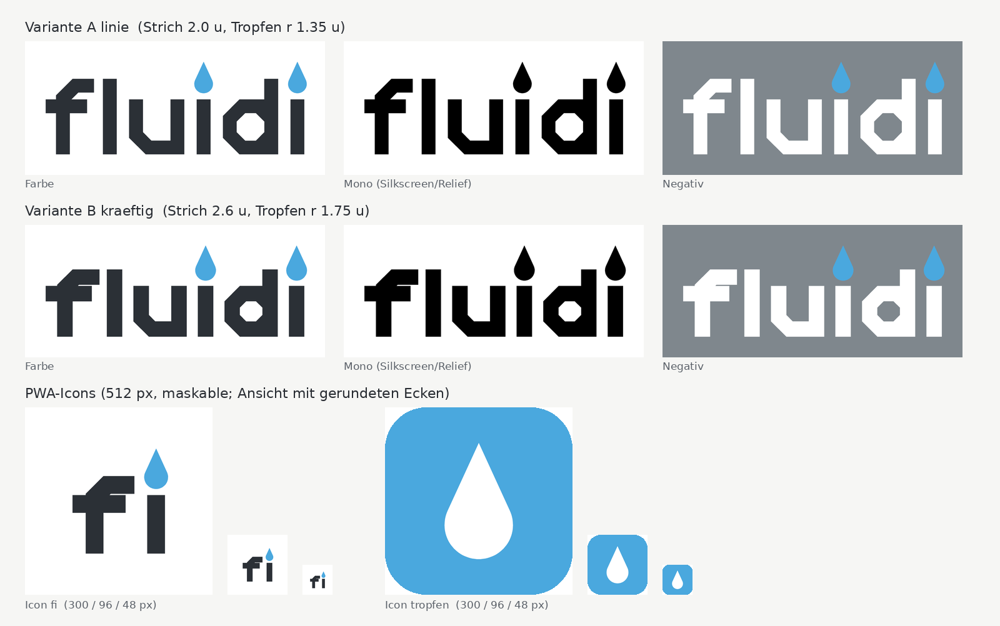

| | |
|---|---|
| Sensorkopf | **28 × 13 × 48 mm**, Sonde 20 mm (Konstruktion A1, `docs/reviews/phase3_sleeve_mechanik.md`). Die Hülse ist grau, Kappe und Taste sind hellblau. **Eine** Sichtfuge bei z = 37 mm (0.3 mm), Rückseite glatt, kein Aufdruck |
| Batteriewechsel | Schraube M2 unten lösen (unverlierbar, unsichtbar), graue Hülse über die Sonde abziehen, Zelle seitlich aus dem Clip schieben. Das Warnsymbol ist **innen** vertieft (S3-W4) |
| LED | Tropfenfenster (r 2.5 / 8.5 mm hoch) mit Diffusor auf der Fuge, RGB-LED: grün = ok, blau = giessen, rot = Batterie tief, gelb = Pairing (Vorschlag) |
| Gateway | G1 62 × 40 × 20 mm, grau mit hellblauem Deckel, Status-Tropfen, FPC-Antenne innen, USB-C hinten |
| Logo | „fluidi“ klein, i-Punkte als Tropfen. Variante A „Linie“ / B „Kräftig“, je Farbe/Mono/Negativ, Icons „fi“ und „Tropfen“ (`docs/design/logo/gen_logo_fluidi.py`) |
| Offene Fragen | Grauton 1/2, Logo A/B, Icon, LED-Farbzuordnung, Logo-Relief aussen ja/nein, Höhe 48 mm / Sonde 20 mm bestätigen (Details `P3_FLUIDI.md` Kap. 6) |

---

## 0 Gemeinsame Randbedingungen (gelten für alle 4 Vorschläge)

| Thema | Festlegung | Quelle |
|---|---|---|
| Kopf-Hüllmass | 28 mm breit (Halter Keystone 3034 W 23.1 + 1 Spiel + 2 × 2 Wand), 12–13 mm tief, ≈ 45 mm hoch | CONCEPTS Kap. 2A |
| Höhenaufteilung innen | Dichtzone 0–5, Zelle/Halter 5–25, Elektronikband 25–35, Antenne + Sperrzone 35–43, Wand 43–45 mm | CONCEPTS Kap. 2A |
| Antenne | TI AN043, **15.2 × 5.7 mm** am oberen Platinenende → Innenbreite ≥ 15.2 mm bis z ≈ 41 mm; oberhalb nur Kunststoff (keine Schraube, kein Metalleinsatz, keine Metall-Effektfilamente) | `docs/appnotes/TI_AN043_SmallPCBAntenna_SWRA117D.pdf` S. 1 |
| Sonde | Leiterplatte 1.6 mm, **Breite 22 mm (ANNAHME**, aus Platinenformat ≈ 22 × 170 mm, CONCEPTS Kap. 2.9/OP-K1b), 100 mm im Boden, Spitze 45° angefast | REQ-MECH-01, -11 |
| Dichtlinie | Unterkante Kopf; Austrittsschlitz mit Verguss (Epoxid/Silikon), dunkler Wulst sichtbar | REQ-MECH-08 |
| Markierung max. Stecktiefe | Silkscreen-Linie + „▼ max“ 5 mm unter der Dichtlinie → Dichtung nie im Substrat, Spritzerschutz | REQ-MECH-01 |
| Batteriezugang | **Deckel auf der Rückseite** (Zelle liegt flach auf der Platine), 23 × 25.5 mm mit 1.2-mm-Fasen, Fuge 0.4 mm; oben Rastnase, **unten eine unverlierbare Edelstahlschraube M2** (Senkkopf, Kreuz) in Gewindeeinsatz, ≥ 30 mm unter der Antenne; Sondendichtung bleibt beim Wechsel unberührt; Deckelnoppe hält die Zelle (Auflage R2-W01 Nr. 4) | REQ-MECH-15, REQ-SAF-CC-04 |
| Warnsymbol | erhaben auf dem Deckel (AMS-Zweitfarbe Anthrazit): Warndreieck + „CR2032 3V“. Platzhalter – das endgültige Symbol nach IEC 60086-4 / ANSI/UL 4200A legt Phase 4 fest | REQ-SAF-CC-04 |
| Material | ASA (HDT ≥ 80 °C), helle Farben; LED-Fenster/Lichtleiter aus naturfarbenem, transluzentem ASA bzw. PETG (**ANNAHME**, HDT im Materialdatenblatt prüfen) | REQ-MECH-12, RB-03 |
| Taster | TS-1187A unter einem Stössel; Stössel mit Dichtung (TPU-Membran oder O-Ring) – gilt für alle Varianten, weil jede Taste in einer Fuge sitzt | REQ-MECH-13, REQ-UI-05 |
| LED | KT-0603R (rot, laut BOM) → Fenster neutral-transluzent, nicht eingefärbt | CONCEPTS Kap. 2.4 |
| Massstab im Bild | Erdoberfläche = Markierung „max“; der Kopf steht damit 5 mm über der Erde (Kopfhöhe 45 + 5 = 50 mm über Erde) | – |

**Hinweis Höhe:** REQ-MECH-02 (Soll) nennt ≤ 45 mm *über der Erde*. Mit der 5-mm-Freistrecke bis zur
Markierung stehen alle Varianten 50–54 mm über der Erde. Vorschlag: Soll so lesen, dass die Kopfhöhe
gemeint ist (45 mm), oder Freistrecke auf 2–3 mm verkürzen – Entscheid Auftraggeber (Punkt E4 unten).

---

## 1 Vorschlag P1 „Facette“ – facettierter Tropfen

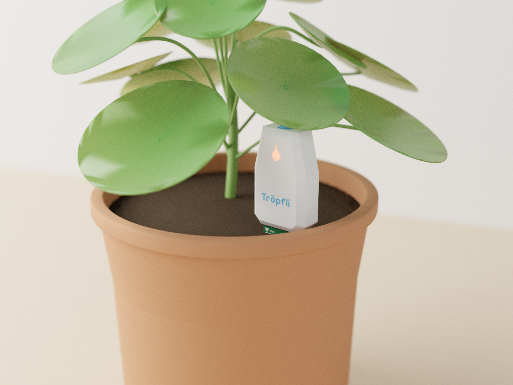
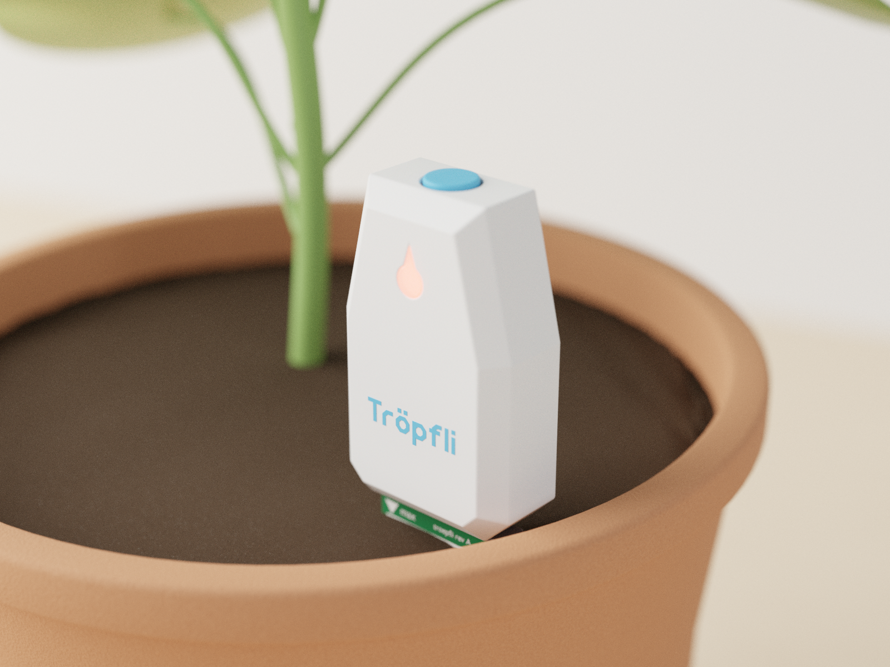
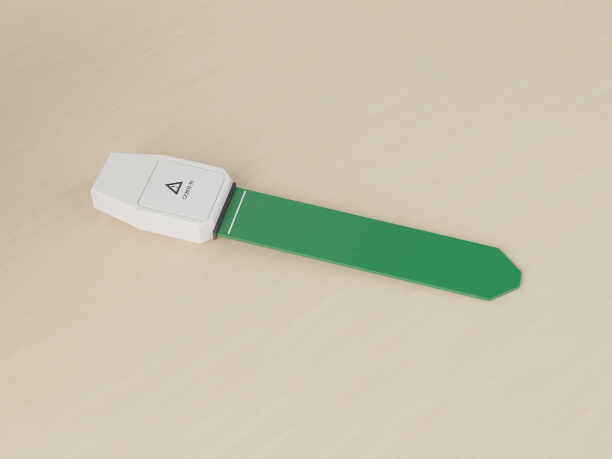

**Idee:** Ein Wassertropfen wie ein geschliffener Edelstein: die Silhouette ist ein gekappter Tropfen, die
Frontkanten sind mit 3-mm-Facetten hart angeschliffen. Verspielt: das LED-Fenster ist selbst ein kleiner
Tropfen, der von innen glüht, und die Taste sitzt wie ein Deckel auf der gekappten Spitze.

| | |
|---|---|
| Hauptmasse | 28 × 13 × 45 mm; oben 19 mm breit (Antennen-Innenbreite ≥ 17 mm bei z = 40.7) |
| Farben | A: Weiss + Wasserblau (Taste, Logo) · B: Hellgrau + Koralle |
| LED | Tropfenfenster 4.2 × 6.9 mm auf der Frontfläche, z ≈ 32–39 mm (Lichtleiter vom Elektronikband) |
| Taster | oben, Ø 7 mm, **axial** (keine Biegung der Sonde) |
| Batterie | Deckel Rückseite, Schraube unten |
| Logo | Wortmarke v1, 15 mm breit, Front unten (Strich 0.59 mm) |
| Druck | 2 Schalen (Front/Rücken) liegend; Facetten 45°-artig → ohne Stützen; Logo/Taste als AMS-Inlay in den ersten Schichten der Frontschale |

| Kriterium | Bewertung |
|---|---|
| Grösse | ✔ 28 × 13 × 45 |
| Druckbarkeit | ✔ stützenfrei; AMS nur in wenigen Schichten |
| Dichtung | ~ flache Oberseite um die Taste – Stösseldichtung nötig, Oberseite 2–3° nach vorn neigen (Abfluss) |
| Antenne | ✔ nach Verbreiterung (oben 19 mm); Seitenwände schräg → gleichmässig ≥ 2 mm Wand halten |
| LED-Sicht | ✔ von vorn/schräg oben |
| Wirkung | ✔✔ trägt den Namen „fluidi“, hart und freundlich zugleich |

## 2 Vorschlag P2 „Keil“ – Prisma mit Giebelschräge

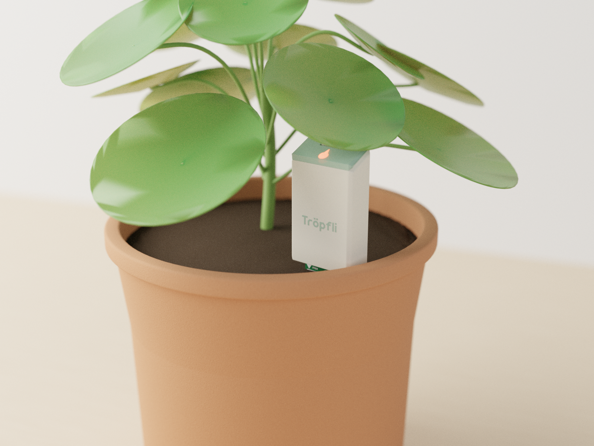
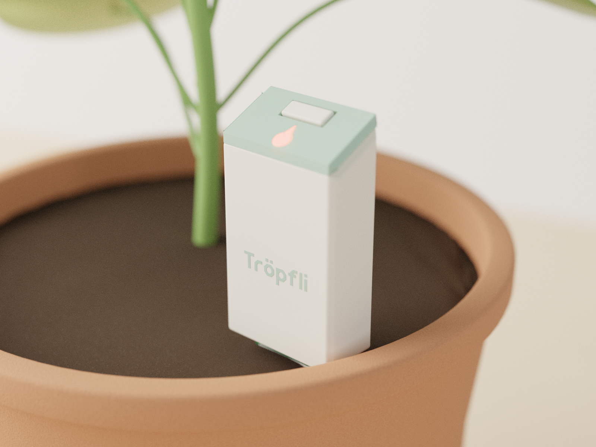
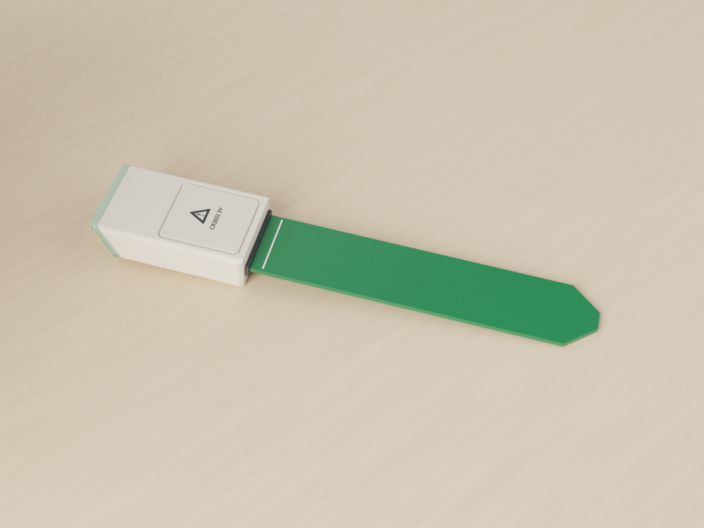

**Idee:** Ein klarer Quader, oben schräg abgeschnitten wie ein Pult (25°), das sich dem Betrachter zuneigt.
Die Schräge ist eine eigene Farbplatte mit LED-Tropfen und Taste – „Bedienfeld“ und Regendach zugleich.

| | |
|---|---|
| Hauptmasse | 28 × 13 × 48 mm (hinten 48, vorne 42) |
| Farben | A: Creme + Salbeigrün · B: Weiss + Sonnengelb |
| LED | Tropfen auf der Schräge vorne – zeigt nach oben/vorn |
| Taster | 10 × 3.8 mm auf der Schräge; Druck 25° zur Achse → Querkomponente ≈ 0.42 × F (klein gegen 10 N in REQ-MECH-10) |
| Batterie | Deckel Rückseite, Schraube unten |
| Logo | Wortmarke v1, 16 mm, Front |
| Druck | Körper stehend; **Dachplatte separat** (sonst Farbwechsel in jeder Schicht der Schräge → viel Spülmaterial), eingeklebt/geklipst |

| Kriterium | Bewertung |
|---|---|
| Grösse | ~ 3 mm höher als Soll (Antenne braucht unter der Schräge ≥ 43 mm Innenhöhe in der Platinenebene) |
| Druckbarkeit | ~ Schräge stehend gedruckt zeigt Treppenstufen; 2 Teile mehr |
| Dichtung | ✔✔ keine Wasserfalle, Wasser läuft nach vorn ab; Fuge Dach/Körper liegt unter der Dachkante (Tropfkante) |
| Antenne | ✔ volle Breite |
| LED-Sicht | ✔✔ ideal von schräg oben |
| Wirkung | ✔ ruhig, technisch; verspielt nur über Farbe und Tropfen |

## 3 Vorschlag P3 „Stele“ – schlanker Monolith mit Wasserstand

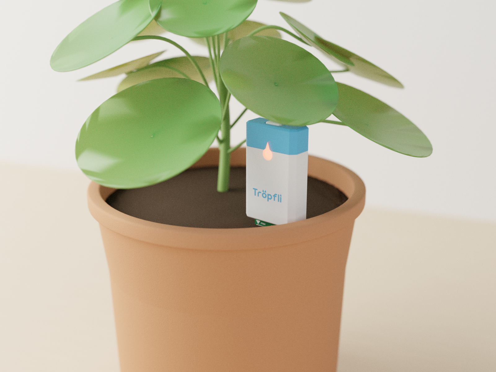
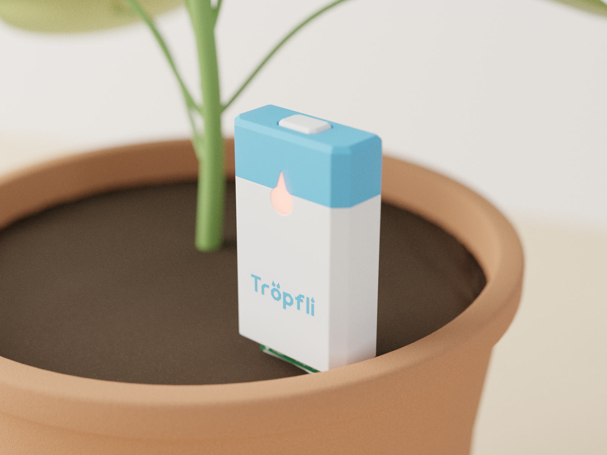
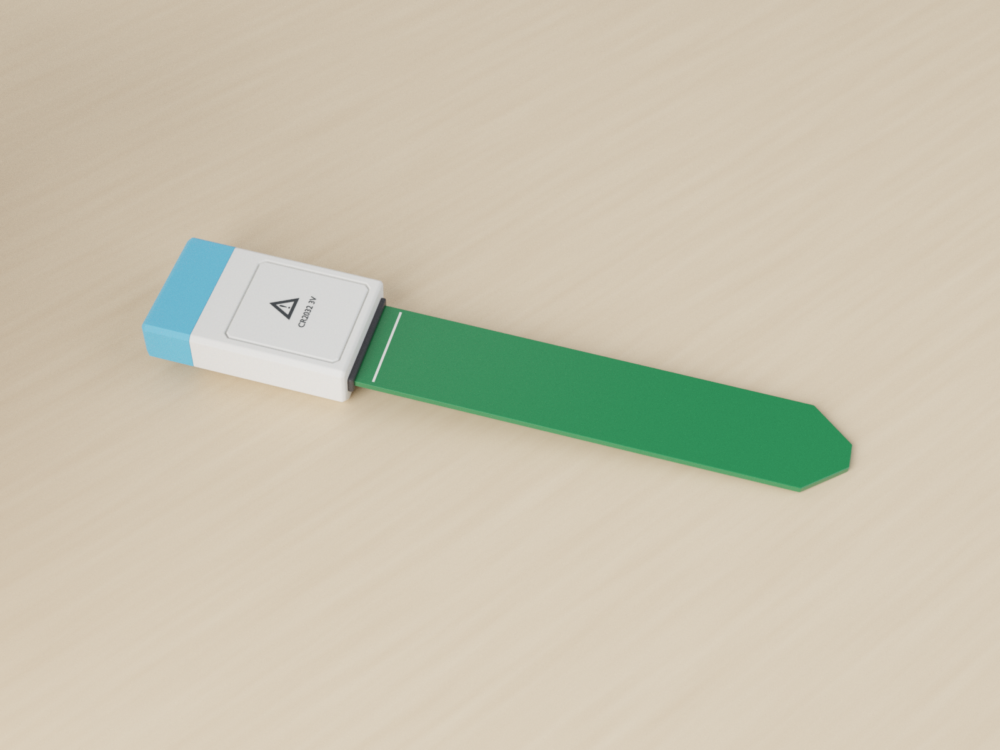

**Idee:** Die einfachste harte Form: ein schlanker Block mit 2.5-mm-Fasen. Die obersten 11 mm sind ein
farbiges Band – der „Wasserstand“ –, und ein grosser Lichttropfen hängt genau an dieser Kante, als würde er
gerade aus dem Band tropfen.

| | |
|---|---|
| Hauptmasse | 28 × **12** × 45 mm (kleinster Vorschlag) |
| Farben | A: Weiss + Wasserblau · B: Hellgrau + Weiss |
| LED | Tropfenfenster 5.2 × 8.4 mm auf der Bandkante (z ≈ 29.6–38 mm) |
| Taster | oben, 9 × 6 mm mit Fase, axial |
| Batterie | Deckel Rückseite, Schraube unten |
| Logo | Wortmarke v2 (Tropfenpunkte), 16 mm, Front unten |
| Druck | stehend gedruckt: Farbband = **ein** Farbwechsel bei z = 34 mm (minimales Spülmaterial); Logo als Prägung (gleiche Farbe) oder Einleger; LED-Tropfen als transluzenter Einsatz |

| Kriterium | Bewertung |
|---|---|
| Grösse | ✔✔ 28 × 12 × 45 |
| Druckbarkeit | ✔✔ einfachste Geometrie, 1 Farbwechsel |
| Dichtung | ~ flache Oberseite um die Taste – wie P1 (Stösseldichtung, Neigung 2–3°) |
| Antenne | ✔✔ volle Innenbreite 24 mm, gleichmässige Wand |
| LED-Sicht | ✔ von vorn/schräg oben, grosses Fenster |
| Wirkung | ✔ schlicht und klar; verspielt durch Band + Tropfen |

## 4 Vorschlag P4 „Gipfel“ – kleines Matterhorn mit Alpenglühen

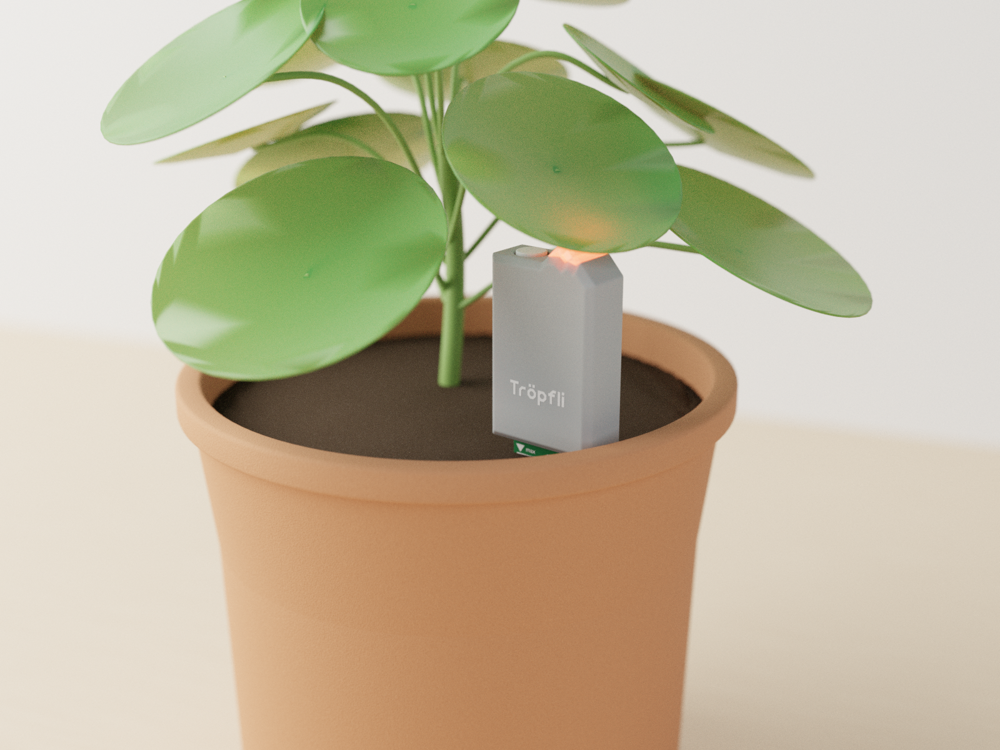
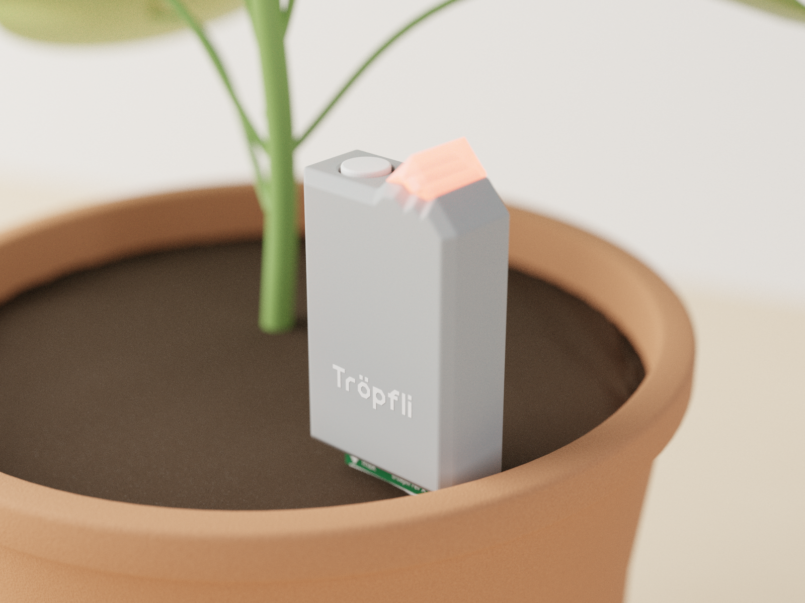
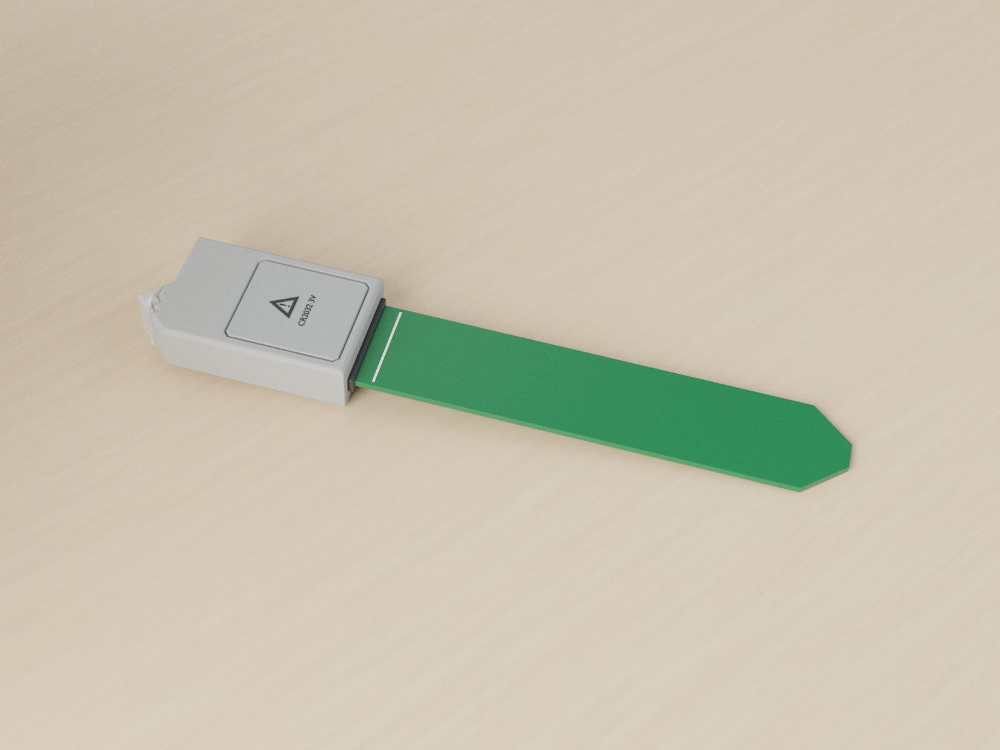

**Idee:** Ein schweizerischer Berg mit asymmetrischem Gipfel und Schulter. Die Schneekappe ist der
Lichtleiter: wenn fluidi Durst meldet, glüht der Gipfel – „Alpenglühen“. Die Taste liegt auf der flachen Schulter.

| | |
|---|---|
| Hauptmasse | 28 × 13 × **49** mm (Schulter 43, Gipfel 49) |
| Farben | A: Steingrau + Schneeweiss · B: Salbeigrün + Weiss |
| LED | ganze Gipfelkappe (transluzent) – sichtbar von allen Seiten und von oben |
| Taster | Schulter, Ø 7 mm, axial, 7 mm neben der Mitte |
| Batterie | Deckel Rückseite, Schraube unten |
| Logo | Wortmarke v1, 15 mm, Front (weiss auf grau) |
| Druck | 2 Schalen liegend; **Kappe als separates transluzentes Teil** (Lichtleiter, verklebt) |

| Kriterium | Bewertung |
|---|---|
| Grösse | ✘ 4 mm über dem Soll: unter der Schulter muss die volle Antennenbreite bleiben, der Gipfel kommt obendrauf |
| Druckbarkeit | ✔ Zickzack-Schneegrenze als Fügefuge, ein Teil mehr |
| Dichtung | ~ Schulter = flache Fläche + Fuge Kappe/Körper → Schulter 3° nach aussen neigen, Kappe eingeklebt |
| Antenne | ~ Taster (Metallkuppel) nahe am Antennenende → mit Elektronik abklären |
| LED-Sicht | ✔✔ rundum |
| Wirkung | ✔✔ am verspieltesten und am stärksten „schweizerisch“; Gefahr: wirkt als Souvenir |

---

## 5 Gateway

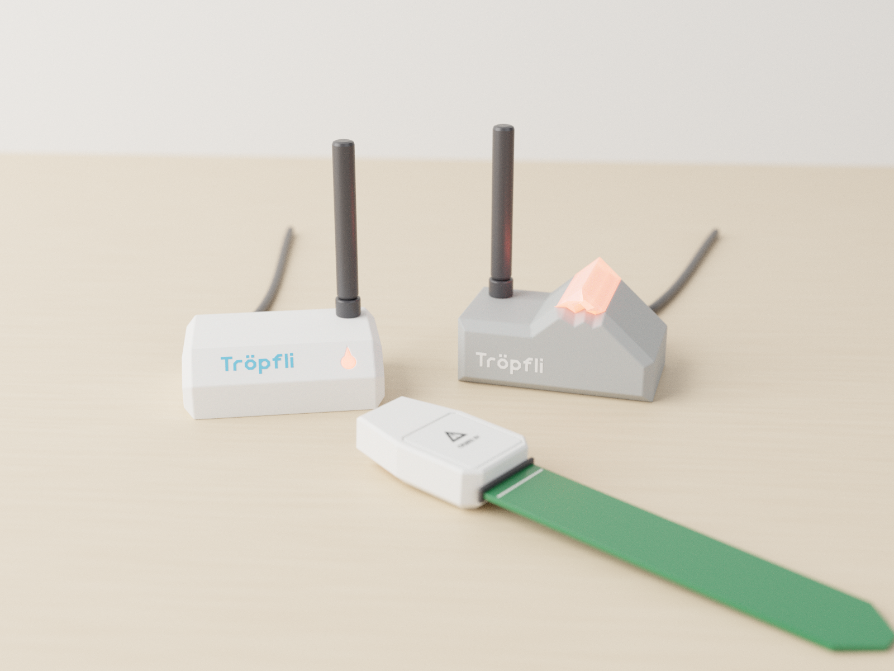

Inhalt: Seeed XIAO ESP32-S3 Plus **21 × 17.8 mm** (Seeed Wiki „Getting Started with XIAO ESP32S3 Series“,
https://wiki.seeedstudio.com/xiao_esp32s3_getting_started, abgerufen 2026-11-07; Höhe ≈ 5 mm laut Händlerangabe
RobotShop – **ANNAHME**, am Muster messen), RTC-Modul ohne Ladepfad (**ANNAHME 15 × 12 mm**, CONCEPTS Kap. 5.1),
U.FL-Pigtail auf Stabantenne, USB-C-Buchse des XIAO an der Rückwand, LED über Lichtleiter (eigene LED oder
Board-LED – Phase 4).

| | **G1 „Sockel“** (passt zu P1/P2/P3) | **G2 „Gipfel“** (passt zu P4) |
|---|---|---|
| Form | flacher Block, 3-mm-Fasen, Frontkante 45° abgeschrägt; LED-Tropfen + Wortmarke auf der Schräge | Bergmassiv mit transluzenter Gipfelkappe (Lichtleiter) |
| Masse | 62 × 40 × 20 mm + Antenne 58 mm | 64 × 38 × 36 mm + Antenne 58 mm |
| Farben | Weiss + Wasserblau | Steingrau + Weiss |
| Anschlüsse | USB-C hinten, Antenne hinten rechts senkrecht | USB-C hinten, Antenne auf der Schulter |
| Druck | 2 Teile (Wanne + Deckel), Gummifüsse | 3 Teile (Wanne, Deckel, Kappe) |

---

## 6 Logo / Wortmarke (`docs/design/logo/`)

Eigene geometrische Pfade, **keine Schrift** (keine Lizenzfrage): Strich 2 u, x-Höhe 8 u, Bögen als
Achtecke mit 45°-Fasen – die „harte“ Form aus den Vorschlägen. Erzeugt mit `docs/design/logo/gen_logo.py`;
alle Flächen sind geschlossene Polygone (Silkscreen-, Bambu-Studio- und Web-tauglich), Import-Test in Blender
(`renders/gen/logo_preview.py`) bestanden.

| Variante | Datei | Icon | Vorschau |
|---|---|---|---|
| v1 schlicht – quadratische Umlaut-/i-Punkte | `logo_v1_schlicht.svg` (+ `_mono`) | `icon_v1.svg` (weisses ö auf Blau) |  |
| v2 verspielt – Punkte als Tropfen (blau) | `logo_v2_tropfen.svg` (+ `_mono`) | `icon_v2.svg` (ö mit Tropfenaugen – „Gesicht“) |  |
| v3 Bildmarke – facettierter Tropfen + Wortmarke | `logo_v3_facette.svg` (+ `_mono`), `mark_v3_tropfen.svg` | `icon_v3.svg` | 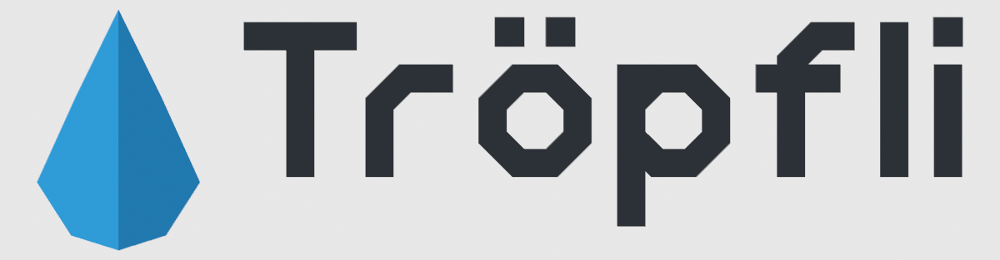 |

Icons: 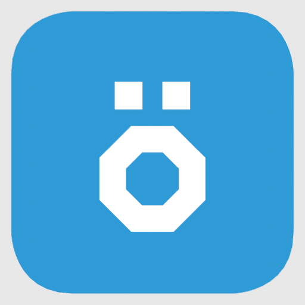 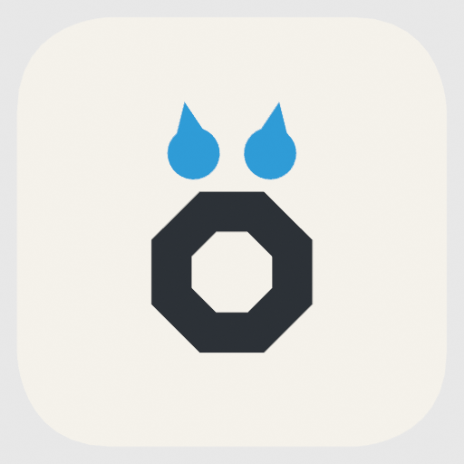 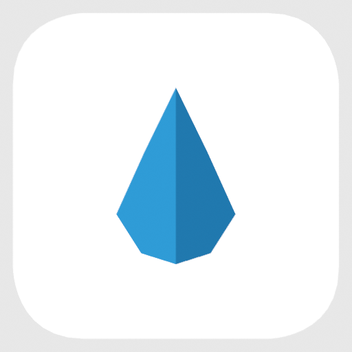

**Mindestgrössen** (JLC: Linie ≥ 0.15 mm, Text ≥ 1.0 mm, `docs/concepts/research_fertigung.md` Z. 38–39):
Wortmarke 51 u breit, Strich 2 u.
- Silkscreen: ≥ 5.2 mm breit (Strich 0.2 mm), empfohlen **12 mm** breit (Strich 0.47 mm, Höhe 3.6 mm).
- FDM-Relief/AMS-Inlay (Düse 0.4 mm): Strich ≥ 0.6 mm → ≥ 15.6 mm breit; auf den Köpfen 15–16 mm (Grenze).
  Tropfenpunkte (v2) sind dann 0.8 mm breit – druckbar, aber an der Grenze; bei < 16 mm Breite v1 verwenden.
- PWA: 512 × 512 px, Motiv in der Sicherheitszone (maskable); kleinere Grössen per Export aus dem SVG.

---

## 7 Familienbild

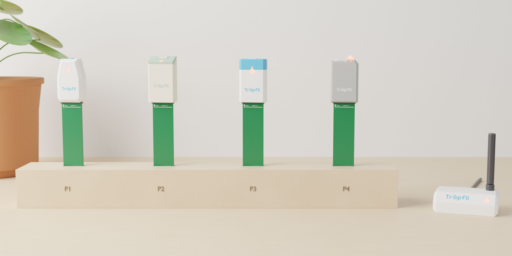

Ständer: Eiche, Schlitze 40 mm tief; Sonden sichtbar (gleicher Massstab, keine geschönten Proportionen).

---

## 8 Gesamtbewertung und Empfehlung

| | P1 Facette | P2 Keil | P3 Stele | P4 Gipfel |
|---|---|---|---|---|
| Vorgabe „hart + verspielt“ | ✔✔ | ✔ | ✔ | ✔✔ |
| Grösse (Soll 45) | ✔ 45 | ~ 48 | ✔✔ 45, 12 tief | ✘ 49 |
| Druck / AMS-Spülung | ✔ | ~ (Zusatzteil) | ✔✔ | ✔ (Zusatzteil) |
| Spritzwasser oben | ~ | ✔✔ | ~ | ~ |
| Antenne | ✔ | ✔ | ✔✔ | ~ |
| LED-Sicht | ✔ | ✔✔ | ✔ | ✔✔ |
| Bezug zum Namen | ✔✔ | ~ | ✔ | ✔ (Schweiz) |

**Empfehlung: P1 „Facette“** mit Gateway **G1 „Sockel“** und Logo **v2 (Tropfenpunkte)** als Wortmarke,
**v3-Icon** für die PWA. Begründung: P1 erfüllt die Vorgabe am direktesten – harte Facetten, ein klar
erkennbarer Tropfen, verspieltes leuchtendes Tropfenfenster –, hält 28 × 13 × 45 mm ein, druckt ohne Stützen
und lässt der Antenne nach der Verbreiterung oben genug Platz. Die Taste oben ist axial (keine Sondenbiegung).
Schwäche ist die flache Oberseite: Stösseldichtung und 2–3° Neigung sind Pflicht.
**P3 „Stele“** ist die technisch risikoärmste Rückfallvariante (kleinste, einfachste Form, ein Farbwechsel).
Gestaltungselemente lassen sich kombinieren (z. B. P1 mit dem farbigen „Wasserstand“-Band aus P3).

## 9 Was der Auftraggeber entscheiden soll

1. **E1 Sensorkopf:** P1, P2, P3 oder P4 (bzw. Kombination, z. B. P1 + Band von P3).
2. **E2 Farbvariante** des gewählten Kopfs (A/B oder eigener Wunsch; hell wegen Sonne, RB-03).
3. **E3 Logo:** v1, v2 oder v3 als Wortmarke; Icon v1/v2/v3 für die PWA.
4. **E4 Höhe über Erde:** REQ-MECH-02 als *Kopfhöhe 45 mm* lesen (dann 50 mm über Erde inkl. 5 mm Freistrecke)
   oder Freistrecke verkürzen.
5. **E5 Gateway:** G1 Sockel oder G2 Gipfel.

## 10 Offene Punkte / Annahmen für Phase 4 (Mechanik/Elektronik)

- Sondenbreite 22 mm ist **ANNAHME** (aus Platinenformat); Kopfplatine ≥ 24 mm wegen Halter 23.1 mm.
- Schraube M2 unten: Schraubdom/Gewindeeinsatz braucht eine Aussparung in der Platine oder liegt unter der Zelle
  im Dichtzonenbereich → mit Mechanik festlegen (Tiefe 13 mm inkl. Dom, CONCEPTS: 12 + Dom = 14).
- Stösseldichtung der Taste (TPU-Membran 2-K oder O-Ring) und Neigung flacher Oberseiten – Spritzwassertest REQ-MECH-13.
- Lichtleiter/Fenstermaterial: HDT und UV-Beständigkeit des transluzenten Filaments belegen (REQ-MECH-12).
- Warnsymbol nach IEC 60086-4 / UL 4200A (Phase 4), hier nur Platzhalter.
- P4: Abstand Taster-Metall zur Antenne (AN043) prüfen.
- XIAO-Höhe und RTC-Modulmasse am Muster messen; Gateway-Innenraum danach festlegen.
- Renderings zeigen FDM-Schichtlinien (0.2 mm) nur angedeutet; reale Oberfläche am Musterdruck beurteilen.

## Dateien

| Datei | Inhalt |
|---|---|
| `renders/gen/fluidi_lib.py` | Geometrie aller Köpfe, Sonde, Deckel, Gateways, Umgebung (Topf, Erde, Pflanze), Materialien |
| `renders/gen/render_phase3.py` | Szenen und Kameras je Vorschlag, Familie, Gateway |
| `renders/gen/batch_render.py` | Stapel-Rendering ohne Oberfläche |
| `renders/gen/logo_preview.py` | SVG-Importtest und Logo-Vorschauen |
| `renders/phase3/*.png`, `*.blend` | Bilder und Blender-Dateien (je Vorschlag, Familie, Gateway) |
| `docs/design/logo/` | SVGs, Generator, Vorschauen |
