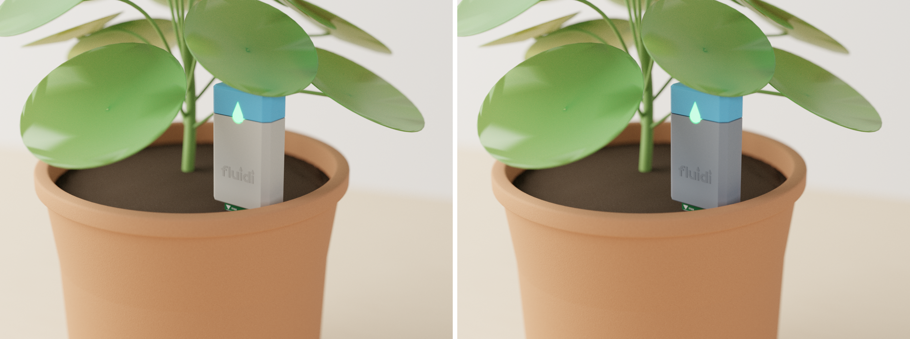
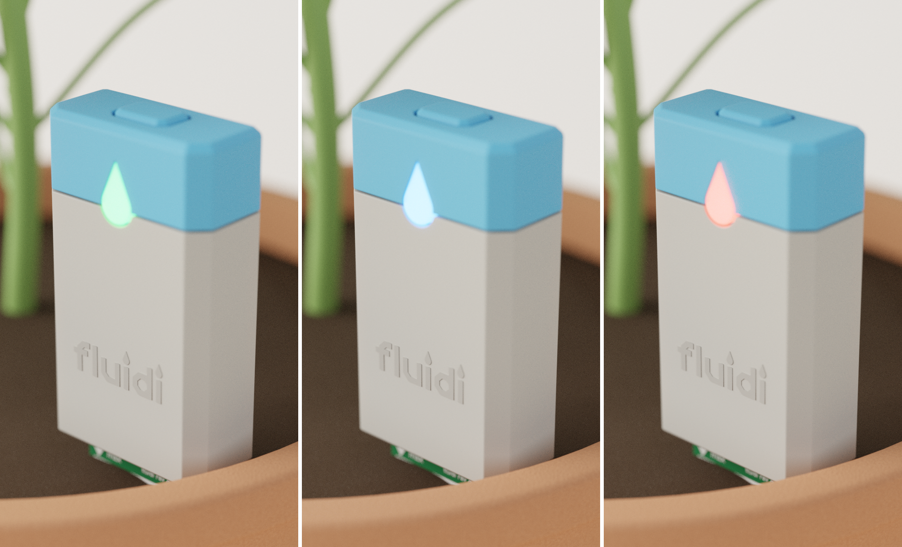
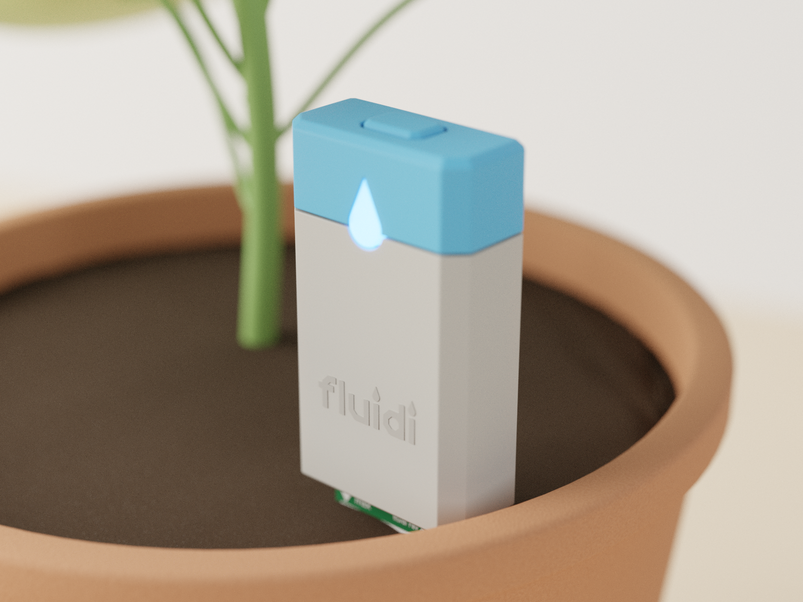
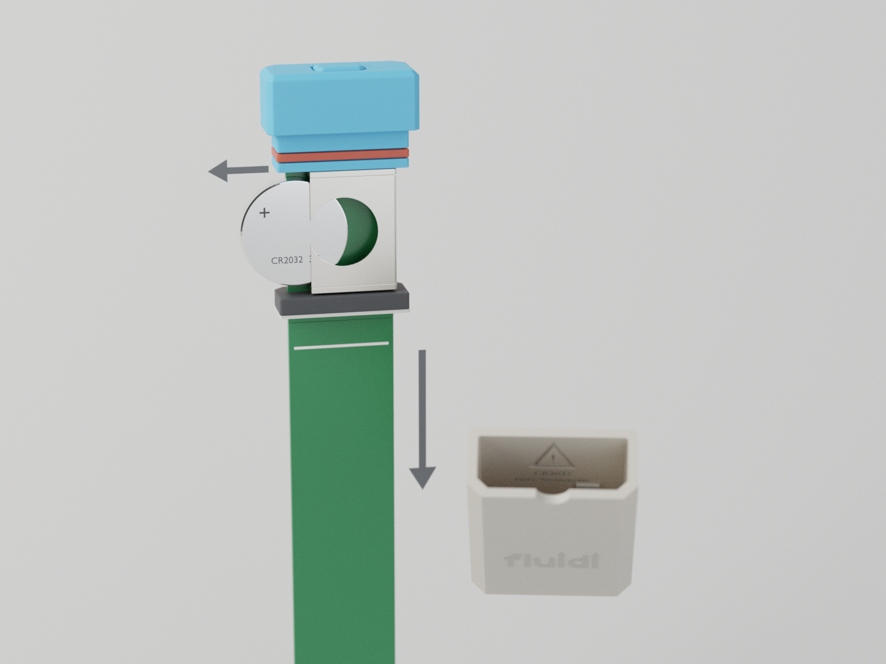
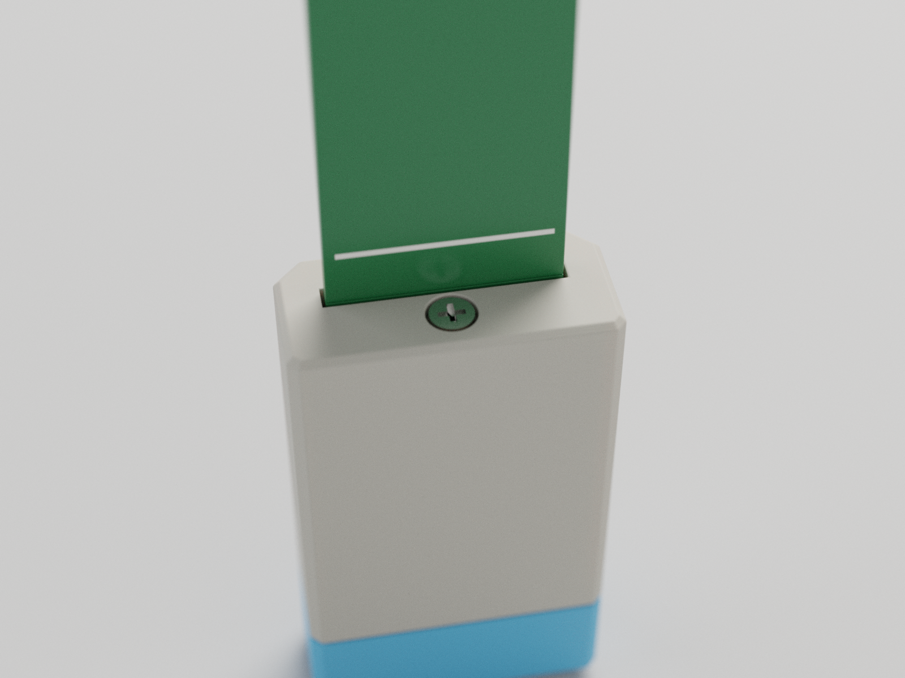
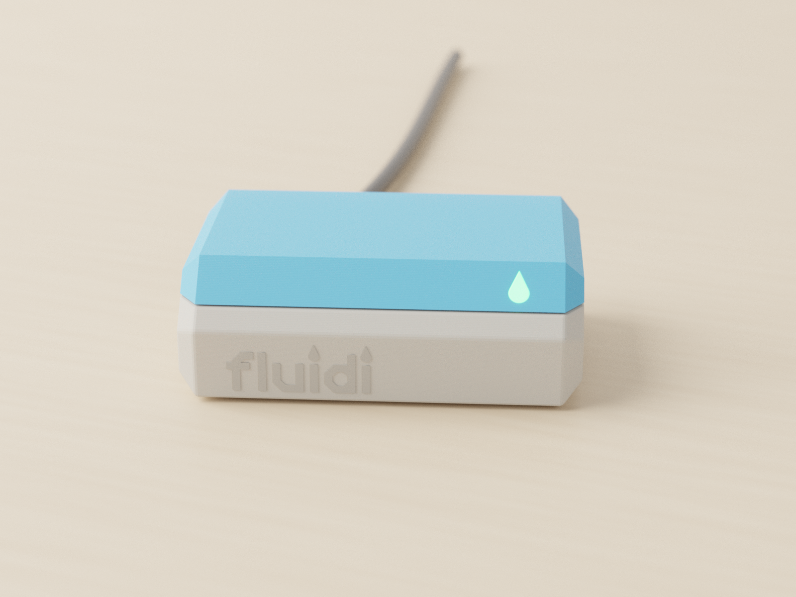
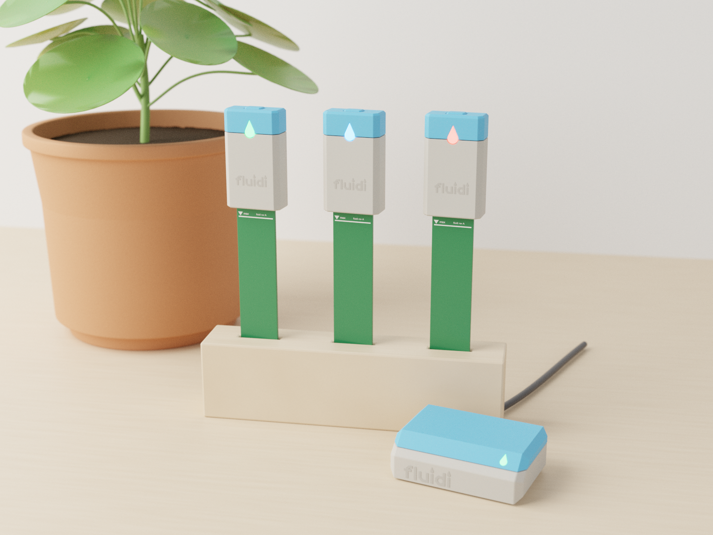
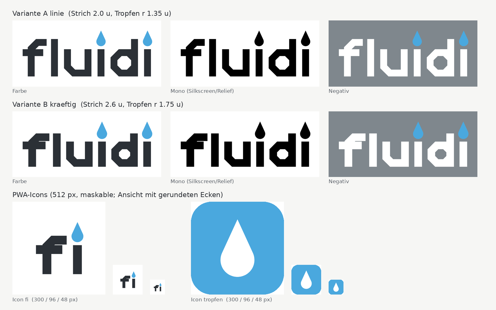

# fluidi – P3 „Stele“, Verfeinerung 1

Stand 2026-11-07, Version 0.2 (Industriedesign), zur Durchsicht durch den Auftraggeber.
Grundlage: D-008 (Name **fluidi**), D-009 (Wahl P3 mit Änderungen), Machbarkeitsberichte
`docs/reviews/phase3_sleeve_mechanik.md` (Konstruktion **A1**, Variante 28/20), `docs/reviews/phase3_sleeve_sicherheit.md`
(kein Veto, Bedingungen S3-K1/K2, W1–W4) und `docs/reviews/phase3_rgb_antenne_elektronik.md` (RGB-LED, FPC-Antenne im Gateway).

Umgesetzt sind alle Wünsche aus D-009: grauer Körper, Kappe und Taste hellblau, LED-Tropfen mit RGB-LED,
kein Batteriefach hinten, kein Aufdruck aussen, Zellwechsel über die Farbfuge, Gateway in denselben Farben
ohne Stabantenne, neues Logo „fluidi“ mit Tropfen als i-Punkte.

Alle Bilder sind mit Blender 4.0.2 gerendert (Cycles CPU **ohne Denoiser**, 384–500 Samples adaptiv). Die Masse sind
mm-genau aus dem Mechanikmodell übernommen, die Proportionen sind nicht geschönt. Neu erzeugen:

```
python3 docs/design/logo/gen_logo_fluidi.py
blender -b --factory-startup --python renders/gen/render_p3v2.py -- topf1 topf2 vergleich nah explosion unten gateway familie
python3 scripts/md2pdf.py docs/design/P3_FLUIDI.md docs/design/P3_fluidi_v1.pdf
```

---

## 1 Der Sensor im Topf – zwei Grautöne zur Auswahl



| | |
|---|---|
| Hüllmass | **28 × 13 × 48 mm** (B × T × H), Sonde **20 mm** breit, 1.6 mm dick. Der Kopf steht 5 mm über der Erde (Markierung „max“) |
| Gegenüber Phase 3 | **+3 mm Höhe** (45 → 48 mm): Der Clip muss für den Zellwechsel an der Fuge quer liegen (Mechanikbericht Kap. 0, Bedingung 1). Die Sonde wird **20 statt 22 mm** breit, sonst bleibt bei 28 mm Kopfbreite zu wenig Dichtsteg (Bedingung 2) |
| Form | Stele mit 2.5-mm-Fasen vorne und 1.0-mm-Fasen hinten, Oberkante mit 1.0-mm-Fase. Die Rückseite ist glatt, ohne Deckel und ohne Aufdruck |
| Teilung | **Eine** sichtbare Fuge: blau/grau bei z = 37 mm, Spalt 0.3 mm, gerade umlaufend. Nur am LED-Tropfen folgt sie dessen Kontur |
| Logo | Wortmarke „fluidi“ (Variante A), 16 mm breit, **Relief 0.2–0.3 mm Ton in Ton** in der Hülsenfront (gleiches Filament, kein Farbwechsel; Strich 0.85 mm ≥ 2 Druckbahnen) |
| Farben | Hülse grau (Option 1 oder 2), Kappe und Taste hellblau (wie bisher, ca. sRGB #59ADDD), LED-Fenster naturweiss transluzent |

Druck: Jedes Teil ist einfarbig, es braucht keinen AMS-Farbwechsel. Die Hülse wird stehend gedruckt (Boden auf dem Bett),
die Kappe kopfüber (Mechanikbericht Kap. 2.6). Das Logo-Relief liegt auf einer senkrechten Wand und druckt deshalb
ohne Stützen.

## 2 LED-Tropfen mit RGB-LED – drei Zustände





| | |
|---|---|
| Fenster | Tropfen r 2.5 mm, Spitze 6.0 mm über der Mitte (8.5 mm hoch, 5 mm breit), **gleiche Form wie die i-Punkte im Logo**. Material: transluzentes, mattes ASA/PETG ≥ 1 mm dick als Diffusor (Elektronikbericht 1.9). Das Fenster ist in die Kappe eingeklebt, die Hülse hat eine Kerbe, 0.3 mm grösser als der Tropfen |
| Lage | Tropfenmitte z = 37.4 mm, genau auf der Fuge: Der Tropfen „hängt“ aus dem blauen Band. Unterkante 34.9 mm, Kerbe 34.6 mm, also **1.1 mm über der O-Ring-Nut** (Forderung Mechanikbericht 2.1: ≥ 1 mm) |
| LED | RGB 1615 (Elektronikbericht 1.1) auf der Platinenvorderseite, z ≈ 37 im Elektronikband (31.3–38.3), Abstand zur Fensterinnenfläche ≈ 2.4 mm (Empfehlung 1.5–2.5 mm). Lichtschacht nur bis z 38.3, nicht in den Antennenbereich |
| Sichtbarkeit | von vorn und schräg oben, wie bisher. Im Bild leuchtet **Blau im blauen Band schwächer** als Rot und Grün. Es braucht also einen höheren PWM-Anteil, und Blau ist bei tiefer Zellspannung ohnehin eingeschränkt (Elektronikbericht 1.4) |

Vorschlag Farbzuordnung (Entscheid Auftraggeber, Firmware-Tabelle nach Elektronikbericht 1.4):

| Zustand | Farbe / Muster | Bemerkung |
|---|---|---|
| alles gut, Messung gesendet (Quittung nach Tastendruck) | grün, 1 × kurz | |
| giessen nötig | blau, 1 × pro Minute kurz | Wasser = blau. Unter ≈ 2.65 V Zellspannung Ausweichfarbe gelb |
| Batterie tief | rot, 2 × kurz | |
| Pairing (Taste lang) | gelb, schnell blinkend | gelb = rot + grün, funktioniert bei jeder Zellspannung |
| keine Verbindung zum Gateway | rot/gelb abwechselnd | selten |

## 3 Batteriewechsel an der Farbfuge (Konstruktion A1)




Ablauf (Mechanikbericht Kap. 2.5):
1. Sensor aus der Erde ziehen, Sonde abwischen.
2. Die Schraube unten lösen. Sie bleibt in der Hülse, weil sie unverlierbar ist.
3. Die graue Hülse über die Sondenspitze nach unten abziehen.
4. Die Zelle seitlich aus dem Clip schieben, die neue Zelle einschieben (+ nach hinten).
5. Hülse aufschieben, Schraube anziehen, Sensor stecken.

| Teil | Masse / Ausführung (Mechanikbericht Kap. 1, Variante 28/20) |
|---|---|
| Hülse grau | aussen 28 × 13 × 36.7, Wand 1.6, Boden 2.2; Sondenschlitz 20.6 × 2.2; Bohrung M2 bei 9 mm hinter der Front (hinter der Platine); Kerbe für den LED-Tropfen; Haltenoppe für die Zelle innen an der Rückwand |
| Kappe blau (Kern) | Band z 37–48, Zapfen bis z 29.8 mit O-Ring-Nut (z 31.5–33.5), Schott mit vergossener Platinendurchführung. Fest mit der Platine verbunden, Elektronikraum dauerhaft dicht (S3-K1) |
| Kragen (Kern) | anthrazit, z 2.8–6.0, auf der Sondenwurzel vergossen = Sondendichtung, wird nie gelöst (S3-K2, REQ-MECH-15). Eingegossene M2-Mutter |
| Dichtungen | O-Ring Silikon 1.5 mm, rot oder transluzent (ohne Russ, 5 mm unter der Antenne); Bodendichtung Silikon 0.8 → 0.6 mm |
| Schraube | M2 × 4 A2, Kreuzschlitz, unverlierbar. 33 mm Abstand zur Antenne |
| Warnsymbol | **innen** auf der Hülsenrückwand, **vertieft 0.4 mm**: Dreieck 8 × 9 mm mit „!“, darunter „CR2032“ und „Kinder: Verschluckgefahr“. Beim Abziehen zwangsläufig sichtbar (S3-W4), aussen kein Aufdruck. Erhaben geht es nicht, weil Kragen und Zapfen beim Aufschieben mit nur 0.2 mm Spalt durch die ganze Hülse gleiten |

## 4 Gateway G1 „Sockel“ in Grau + Hellblau




| | |
|---|---|
| Masse | **62 × 40 × 20 mm**, 3-mm-Fasen seitlich, 45°-Facette vorne oben (9 mm) |
| Farben | Wanne grau (z 0–13.85), Deckel hellblau (z 14.15–20) mit dem oberen Teil der Facette. Die Fuge ist 0.3 mm breit und läuft wie am Sensor gerade um |
| Status-LED | kleiner Tropfen (r 1.6 mm) rechts auf der Facette, transluzent; Board-LED oder eigene LED über Lichtleiter (Phase 4) |
| Antenne | **keine Stabantenne.** FPC-Antenne (z. B. Seeed A-02, 1.16 dBi) **innen** an die Frontwand hinter der Facette geklebt, senkrecht. Laut Elektronikbericht Kap. 2 braucht sie ≥ 15 mm Abstand zu XIAO, USB-C und RTC (**ANNAHME**: XIAO an der Rückwand, 17.8 mm tief → ≈ 18 mm Abstand bis zur Frontwand; Lage mit `mechanik` klären, GW-4) |
| Anschlüsse | USB-C hinten (Buchse des XIAO), 4 Gummifüsse |
| Logo | Wortmarke A, 22 mm breit, Relief Ton in Ton auf der grauen Front (Strich 1.2 mm) |

## 5 Logo „fluidi“



Die Wortmarke ist aus eigenen Pfaden aufgebaut, nicht aus einer Schrift, es stellt sich also keine Lizenzfrage. Sie folgt der harten Formsprache: Stämme gerade,
Bögen als Achteck-Ecken mit 45°-Fasen, alles klein geschrieben. **Beide i-Punkte sind Wassertropfen** (hellblau) in derselben
Form wie das LED-Fenster. Generator: `docs/design/logo/gen_logo_fluidi.py`. Alle Flächen sind geschlossene Polygone
(KiCad-Silkscreen, Bambu Studio, Web), der Blender-Import wurde mit den Renderings getestet.

| Variante | Dateien (`docs/design/logo/`) | Charakter |
|---|---|---|
| **A „Linie“** | `fluidi_A_linie.svg`, `_mono.svg`, `_weiss.svg` | Strich 2.0 u, x-Höhe 8 u, Tropfen r 1.35 u; ruhig, schlank. Auf Sensor und Gateway verwendet |
| **B „Kräftig“** | `fluidi_B_kraeftig.svg`, `_mono.svg`, `_weiss.svg` | Strich 2.6 u, x-Höhe 8.6 u, Tropfen r 1.75 u; fetter, Tropfen auffälliger, besser lesbar sehr klein |
| Icon „fi“ | `icon_fluidi_fi.svg` | „fi“ (Variante B) anthrazit mit blauem Tropfen auf Weiss |
| Icon „Tropfen“ | `icon_fluidi_tropfen.svg` | weisser Tropfen auf Hellblau |

Die Icons haben 512 × 512 px, sind vollflächig und maskable: Das Motiv liegt innerhalb des Sicherheitskreises r = 205 px
(Prüfung im Skript: 191 bzw. 159 px).

**Mindestmasse** (Skriptausgabe; JLC Silkscreen Linie ≥ 0.15 mm, Text ≥ 1.0 mm hoch, Projektempfehlung Strich ≥ 0.2 mm,
`docs/concepts/research_fertigung.md` Pkt. 7; FDM-Relief: Strich ≥ 0.8 mm = 2 Bahnen bei Düse 0.4, Grenze 0.45 mm):

| | A „Linie“ | B „Kräftig“ |
|---|---|---|
| Silkscreen JLC-Minimum (0.15 mm) | ≥ 2.8 mm breit | ≥ 2.5 mm breit |
| Silkscreen empfohlen (0.2 mm), Text ≥ 1.5 mm hoch | ≥ 4.2 mm breit, **empfohlen 10–12 mm** | ≥ 4.3 mm breit, empfohlen 10–12 mm |
| FDM-Relief 2 Bahnen (0.8 mm) | ≥ 15.0 mm breit | ≥ 13.5 mm breit |
| auf dem Sensor (16 mm) | Strich 0.85 mm, Tropfen 1.15 mm breit ✔ | Strich 0.95 mm, Tropfen 1.28 mm ✔ |

## 6 Offene Fragen an den Auftraggeber

1. **Grauton:** Option 1 „Warmgrau hell“ (#B9B5AC) oder Option 2 „Kühlgrau mittel“ (#7F8790)? Im Rendering wirkt
   Option 1 freundlicher und Option 2 schmutzunempfindlicher. Das endgültige Filament wird nach Musterdruck gewählt (z. B. ASA
   grau verschiedener Hersteller; der Farbton im Bild ist Näherung).
2. **Logo-Variante:** A „Linie“ oder B „Kräftig“?
3. **PWA-Icon:** „fi“ mit Tropfen oder nur Tropfen?
4. **LED-Farben:** Zuordnung nach Tabelle Kap. 2 einverstanden? Besonders: Ist Blau für „giessen nötig“ richtig, mit Gelb als Ausweichfarbe bei schwacher Zelle?
5. **Logo auf dem Sensor:** Relief Ton in Ton wie gezeigt? Oder gar kein Logo aussen, nur im Silkscreen der Platine? Der Wunsch „kein Aufdruck“ bezog sich auf den Warnhinweis.
6. **Höhe 48 mm** statt 45 mm und **Sonde 20 mm** statt 22 mm: Beides ist die Folge des Zellwechsels an der Fuge (Mechanik). Einverstanden? Die Feldsimulation für Sonde 20 mm folgt (REQ-MECH-11, Elektronik).

## 7 Offene technische Punkte (an `mechanik` / `elektronik`, Phase 4)

- LED-Fenster unterhalb der Fuge: Das Fenster ist in die Kappe eingeklebt und rückseitig auf dem Zapfen abgestützt. Seine Klebefuge
  begrenzt den Elektronikraum oberhalb des O-Rings. Der Lichtschacht geht durch die Zapfenwand. Dichtheit und Abstützung prüfen.
- Die Tropfenspitze (z bis 43.4) liegt in der Wandebene vor dem Antennenbereich (38.3–44). Es ist nur Kunststoff, der Lichtschacht endet bei 38.3. Die Elektronik
  soll bestätigen, dass das unkritisch ist (RGB-5).
- Der Schraubenkopf ist im Rendering wie im Mechanikmodell in einer Senkung gezeigt. Der Mechanikbericht 2.7 empfiehlt einen Kopf ohne Senkung
  (1.2 mm vorstehend, unsichtbar unten) oder einen Boden von 3 mm. Ein vorstehender Kopf würde das Bild nicht verändern.
- Die Bedingungen der Sicherheit (S3-W1: Metalleinsatz statt Mutter? ≥ 2 Gänge; S3-W2 Schütteltest; S3-W3 Dachziegelfuge)
  bleiben bei der Mechanik. Die Dachziegel-Option (Kappe überlappt die Hülse um 1.5 mm) ändert die Optik kaum, sie ist aber nicht gerendert.
- Gateway: FPC-Lage und Freiraum ≥ 15 mm am Muster prüfen, RSSI Stab gegen FPC (Elektronikbericht, PROTOTYP-PRÜFUNG).

## Dateien

| Datei | Inhalt |
|---|---|
| `renders/gen/fluidi_p3v2.py` | Geometrie P3 v2 (Hülse, Kern, Schraube, Warnsymbol, LED), Gateway G1 v2, Studio |
| `renders/gen/render_p3v2.py` | Szenen, Kameras, Stapel-Rendering (`blender -b … -- topf1 …`) |
| `renders/phase3_v2/*.png`, `*.blend` | Bilder und Szenen |
| `docs/design/logo/gen_logo_fluidi.py` | Wortmarken, Icons, Vorschauen, Mindestmasse |
| `docs/design/logo/fluidi_*.svg`, `icon_fluidi_*.svg`, `preview_*fluidi*.png`, `logo_uebersicht.png` | Logo-Dateien |
