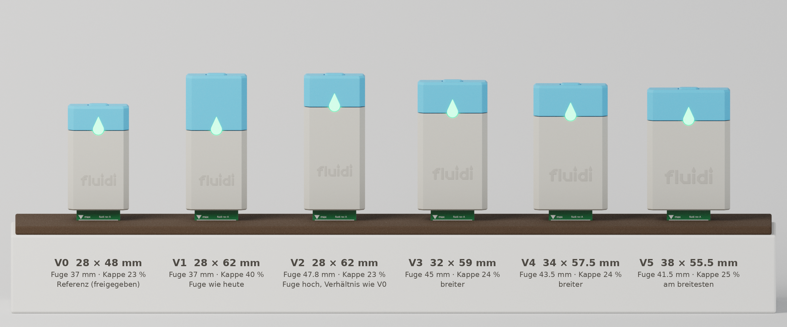
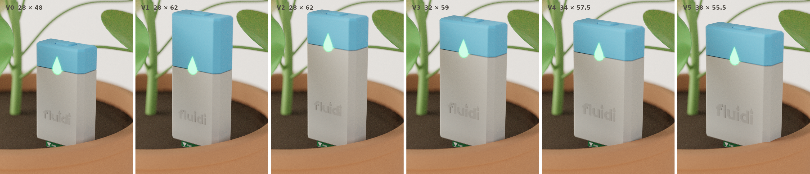
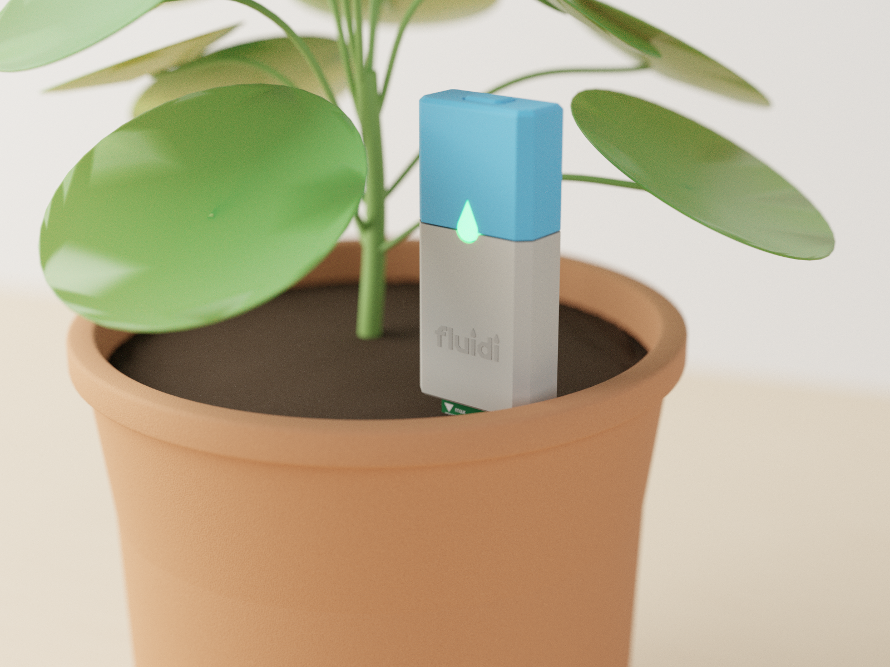
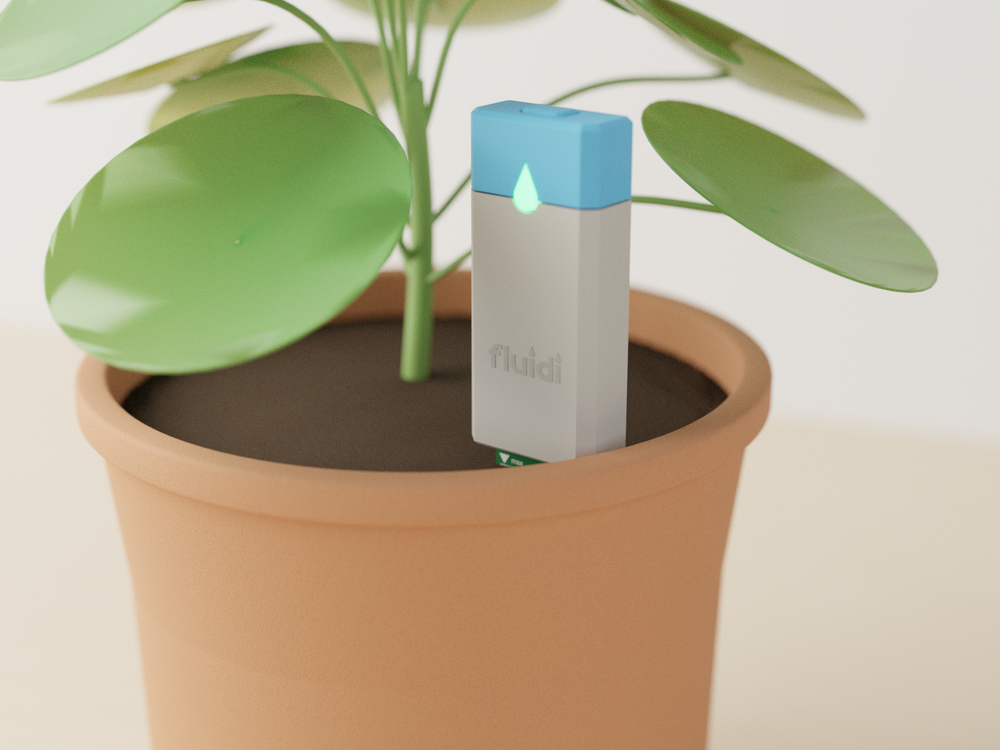
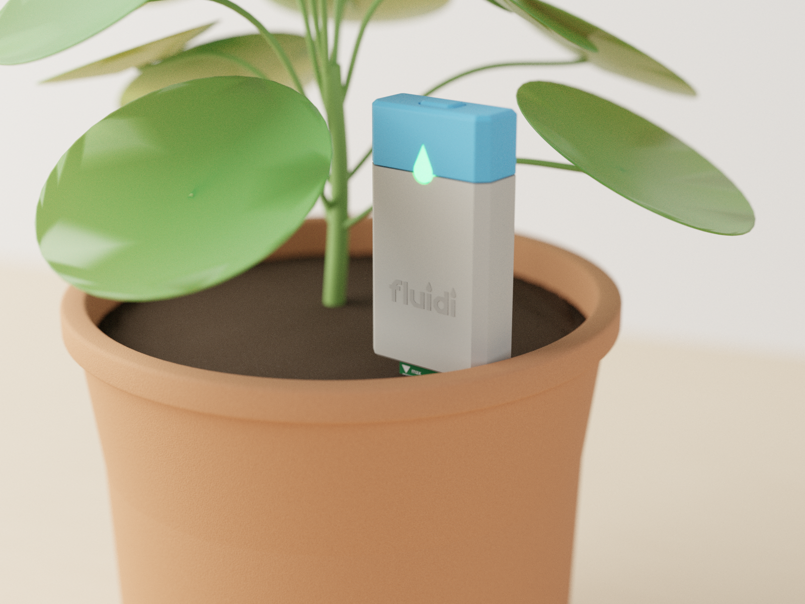
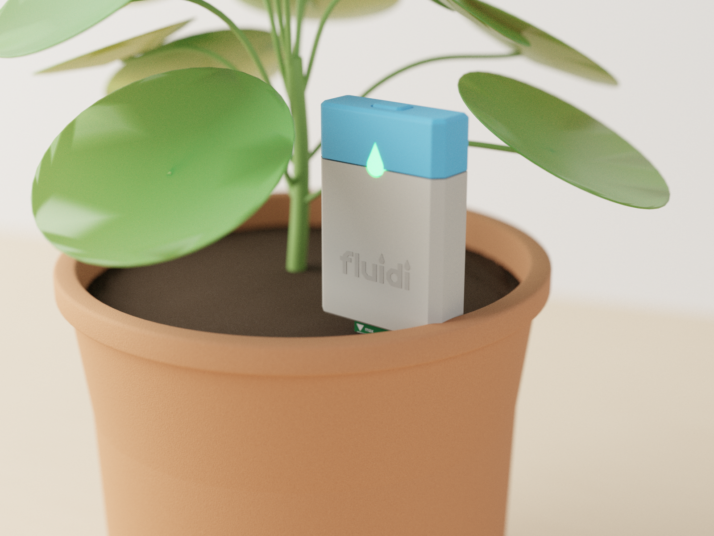
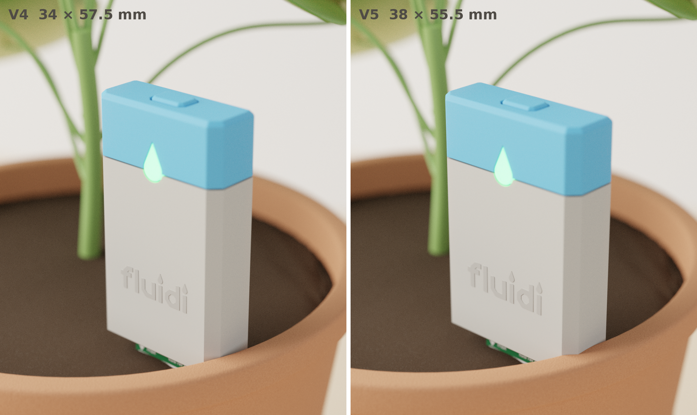

# fluidi – Proportionsstudie Sensorkopf P3

Stand 2026-11-07, Industriedesign. Entscheidungshilfe für den Auftraggeber.

## Ausgangslage

Die Elektronik passt nicht in den freigegebenen Kopf 28 × 13 × 48 mm (D-010). Der Kopf muss höher und/oder breiter
werden. Machbare Kombinationen nach Überschlag des Projektleiters (**ANNAHME ±2 mm**, noch nicht von `mechanik`
bestätigt): Breite 28 → Höhe ≈ 62 mm, 32 → ≈ 59, 34 → ≈ 57.5, 38 → ≈ 55.5 mm.

Die Farbfuge blau/grau muss nicht an der inneren Dichtung liegen. Die graue Hülse darf als Sichtschale über den dichten
Kern hinaufreichen. Die Fuge mit dem LED-Tropfen kann deshalb auf die optisch beste Höhe gelegt werden.

Unverändert bleiben: Tiefe 13 mm, Grundriss mit Fasen 2.5 mm vorne und 1.0 mm hinten, Sichtfuge 0.3 mm,
LED-Tropfen (r 2.5 mm, 8.5 mm hoch, Mitte 0.4 mm über der Fuge), Taste 9 × 6 mm, Unterseite mit Schraube,
Sonde 20 mm und 5 mm Abstand zur Erde. Die Farben sind die freigegebenen: Warmgrau hell #B9B5AC, Hellblau, Logo
Ton in Ton, Tropfen grün leuchtend. Das Logo wächst mit der Breite (16 mm bei 28 mm Breite) und sitzt wie
freigegeben bei 39 % der Hülsenhöhe.

Auftraggeber: „mir gefällt das glaube ich nicht wenn es zu hoch wird. sonst machen wir es lieber noch ein wenig
breiter. aber das verhältnis von blau und grau sollte einfach gut aussehen und der tropfen nicht zu weit unten.“

## Varianten

| Variante | B × H (mm) | H : B | Fuge z (mm) | Kappe (mm) | Kappe in % der Höhe | Tropfenmitte in % der Höhe | Logo-Breite (mm) |
|---|---|---|---|---|---|---|---|
| **V0** Referenz, freigegeben | 28 × 48 | 1.71 | 37.0 | 11.0 | 22.9 % | 78 % | 16.0 |
| **V1** Fuge wie heute | 28 × 62 | 2.21 | 37.0 | 25.0 | 40.3 % | 60 % | 16.0 |
| **V2** Fuge hoch, Verhältnis wie V0 | 28 × 62 | 2.21 | 47.8 | 14.2 | 22.9 % | 78 % | 16.0 |
| **V3** | 32 × 59 | 1.84 | 45.0 | 14.0 | 23.7 % | 77 % | 18.3 |
| **V4** | 34 × 57.5 | 1.69 | 43.5 | 14.0 | 24.3 % | 76 % | 19.4 |
| **V5** | 38 × 55.5 | 1.46 | 41.5 | 14.0 | 25.2 % | 75 % | 21.7 |

Fuge z ist die Unterkante der Kappe über der Kopfunterkante. Die Hülse endet 0.3 mm tiefer. Kappenhöhe = H − Fuge.

**Regel für V3–V5:** Die Kappe ist bei allen **14 mm hoch**. Damit bleibt der Abstand von der Taste zum Tropfen
gleich, und der Tropfen sitzt immer im oberen Viertel. Bei breiteren Köpfen wird der Kappenanteil dadurch leicht
grösser (24–25 %). Das ist gewollt: Ein breiter Kopf mit sehr flacher Kappe würde wie ein Deckel auf einer Dose
wirken.

## 1 Aufstellung (gleicher Massstab, frontal)



## 2 Wirkung im Topf (gleiche Kamera wie das freigegebene Bild p3v2_topf_grau1)



Einzelbilder (1600 × 1200 px): `renders/phase4_prop/prop_topf_V0.png` … `prop_topf_V5.png`.










Hinweis zur Szene: Ein Blatt der Pilea (Blatt5) würde in den Raum des grössten Kopfes ragen. Es ist bei **allen**
Topfbildern dieser Studie (auch bei V0) samt Stiel ausgeblendet. So ist die Pflanze überall gleich. Im
freigegebenen Bild p3v2_topf_grau1 ist dieses Blatt noch vorhanden.

## 3 Nahaufnahme der zwei besten Varianten (3/4-Ansicht)



## Beurteilung

| Variante | Urteil |
|---|---|
| V1 | Ehrlich, aber unausgewogen. Die Kappe nimmt 40 % ein, der Tropfen rutscht in die Mitte. Das wirkt wie ein blauer Block auf einem grauen Block. Erfüllt „Tropfen nicht zu weit unten“ nicht. **Nicht empfohlen.** |
| V2 | Das Farbverhältnis stimmt, aber der Kopf ist 2.2-mal so hoch wie breit. Er wirkt wie ein Stab und überragt im Topf deutlich die unteren Blätter. Genau das will der Auftraggeber nicht („zu hoch“). |
| V3 | Guter Kompromiss. Er ist noch schlank, aber spürbar höher als V0. |
| **V4** | **Empfehlung.** Das Seitenverhältnis H : B = 1.69 entspricht fast genau dem freigegebenen V0 (1.71). V4 wirkt wie V0, um rund 20 % vergrössert. Die Kappe hat 24 %, der Tropfen sitzt im oberen Viertel. Die Figur bleibt die freigegebene „Stele“. |
| V5 | Die beste Antwort auf „lieber breiter“: der niedrigste Kopf, ruhig und freundlich. Er ist aber deutlich gedrungener (1.46) und wirkt eher wie ein Kästchen als wie eine Stele. Im Topf belegt er mehr Fläche. Wenn die Höhe das Hauptkriterium ist: **zweite Wahl**. |

**Empfehlung:** V4 (34 × 13 × 57.5 mm, Fuge 43.5 mm, Kappe 14 mm = 24 %). V5 (38 × 55.5) ist die Alternative, falls
jeder Millimeter Höhe zählt.

## Offene Punkte für `mechanik` / `elektronik`

- Die Masse B × H stammen aus dem Überschlag (**ANNAHME ±2 mm**). Nach der Wahl muss `mechanik` sie bestätigen. Die
  Regel „Kappe 14 mm“ lässt sich auf die bestätigte Höhe übertragen.
- Die Fuge liegt bei V2–V5 über der Dichtung (O-Ring-Nut). Die graue Sichtschale reicht über den Kern hinauf.
  Zu klären sind die Wanddicke und Führung der Schale im FDM-Druck (≥ 1.2 mm), die Kerbe für den Tropfen in der
  Schale und der **Lichtweg** von der LED zum Tropfenfenster, das jetzt höher liegt (Lichtleiter oder LED-Lage).
- Die Taste bleibt 9 × 6 mm in der Kappenmitte. Bei breiteren Köpfen ist rechts und links mehr Rand, und die Bedienung
  wird nicht schwieriger.

## Neu erzeugen

```
blender -b --factory-startup --python renders/gen/render_proportions.py -- aufstellung topf nah vergleich
python3 scripts/md2pdf.py docs/design/PROPORTIONEN.md docs/design/PROPORTIONEN.pdf
```

Cycles CPU, **ohne Denoiser**, 384 Samples (Nahaufnahmen 499), adaptiv. Geometrie und Materialien aus
`renders/gen/fluidi_p3v2.py` (freigegebene Fassung), je Variante nur Breite, Höhe, Fuge und Logo angepasst.
