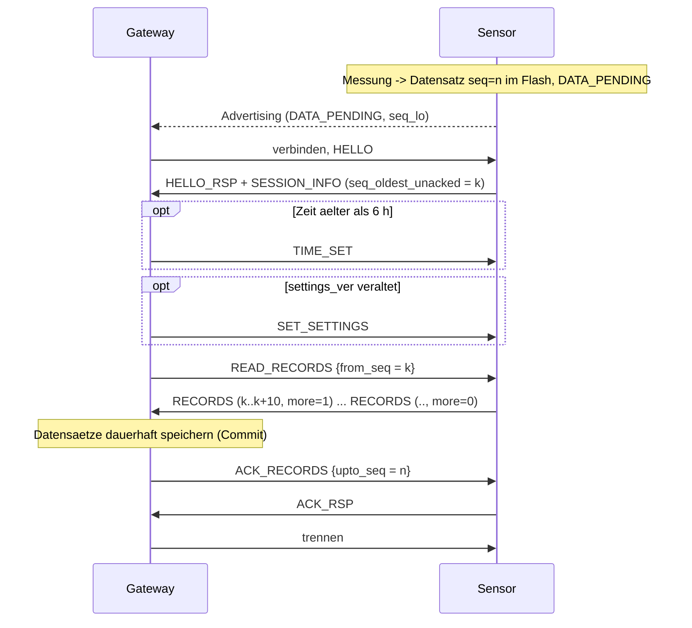
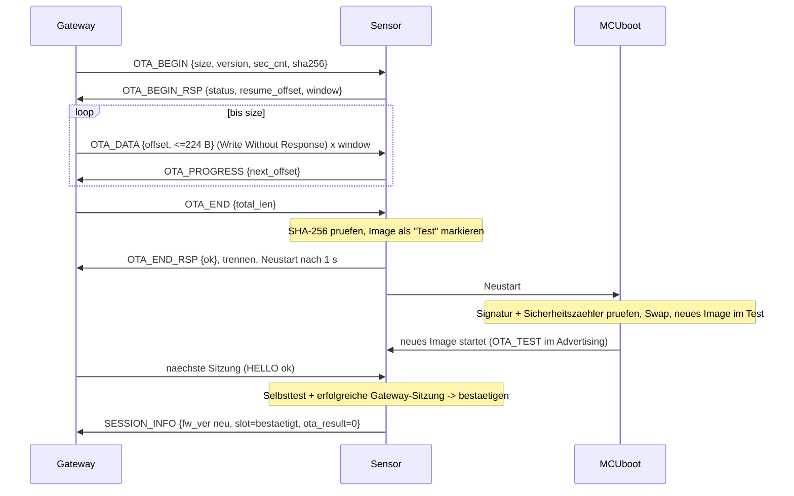

# fluidi – Funkprotokoll Sensor ↔ Gateway (BLE) und Datenformat

| | |
|---|---|
| Dokument | `firmware/PROTOCOL.md` |
| Protokollversion | **1** (Frame-Version 1, Advertising-Format 1, Datensatzformat 1) |
| Dokumentversion | 0.1 – Entwurf zur Prüfung (Phase 4, Welle 1) |
| Datum | 2026-11-07 |
| Ersteller | Firmware/Energie |
| Gegenseite | Software-Agent (Gateway XIAO ESP32-S3 Plus, ESP-IDF v6.1, NimBLE) |
| Grundlagen | `docs/requirements/REQUIREMENTS.md` v1.0; `DECISIONS.md` D-006 (A-32), D-010 (LED-Farben); `docs/concepts/CONCEPTS.md` 1, 2.2, 2.7, 2.8, 5.3; `docs/concepts/research_gateway.md` 2.4, 3; `docs/reviews/phase3_rgb_antenne_elektronik.md` 1.4–1.8 |

Kennzeichnungen: **ANNAHME** = nicht belegt; **PROTOTYP-PRÜFUNG** = erst am Muster nachweisbar;
**MUSS/SOLL** in Implementierungsregeln wie in RFC 2119 (MUSS = zwingend für beide Seiten).
Alle Mehrbyte-Zahlen sind **little-endian**, falls nicht anders angegeben.

Dieses Dokument ist die **verbindliche Schnittstelle** zwischen Sensor-Firmware (`firmware/sensor/`)
und Gateway-Firmware (`firmware/gateway/`). Änderungen nur mit Erhöhung der betroffenen Version
(Kap. 13) und Prüfung durch beide Seiten.

---

## 1 Überblick und Grundsätze

| Thema | Festlegung | Begründung |
|---|---|---|
| Funk | Bluetooth LE 4.2+/5, 1M PHY, Legacy-Advertising | CC2340 und ESP32-S3 unterstützen beides; Legacy-Advertising wird von jedem Scanner gesehen |
| Rollen | **Sensor = Peripheral/Advertiser** (GATT-Server), **Gateway = Central/Scanner** (GATT-Client) | Der Sensor schläft und bestimmt selbst, wann er erreichbar ist (Energie); das Gateway ist dauernd versorgt und scannt dauernd (`research_gateway.md` 2.4) |
| Wer verbindet? | Nur das Gateway, und **nur wenn es etwas zu tun hat** (Daten liegen an, Befehl wartet, Zeit/Einstellungen veraltet) | Eine Verbindung kostet so viel wie ≈ 18 Advertising-Ereignisse (Kap. 12) |
| Sicherheit | **Anwendungsschicht**: individueller Schlüssel pro Sensor (ECDH beim Koppeln), jede Sitzung mit frischem Sitzungsschlüssel, AES-128-CCM für alle Befehle und Daten. **Kein BLE-Bonding** | Kap. 4.1 |
| Datenfluss | Sensor misst und puffert **immer** (Ringspeicher im Flash); das Gateway holt ab und quittiert. Nichts wird gelöscht, bevor es quittiert ist | REQ-LOG-01/-02/-03 |
| Zeit | Sensor kennt nur eine **monotone Laufzeit** (`boot_id`, `uptime`); das Gateway rechnet in absolute Zeit um | Kap. 7; einfacher und genauer als eine Uhr im Sensor; REQ-SYS-07 |
| Kalibrierung | **Im Gateway** (pro Sensor und Substrat). Der Sensor liefert Rohwerte (Kapazität in 0.01 pF) und Temperatur | REQ-MES-02/-09; Kalibrierwerte überleben Sensortausch und Batteriewechsel ohne Sensorspeicher |
| Firmware-Update | MCUboot, ECDSA-P-256-signiert, Swap mit Test/Bestätigung und Rückfall, Anti-Rollback-Zähler; Transport im gesicherten Kanal | Kap. 9; REQ-FW-02…05 |

---

## 2 Advertising

### 2.1 Zustände und Intervalle

| Sensorzustand | Advertising | Intervall (Werkseinstellung) | Bemerkung |
|---|---|---|---|
| **Ungekoppelt** | **keines** | – | Spart Energie bei Lagerung. Kurzer Tastendruck = Messung + Status-LED, sonst Schlaf |
| **Kopplungsmodus** (Taster ≥ 3 s, Kap. 10) | `ADV_IND`, Flag `PAIRING` | **500 ms**, max. 120 s | danach zurück in den vorherigen Zustand |
| **Gekoppelt, Normalbetrieb** | `ADV_IND` | **`adv_interval`** = 27.5 s (Reaktionszeit 1 min) | Werte nach Kap. 2.2 |
| Gekoppelt, kurz nach Tastendruck oder Messung mit Tastendruck | `ADV_IND` | 100 ms für max. 2 s (20 Ereignisse), dann normal | schnelle Abholung, damit die LED „gesendet“ zeigen kann |
| Gekoppelt, **> 24 h kein erfolgreicher Kontakt** | `ADV_IND` | `adv_interval_offline` = 147.5 s | spart Energie bei Gateway-Ausfall (UC-10); sobald eine Sitzung gelingt, wieder `adv_interval` |
| Handshake-Sperre (Kap. 4.5) | `ADV_NONCONN_IND`, Flag `LOCKED` | `adv_interval` | 30 min keine Verbindungen |
| Unterspannung (< 2.4 V unter Last, CONCEPTS E1) | keines | – | Daten gesichert, nur Tasterwecken (LED rot) |

Kanäle 37/38/39 je Ereignis, Sendeleistung `tx_power` (Werkseinstellung 0 dBm, einstellbar −20…+8 dBm,
`TI_CC2340R5_Datasheet_SWRS272F.pdf` S. 1; REQ-RF-03).

### 2.2 Intervall und Reaktionszeit (REQ-SYS-05)

Das Erreichbarkeitsintervall folgt aus `scripts/energy_budget.py`, Funktion `reach_interval`:
t_adv = (Reaktionszeit − 5 s Aufbau) / k, mit k = kleinste Zahl verpasster Fenster, sodass
P_MISS^k ≤ 1 %. Mit P_MISS = 10 % (ANNAHME, OP-K12) ist k = 2:

| Reaktionszeit (Einstellung) | `adv_interval` | Bemerkung |
|---|---|---|
| **1 min (Werk)** | **27.5 s** | Soll REQ-SYS-05; Laufzeit A-32 nach `scripts/concept_energy.py` |
| 2 min | 57.5 s | Rückfall, falls Koexistenztest am Gateway schlecht (CONCEPTS 7) |
| 5 min | 147.5 s | Muss-Grenze |

Das Gateway rechnet die Reaktionszeit in `adv_interval` um und schreibt sie als Einstellung (Kap. 8).
Nach dem Koexistenztest (OP-K12) wird P_MISS ersetzt; das Gateway MUSS dann die Tabelle aus dem
gemessenen P_MISS neu berechnen (gleiche Formel).

### 2.3 Inhalt (31 Byte Legacy-Advertising, keine Scan-Antwort nötig)

| Byte | AD-Struktur | Inhalt |
|---|---|---|
| 0–2 | Flags | `02 01 06` (LE General Discoverable, BR/EDR not supported) |
| 3–15 | Complete Local Name | `0C 09` + `fluidi-XXXX` (11 ASCII-Zeichen) |
| 16–28 | Manufacturer Specific Data | `0C FF` + 11 Byte nach Tabelle 2.4 |
| 29–30 | – | frei (Reserve) |

**Gerätename `fluidi-XXXX` (REQ-SYS-08):** XXXX = die zwei niederwertigsten Bytes der werkseitigen,
gerätespezifischen BLE-Adresse aus dem FCFG (`.deviceInfo.bleAddr[6]`,
`TI_CC23xx_TechnicalReferenceManual_SWCU193A.pdf` S. 472, Tab. 9-1) als **vier Grossbuchstaben-Hexziffern**,
höherwertiges Byte zuerst. Beispiel: Adresse `80:6F:B0:12:AB:CD` → `fluidi-ABCD`. Die Adresse wird als
**öffentliche Geräteadresse** verwendet und ist die eindeutige **Sensor-ID** (48 bit) im Gateway.
Der Name ist nicht eindeutig (16 bit); das Gateway identifiziert Sensoren **nur über die 48-bit-Adresse**.

### 2.4 Herstellerdaten (Manufacturer Specific Data, 11 Byte Nutzlast)

| Offset | Grösse | Feld | Werte |
|---|---|---|---|
| 0 | 2 | `company_id` | `0xFFFF` (laut Bluetooth SIG für interne Tests reserviert; zulässig, da keine Zertifizierung, RB-06; **ANNAHME**) |
| 2 | 2 | `magic` | `0x66 0x6C` („fl“) – Filter im Gateway |
| 4 | 1 | `adv_fmt` | `1` |
| 5 | 1 | `state` | Bitfeld: b0 `PAIRED`, b1 `PAIRING`, b2 `DATA_PENDING` (unquittierte Datensätze), b3 `BATT_LOW`, b4 `ERROR`, b5 `OTA_TEST` (neues Image unbestätigt), b6 `LOCKED`, b7 `TIME_UNSYNCED` |
| 6 | 1 | `vbat` | Zellspannung unter Last beim letzten Funkereignis: (mV − 2000) / 10, 0…255 → 2.00…4.55 V |
| 7 | 2 | `seq_lo` | untere 16 bit der höchsten vergebenen Datensatz-Sequenznummer |
| 9 | 2 | `gw_hint` | erste 2 Byte von SHA-256(`gateway_id`) des gekoppelten Gateways, `0x0000` wenn ungekoppelt |

Die Herstellerdaten sind **nicht authentisiert** (Platz); sie dienen nur der Entscheidung, ob das Gateway
verbindet. Fälschung bewirkt höchstens eine unnötige oder ausbleibende Verbindung; jede Verbindung wird
kryptografisch geprüft (Kap. 4). Inhalt ist für Mithörer im Raum sichtbar (Spannung, „Daten liegen an“) –
für ein Büro akzeptiert (**ANNAHME**, Sicherheits-Agent prüft).

### 2.5 Regeln für das Gateway (Scan und Verbindungsentscheid)

1. Gateway scannt **dauernd passiv** (Scan-Window = Scan-Interval, z. B. 100/100 ms), Filter `magic`.
2. Verbinden, wenn eine der Bedingungen gilt, beim nächsten Advertising des Sensors:
   - `DATA_PENDING` gesetzt, oder `seq_lo` ≠ letzter quittierter Wert (mod 2¹⁶);
   - ein Befehl für diesen Sensor wartet (Messen, Kalibrieren, Einstellungen, OTA, Entkoppeln);
   - letzte Zeitsynchronisierung > 6 h (wird sonst bei der nächsten Datensitzung mit erledigt);
   - `OTA_TEST` gesetzt (das neue Image braucht eine Sitzung zur Bestätigung, Kap. 9.5).
3. Sonst **nicht verbinden**. Höchstens **3 gleichzeitige** Verbindungen, Rest in Warteschlange
   (`research_gateway.md` 2.4).
4. Verbindungsparameter (Gateway setzt sie): Verbindungsintervall **7.5–15 ms**, Slave Latency 0,
   Supervision Timeout **1 s**, ATT-MTU anfordern **247**, Data Length Extension 251 Byte, 1M PHY
   (2M PHY nur während OTA, SOLL).
5. Nach Ende der Arbeit **sofort trennen**. Sitzung (ohne OTA) SOLL ≤ 12 Verbindungsereignisse dauern.

---

## 3 GATT

Eigener Dienst, 128-bit-UUIDs mit Basis `0f74xxxx-f9fb-4a4d-9c3b-347f1f1affd5` (zufällig erzeugt 2026-11-07):

| Element | UUID | Eigenschaften | Zweck |
|---|---|---|---|
| Dienst **fluidi** | `0f740001-f9fb-4a4d-9c3b-347f1f1affd5` | primär | – |
| **RX** (Gateway → Sensor) | `0f740002-f9fb-4a4d-9c3b-347f1f1affd5` | Write, Write Without Response | alle Frames vom Gateway; OTA-Daten mit Write Without Response |
| **TX** (Sensor → Gateway) | `0f740003-f9fb-4a4d-9c3b-347f1f1affd5` | Notify (+ CCCD) | alle Frames vom Sensor |

Regeln:
- Ein Frame = genau ein ATT-Wert; **keine Fragmentierung**. Maximale Frame-Länge = ATT-MTU − 3
  (bei MTU 247: **244 Byte**). Frames sind so definiert, dass sie bei MTU ≥ 100 passen; Listen
  (Datensätze) passen sich der MTU an.
- Die Attribute haben **keine** Link-Layer-Sicherheitsanforderung; der Sensor lehnt BLE-Pairing
  (SMP) ab. Alle Sicherheit liegt in den Frames (Kap. 4).
- Ablauf: Gateway verbindet → MTU-Austausch → CCCD von TX auf Notify → HELLO (Kap. 4.3).
- Sensor trennt, wenn nach Verbindungsaufbau **0.5 s** kein gültiges HELLO kommt (normal ≈ 4 Verbindungsereignisse), nach **3 s** ohne
  gültigen Frame (ausser OTA: 30 s) und spätestens nach **10 s** Sitzungsdauer (ausser OTA).

---

## 4 Sicherheit: Koppeln, Schlüssel, Sitzung

### 4.1 Warum Anwendungsebene statt BLE-Bonding

| Punkt | BLE-Bonding (LE Secure Connections) | **Anwendungsebene (gewählt)** |
|---|---|---|
| MITM-Schutz | Sensor hat weder Display noch Tastatur → nur „Just Works“, **kein** MITM-Schutz | Vergleich einer Farbfolge (LED ↔ PWA) + Tastendruck + PWA-Bestätigung (REQ-RF-05) |
| Bindung an Gateway (REQ-RF-06) | Bond gilt für die BLE-Identität des Gateway-Chips | Schlüssel gehört zur `gateway_id`; Befehle nur mit gültigem MIC dieses Schlüssels |
| Gateway-Ersatz (UC-14, REQ-GW-06) | Bonds hängen an Chip/Stack, Backup/Restore heikel | Schlüssel liegen in der Gateway-Datenbank → Backup einspielen genügt |
| Anzahl Sensoren | NimBLE speichert standardmässig 3 Bonds (`CONFIG_BT_NIMBLE_MAX_BONDS`, `research_gateway.md` 2.4) | unbegrenzt (Datenbank) |
| Replay-Schutz | Link-Layer | pro Sitzung frischer Schlüssel + Zähler (Kap. 4.4) |
| Aufwand | im Stack | eigene Implementierung → nur Standardverfahren (ECDH P-256, HKDF-SHA-256, HMAC-SHA-256, AES-CCM) mit Testvektoren (Kap. 14) |

Verfügbarkeit auf dem Sensor (SDK 9.23.00.27, Pfade im SDK): ECDH P-256 in Software
(`source/ti/drivers/ecdh/ECDHLPF3SW.c`), SHA-256 in Software (`source/ti/drivers/sha2/SHA2LPF3SW.c`),
AES-CCM mit Hardware-AES (`source/ti/drivers/aesccm/AESCCMXXF3.c`; AES-Beschleuniger und RNG:
`TI_CC2340R5_Datasheet_SWRS272F.pdf` S. 1; CCM 256 B in ≈ 60 µs: TRM S. 835). Gateway: mbedTLS
(ESP-IDF) bietet alle Verfahren. ECDH-Rechenzeit auf dem Cortex-M0+ (nur beim Koppeln):
**PROTOTYP-PRÜFUNG** (ANNAHME ≤ 3 s).

### 4.2 Koppeln (REQ-RF-05)

Voraussetzung: Sensor im Kopplungsmodus (Taster ≥ 3 s, LED gelb 1 Hz), Advertising mit `PAIRING`.
Die PWA zeigt nur Sensoren im Kopplungsmodus; der Nutzer wählt `fluidi-XXXX`.

```mermaid
sequenceDiagram
  participant U as Nutzer
  participant G as Gateway (PWA)
  participant S as Sensor
  U->>S: Taster >= 3 s (Kopplungsmodus, gelb 1 Hz)
  U->>G: PWA: fluidi-XXXX koppeln
  G->>S: verbinden, PAIR_REQ {gateway_id, gw_pub, gw_nonce}
  S->>G: PAIR_RSP {sensor_addr, hw_rev, fw_ver, s_pub, s_nonce}
  Note over G,S: beide: Z = ECDH(P-256), K_link, K_conf = HKDF(...), SAS = 5 Farben
  G->>S: PAIR_SHOW
  S-->>U: LED zeigt Farbfolge (z. B. rot-gruen-gelb-gelb-rot)
  G-->>U: PWA zeigt dieselbe Folge
  U->>S: kurzer Tastendruck = "Farben stimmen"
  S->>G: PAIR_CONFIRM_S {HMAC(K_conf, "S" | transcript)}
  U->>G: PWA: "Farben stimmen" bestaetigen
  G->>S: PAIR_CONFIRM_G {HMAC(K_conf, "G" | transcript)}
  S->>G: PAIR_DONE {status}
  Note over G,S: beide speichern K_link erst jetzt; LED gruen 1 s
```

Berechnungen (alle Seiten identisch):
- `transcript = SHA-256(payload(PAIR_REQ) ‖ payload(PAIR_RSP))`
- `Z` = ECDH-P-256-Geheimnis (32 Byte, x-Koordinate), Schlüsselpaare **einmalig pro Kopplung** zufällig.
- `K_link ‖ K_conf = HKDF-SHA-256(IKM = Z, salt = gw_nonce ‖ s_nonce, info = "fluidi-pair-v1" ‖ gateway_id ‖ sensor_addr, L = 32)`
  → K_link = Byte 0–15 (AES-128), K_conf = Byte 16–31.
- **SAS (Farbfolge):** `h = SHA-256("fluidi-sas" ‖ transcript)`; `n = (h[0] | h[1] << 8) mod 243`;
  5 Ziffern zur Basis 3 (höchstwertige zuerst): 0 = **Rot**, 1 = **Grün**, 2 = **Gelb**. Blau wird nicht
  verwendet (bei schwacher Zelle unsicher sichtbar, `phase3_rgb_antenne_elektronik.md` 1.4).
- `PAIR_CONFIRM_x.mac = HMAC-SHA-256(K_conf, "S" bzw. "G" ‖ transcript)`, erste 16 Byte.

Regeln:
- Sensor speichert `K_link` und `gateway_id` **erst**, wenn (a) sein eigener Tastendruck erfolgt ist **und**
  (b) ein gültiges `PAIR_CONFIRM_G` vorliegt. Gateway speichert erst nach PWA-Bestätigung **und**
  gültigem `PAIR_CONFIRM_S`. Ein bestehender Schlüssel wird dabei ersetzt (Neukopplung).
- Abbruch: 60 s nach `PAIR_SHOW` ohne beide Bestätigungen, ungültiger MAC oder Trennung → beide verwerfen
  alles, Sensor LED rot 3×, zurück in den vorherigen Zustand.
- Restrisiko: Ein aktiver Angreifer im Funkbereich während des 2-min-Fensters bleibt mit
  Wahrscheinlichkeit 1/243 unentdeckt, sofern der Nutzer die Farben vergleicht (**Sicherheits-Agent prüft**).

`gateway_id`: 8 zufällige Byte, vom Gateway beim ersten Start erzeugt, Teil des Backups (REQ-SYS-11).

### 4.3 Sitzungsaufbau (jede Verbindung nach dem Koppeln)

```mermaid
sequenceDiagram
  participant G as Gateway
  participant S as Sensor
  G->>S: HELLO {proto_max, gateway_id, gw_nonce}
  alt gekoppelt mit dieser gateway_id
    S->>G: HELLO_RSP {s_nonce} + SECURE#0 SESSION_INFO
    Note over G,S: K_s = HKDF(K_link, gw_nonce|s_nonce) ; G prueft MIC -> Sensor echt
    G->>S: SECURE#0 (erster Befehl) ; S prueft MIC -> Gateway echt
  else nicht gekoppelt / anderes Gateway
    S->>G: ERROR {NOT_PAIRED}
  end
```

- `K_s = HKDF-SHA-256(IKM = K_link, salt = gw_nonce ‖ s_nonce, info = "fluidi-sess-v1", L = 16)`.
- `gw_nonce`, `s_nonce`: je 8 Byte aus dem Zufallsgenerator (Sensor: Hardware-RNG; Gateway: `esp_fill_random`).
- Der Sensor führt **keinen** Befehl aus, bevor ein gültiger SECURE-Frame des Gateways angekommen ist.

### 4.4 SECURE-Frames (AES-128-CCM)

- Schlüssel `K_s`, **MIC 8 Byte**, Nonce 13 Byte = `dir` (1) ‖ `ctr` (4, LE) ‖ `sensor_addr` (6) ‖ `00 00`
  mit `dir` = `0x00` Gateway→Sensor, `0x01` Sensor→Gateway.
- `ctr` beginnt je Richtung und Sitzung bei 0 und steigt um 1 je Frame. Empfänger akzeptiert **nur
  `ctr` = erwarteter Wert** (keine Lücken; BLE-Verbindungen sind verlustfrei und geordnet) → Replay
  innerhalb der Sitzung unmöglich; Replay aus alten Sitzungen scheitert am frischen `K_s`.
- Assoziierte Daten (AAD) = die ersten 5 Byte des Frames (Kopf + `ctr`).
- Ein ungültiger MIC beendet die Sitzung sofort (Sensor trennt) und zählt als Fehlversuch (Kap. 4.5).

### 4.5 Schutz gegen Batterie-Entleerung durch Fremde

Ein Angreifer kann Verbindungen aufbauen, aber keine gültigen Frames senden. Sensor-Regeln:
0.5 s Frist für HELLO, sofortige Trennung bei Fehlern; **nach 3 fehlgeschlagenen Handshakes in Folge**
30 min nur nicht verbindbares Advertising (`LOCKED`), Fehlercode `0x0B` im Fehlerprotokoll. Ein
Fehlversuch kostet ≈ 0.25 mC (0.5 s bei 7.5-ms-Verbindungsintervall, ≈ 3.5 µC je Verbindungsereignis,
**ANNAHME**) → dauerhaft angegriffen höchstens 6 Versuche/h ≈ 36 mC/Tag ≈ 0.4 µA (pess. ≈ 1 µA).
Restrisiko: Während der Sperre ist der Sensor auch für das echte Gateway nicht erreichbar (die Daten
bleiben gepuffert); die PWA zeigt `LOCKED` als Störung an.

### 4.6 Schlüsselablage

- Sensor: `K_link`, `gateway_id` im Einstellungsbereich des Flash (Kap. 6.4). Der ROM-UART-Bootloader hat
  **keinen Lesebefehl** (nur PING, STATUS, PART_ID, RESET, CHIP_ERASE, CRC32, DOWNLOAD, SEND_DATA;
  TRM S. 465–467, Tab. 8-39) → Schlüssel nicht über die Pads auslesbar; SWD per CCFG gesperrt
  (CONCEPTS 2.8). CHIP_ERASE löscht alles (Neukopplung nötig).
  Achtung: Der ROM-Befehl CRC32 rechnet über ganze Sektoren (TRM S. 467). Ist der Rest eines Sektors
  bekannt, verrät eine CRC32 lineare Information über den Schlüssel. Gegenmassnahmen: (a) der
  Schlüsselbereich wird beim Schreiben mit **Zufallsbyte aufgefüllt**; (b) in der Serie ist der
  ROM-Bootloader per CCFG gesperrt bzw. auf MCUboot umgeleitet (CONCEPTS 2.8). **Sicherheits-Agent prüft.**
- Gateway: Schlüssel in der Datenbank, Flash-/NVS-Verschlüsselung (CONCEPTS 5.1), im Backup enthalten.

---

## 5 Frame- und Nachrichtenformat

### 5.1 Frame-Kopf (alle Frames)

| Byte | Feld | Inhalt |
|---|---|---|
| 0 | `vt` | Bit 7–4: Frame-Version (**1**); Bit 3–0: Frame-Typ |

| Frame-Typ | Name | Schutz | Richtung |
|---|---|---|---|
| `0x0` | HELLO | Klartext | G→S |
| `0x1` | HELLO_RSP | Klartext (`s_nonce`), gefolgt von SECURE#0 | S→G |
| `0x2` | SECURE | AES-CCM | beide |
| `0x3` | PAIR | Klartext, Transkript per HMAC bestätigt | beide |
| `0xF` | ERROR | Klartext | S→G (nur vor bzw. ohne Sitzung) |

Unbekannte Frame-Version → Sensor antwortet `ERROR {0x08 PROTO_VERSION, unterstützte Version}` und trennt.

### 5.2 Klartext-Frames

**HELLO** (G→S), 18 Byte: `vt=0x10` · `proto_max` u8 (höchste vom Gateway unterstützte Protokollversion) ·
`gateway_id` [8] · `gw_nonce` [8].

**HELLO_RSP** (S→G), 10 Byte: `vt=0x11` · `proto` u8 (gewählte Version = min(proto_max, Sensor)) · `s_nonce` [8].
Unmittelbar danach (nächste Notification) folgt SECURE#0 mit `SESSION_INFO`.

**ERROR** (S→G), 3–4 Byte: `vt=0x1F` · `code` u8 (Kap. 11) · optional `detail` u8.

**PAIR** (beide): `vt=0x13` · `pmsg` u8 · Nutzlast:

| `pmsg` | Name | Richtung | Nutzlast | Länge |
|---|---|---|---|---|
| `0x01` | PAIR_REQ | G→S | `gateway_id`[8] · `gw_pub`[64] (X‖Y, big-endian wie SEC1 ohne 0x04) · `gw_nonce`[16] | 88 |
| `0x02` | PAIR_RSP | S→G | `sensor_addr`[6] · `hw_rev` u8 · `fw_ver`[4] · `s_pub`[64] · `s_nonce`[16] | 91 |
| `0x03` | PAIR_SHOW | G→S | – | 0 |
| `0x04` | PAIR_CONFIRM_S | S→G | `mac`[16] | 16 |
| `0x05` | PAIR_CONFIRM_G | G→S | `mac`[16] | 16 |
| `0x06` | PAIR_DONE | S→G | `status` u8 (Fehlercode, 0 = ok) | 1 |

PAIR-Frames nimmt der Sensor **nur im Kopplungsmodus** an (sonst `ERROR 0x0A NOT_ALLOWED`).

### 5.3 SECURE-Frame

| Byte | Feld |
|---|---|
| 0 | `vt = 0x12` |
| 1–4 | `ctr` u32 |
| 5 … n−9 | Chiffrat von: `msg` u8 · `rid` u8 · Nutzlast |
| n−8 … n−1 | MIC [8] |

Overhead 15 Byte; maximale Nutzlast bei MTU 247: **229 Byte**.
`msg` = Nachrichtentyp (Kap. 5.4); Antworten haben `msg | 0x80`. `rid` = Anfragekennung, vom Gateway
frei gewählt, in der Antwort zurückgegeben. Unaufgeforderte Sensor-Nachrichten (Datenstrom, Fortschritt)
tragen das `rid` der auslösenden Anfrage.

**Erweiterbarkeit:** Empfänger MÜSSEN zusätzliche Byte am Ende einer bekannten Nutzlast ignorieren
(neue Felder werden nur angehängt). Unbekannte `msg` → Antwort `ERR_RSP {0x01 UNKNOWN_CMD}`.

### 5.4 Nachrichtenkatalog (in SECURE-Frames)

| `msg` | Name | Richtung | Anfrage-Nutzlast | Antwort (`msg|0x80`) |
|---|---|---|---|---|
| `0x01` | SESSION_INFO | S→G (SECURE#0, ohne Anfrage, `rid=0`) | – | siehe 5.5 (keine Antwort) |
| `0x10` | GET_INFO | G→S | – | `0x90` INFO = SESSION_INFO-Layout + Erweiterung 5.5 |
| `0x11` | TIME_SET | G→S | `unix_ms` u64 · `tz_min` i16 (Versatz Lokalzeit zu UTC in min, inkl. Sommerzeit) | `0x91` · `status` u8 |
| `0x12` | READ_RECORDS | G→S | `from_seq` u32 · `max` u16 (0 = alle) | 0…n × `0x92` RECORDS (5.6), zuletzt mit `more=0` |
| `0x13` | ACK_RECORDS | G→S | `upto_seq` u32 (alle ≤ diesem Wert sind gespeichert) | `0x93` · `status` u8 · `oldest_unacked` u32 |
| `0x14` | MEASURE | G→S | `purpose` u8 (0 normal, 1 Kalibrierung trocken, 2 Kalibrierung nass, 3 Diagnose) · `led` u8 (0 aus, 1 Quittung grün) | `0x94` · `status` u8 · Datensatz [20] (5.6) |
| `0x15` | GET_SETTINGS | G→S | – | `0x95` · `settings_ver` u16 · TLV-Liste (Kap. 8) |
| `0x16` | SET_SETTINGS | G→S | `settings_ver` u16 (neu) · TLV-Liste | `0x96` · `status` u8 · `bad_tlv_id` u8 (0 = alle ok) |
| `0x17` | IDENTIFY | G→S | `seconds` u8 (1–30) | `0x97` · `status` |
| `0x18` | GET_DIAG | G→S | – | `0x98` · Fehlerprotokoll (5.7) |
| `0x19` | CLEAR_DIAG | G→S | – | `0x99` · `status` |
| `0x20` | OTA_BEGIN | G→S | Kap. 9.3 | `0xA0` |
| `0x21` | OTA_DATA | G→S (Write Without Response) | `offset` u32 · Daten (≤ 224 Byte bei MTU 247) | keine einzeln; `0xA1` OTA_PROGRESS nach Fenster |
| `0x22` | OTA_END | G→S | `total_len` u32 | `0xA2` · `status` u8 |
| `0x23` | OTA_ABORT | G→S | – | `0xA3` · `status` |
| `0x30` | REBOOT | G→S | `delay_s` u8 | `0xB0` · `status` (dann Neustart) |
| `0x31` | UNPAIR | G→S | – | `0xB1` · `status`; Sensor löscht `K_link`, `gateway_id`, Einstellungen; LED gelb 2×; Zustand ungekoppelt |
| `0x7F` | – | S→G | – | `0xFF` ERR_RSP · `code` u8 · `detail` u8 (für jede abgelehnte Anfrage) |

### 5.5 SESSION_INFO / INFO

| Offset | Grösse | Feld | Bedeutung |
|---|---|---|---|
| 0 | 1 | `info_fmt` | 1 |
| 1 | 4 | `fw_ver` | major u8, minor u8, patch u16 (= MCUboot-Image-Version ohne Build) |
| 5 | 4 | `fw_build` | Build-Nummer u32 |
| 9 | 1 | `hw_rev` | Platinenrevision (A = 0x0A) |
| 10 | 1 | `state` | wie Advertising 2.4 |
| 11 | 2 | `boot_id` | Startzähler (u16, nichtflüchtig, steigt bei jedem Start) |
| 13 | 4 | `uptime_s` | Sekunden seit Start (RTC, 32.768 kHz) |
| 17 | 2 | `uptime_frac` | Sekundenbruchteil × 65536 |
| 19 | 4 | `seq_last` | höchste vergebene Datensatznummer (0xFFFFFFFF = keine) |
| 23 | 4 | `seq_oldest_unacked` | älteste nicht quittierte Nummer (= `seq_last`+1, wenn keine) |
| 27 | 2 | `vbat_load_mv` | min. Spannung beim letzten Funkereignis (Batteriemonitor) |
| 29 | 2 | `vbat_rest_mv` | Spannung in Ruhe vor dem letzten Funkereignis |
| 31 | 4 | `charge_uc` | geschätzte entnommene Ladung seit letztem Power-on-Reset in µC (Ereigniszählung, REQ-ENE-05) |
| 35 | 2 | `settings_ver` | Version der gespeicherten Einstellungen |
| 37 | 1 | `reset_reason` | 0 Power-on, 1 Pin/Reset, 2 Watchdog, 3 Software (OTA/REBOOT), 4 Brownout, 5 HardFault, 6 Unterspannungsabschaltung |
| 38 | 1 | `last_error` | letzter Fehlercode (Kap. 11), 0 = keiner seit CLEAR_DIAG |
| 39 | 1 | `ota_result` | Ergebnis des letzten Updates (Kap. 11, 0 = ok, `0xFF` = keines) |
| 40 | 1 | `slot` | b0 laufendes Image ist bestätigt (1) / im Test (0) |
| 41 | 1 | `rec_fmt` | Datensatzformat (1) |
| 42 | 2 | `log_capacity` | Ringspeicher-Kapazität in Datensätzen |
| 44 | 4 | `lost_records` | Zähler überschriebener, nie quittierter Datensätze |

Ab Offset 48 SOLL INFO (nur `0x90`) zusätzlich liefern: `meas_count` u32, `adv_count` u32, `conn_count` u32,
`led_ms` u32 (Grundlage für die Ladungsschätzung im Gateway).

### 5.6 Datensatz (Messwert) und RECORDS

**Datensatz, 20 Byte (Format 1):**

| Offset | Grösse | Feld | Einheit / Werte |
|---|---|---|---|
| 0 | 4 | `seq` | fortlaufende Nummer, nie zurückgesetzt (auch nicht bei Werkseinstellung), beginnt bei 0 |
| 4 | 2 | `boot_id` | Startzähler zum Messzeitpunkt |
| 6 | 4 | `uptime_s` | Laufzeit zum Messzeitpunkt (s) |
| 10 | 2 | `c_probe` | Sondenkapazität, ratiometrisch (CONCEPTS 2.3), 0.01 pF; `0xFFFF` ungültig |
| 12 | 2 | `c_diag` | Diagnosewert f2-Messung (mit Cref2), 0.01 pF; `0xFFFF` nicht gemessen |
| 14 | 2 | `temp` | Temperatur TMP1075, i16, 0.01 °C; `0x8000` ungültig |
| 16 | 2 | `vbat_mv` | Zellspannung unter Messlast, mV |
| 18 | 1 | `cause` | 0 automatisch, 1 Taster, 2 Gateway (MEASURE normal), 3 Kalibrierung trocken, 4 Kalibrierung nass, 5 Diagnose |
| 19 | 1 | `flags` | b0 Ausreisser verworfen (REQ-MES-10), b1 Streuung über Grenze, b2 unter Trockenpunkt-Schwelle („Luft“, REQ-MES-12), b3 über Nasspunkt-Schwelle („überflutet“), b4 Temperatur ungültig, b5 Messkette gestört (siehe Fehlerprotokoll), b6–7 reserviert |

Die Plausibilitätsbits b2/b3 setzt der Sensor nur, wenn das Gateway die Rohwertgrenzen `air_raw`/`flood_raw`
gesetzt hat (Kap. 8); massgebend für die PWA ist die Auswertung im Gateway.

**RECORDS** (`0x92`): `count` u8 · `more` u8 (1 = weitere folgen) · `count` × Datensatz.
Pro Frame höchstens `floor((MTU − 3 − 15 − 2) / 20)` Datensätze (MTU 247 → **11**).

### 5.7 Fehlerprotokoll (GET_DIAG)

`count` u8 · `count` × {`code` u8, `detail` u8, `boot_id` u16, `uptime_s` u32} (8 Byte, Ringspeicher mit
16 Einträgen, nichtflüchtig) · Zähler: `wdt_resets` u16, `brownouts` u16, `auth_fail` u16, `button_stuck` u16.

---

## 6 Pufferung, Sequenznummern, Nachlieferung (REQ-LOG-01…03)

### 6.1 Ablauf einer Datensitzung



### 6.2 Regeln

1. Jede Messung (automatisch, Taster, Gateway, Kalibrierung) erzeugt **einen** Datensatz mit neuer `seq`
   und wird **vor** dem Senden nichtflüchtig gespeichert.
2. Das Gateway quittiert mit `ACK_RECORDS` **erst nach** dauerhaftem Speichern in seiner Datenbank.
3. Der Sensor markiert Datensätze ≤ `upto_seq` als zugestellt; sie bleiben lesbar, bis der Ring sie
   überschreibt (zweite Chance bei Gateway-Datenverlust).
4. **Duplikate:** Das Gateway speichert eindeutig nach (`sensor_addr`, `seq`) und verwirft Wiederholungen
   (z. B. nach Trennung vor der Quittung). **Lücken** in `seq` meldet die PWA als verlorene Messungen;
   `lost_records` (INFO) zählt sie auf Sensorseite.
5. Ist der Ring voll, überschreibt der Sensor den ältesten Datensatz, **auch unquittiert**, erhöht
   `lost_records` und protokolliert `0x31 LOG_OVERWRITTEN`.
6. `seq` und `boot_id` überdauern Batteriewechsel, Werkseinstellung und OTA (eigener Flash-Bereich).

### 6.3 Kapazität

Ringspeicher **24 kB = 12 Sektoren à 2 kB** (Sektorgrösse `TI_CC2340R5_Datasheet_SWRS272F.pdf` S. 20,
Tab. 7.11), ein Sektor bleibt zum Löschen frei → 11 × 102 = **1122 Datensätze** (Kopf 8 Byte je Sektor,
ANNAHME interne Ablage mit CRC).

| Messungen/Tag | Pufferdauer | REQ-LOG-01 (60 Tage bei 6/Tag) |
|---|---|---|
| 6 (Werk) + 2 manuell | **140 Tage** | ✔ |
| 18 | 62 Tage | ✔ |
| 96 (Maximum REQ-SYS-04) | 11.7 Tage | nicht verlangt; PWA warnt bei > 18/Tag |

Flash-Verschleiss: bei 96/Tag wird jeder Sektor alle ≈ 12 Tage gelöscht → ≈ 30 Löschungen/Jahr
≪ 60 000 Zyklen je Sektor (DS S. 20, Tab. 7.11). Maximal 83 Schreibvorgänge je Zeile vor dem Löschen
(DS S. 21) → Datensätze nur einmal schreiben, Quittungen als eigenes, sequenziell beschriebenes
Markierungsfeld (Firmware-Detail).

### 6.4 Flash-Aufteilung CC2340R52 (512 kB, Vorschlag, ANNAHME bis Build-Test)

Grundlage: MCUboot-Vorgaben des SDK für CC23X0 (Bootloader 0x0, 0x6000 Byte, Sektor 0x800,
Flash-Grenze 0x80000; `source/ti/common/.meta/mcuboot/mcubootTemplate.syscfg.js`). Die SDK-Vorgabe
belegt mit 2 × 0x3D000 den ganzen Flash; für Einstellungen und Ringspeicher werden die Slots verkleinert.

| Bereich | Start | Grösse | Inhalt |
|---|---|---|---|
| MCUboot | 0x00000 | 0x06000 (24 kB) | Bootloader; letzter Sektor 0x05800 = Sicherheitszähler (BIMINFO, Kap. 9.6) |
| Slot primär | 0x06000 | 0x39000 (228 kB) | laufende Anwendung (Swap-using-Move: 1 Sektor grösser als sekundär) |
| Slot sekundär | 0x3F000 | 0x38800 (226 kB) | Update-Ziel |
| Einstellungen/Schlüssel | 0x77800 | 0x02000 (8 kB) | doppelt gepuffert (NVS) |
| Ringspeicher | 0x79800 | 0x06000 (24 kB) | Datensätze, `seq`/`boot_id`-Zähler, Fehlerprotokoll |
| Reserve | 0x7F800 | 0x00800 | – |

CCFG liegt ausserhalb des Hauptflash (0x4E020000, TI Linux-SBL README). Maximale Anwendungsgrösse
damit **≤ 226 kB** (signiertes Image inkl. MCUboot-Kopf/TLV). **PROTOTYP-PRÜFUNG/Build-Test:** Grösse
`basic_ble` + Anwendung (Energiemodell rechnet mit 200 kB).

---

## 7 Zeitsynchronisation (REQ-SYS-07, REQ-GW-09)

**Grundsatz:** Der Sensor hat **keine Uhrzeit**, nur `boot_id` und `uptime` (RTC aus dem 32.768-kHz-Quarz,
läuft im Standby, DS S. 1). Das Gateway ordnet zu.

1. **Synchronpunkte:** Bei jeder Sitzung speichert das Gateway (`sensor_addr`, `boot_id`, `uptime_s` +
   `uptime_frac`, `gw_unix_ms`, `gw_time_valid`) aus SESSION_INFO; `gw_unix_ms` = Empfangszeit des Frames
   (Fehler durch Funklaufzeit ≪ 1 s).
2. **Umrechnung eines Datensatzes** (`boot_id`, `uptime_s`):
   - Synchronpunkte derselben `boot_id` vor und nach dem Datensatz → **lineare Interpolation**
     (korrigiert die Quarzabweichung automatisch);
   - nur Punkte davor → Extrapolation mit der zuletzt bestimmten Gangabweichung dieses Sensors
     (aus den letzten zwei Punkten mit Abstand ≥ 24 h; sonst 0 ppm);
   - nur Punkte danach (Werte nach Batteriewechsel, Gateway war aus) → Rückrechnung vom ersten Punkt
     der neuen `boot_id` (**REQ-SYS-07, zweiter Satz**);
   - kein Punkt dieser `boot_id` und die nächste `boot_id` beginnt später → Zeit als **„geschätzt“**
     markieren (obere Grenze = Start der nächsten `boot_id`, falls bekannt).
3. Synchronpunkte nur mit gültiger Gateway-Zeit (`gw_time_valid`, REQ-GW-09); sonst wird der Punkt
   gespeichert, aber erst nach Zeitabgleich des Gateways verwendet.
4. **TIME_SET** dient nur der LED-Logik im Sensor (Tagesfenster „Giessen nötig“, Messzeitpunkte an der
   Tageszeit ausrichten). Gateway sendet TIME_SET bei Sitzungen, wenn die letzte > 6 h zurückliegt,
   und nach jedem Neustart des Sensors (`reset_reason`).
5. Genauigkeit: Quarz-Budget 48 ppm bei 5–45 °C (CONCEPTS 1) → 60 Tage ohne Gateway ≤ 4.2 min,
   14 Tage ≤ 1.0 min (Grenzen ±5 / ±2 min); mit Interpolation in der Praxis besser. **PROTOTYP-PRÜFUNG.**

**Messzeitpunkte:** Ist die Zeit bekannt, misst der Sensor zu Vielfachen von `meas_interval` ab
Mitternacht (Lokalzeit) plus sensorindividuellem Versatz 0–299 s (= `sensor_addr` mod 300), damit
nicht alle Sensoren gleichzeitig funken. Ohne Zeit: ab Start im Intervall.

---

## 8 Einstellungen (SET_SETTINGS / GET_SETTINGS)

TLV: `id` u8 · `len` u8 · Wert. Unbekannte `id` → `bad_tlv_id`, nichts wird übernommen (atomar).
`settings_ver` setzt das Gateway (steigt bei jeder Änderung); der Sensor meldet sie in SESSION_INFO.

| id | Name | Typ | Bereich | Werk | Anforderung |
|---|---|---|---|---|---|
| 0x01 | `meas_interval_s` | u32 | 900–86400 (96…1 pro Tag) | **14400** (6/Tag) | REQ-SYS-04 |
| 0x02 | `adv_interval_ms` | u32 | 1000–150000 | **27500** | REQ-SYS-05, Kap. 2.2 |
| 0x03 | `adv_interval_offline_ms` | u32 | 27500–300000 | 147500 | UC-10 |
| 0x04 | `tx_power_dbm` | i8 | −20…+8 | 0 | REQ-RF-03 |
| 0x05 | `water_raw` | u16 | 0.01 pF; 0 = aus | 0 | REQ-UI-07 (Schwelle kommt vom Gateway, aus Kalibrierung und %-Schwelle umgerechnet) |
| 0x06 | `water_led` | u8 | 0 aus / 1 ein | 1 | REQ-UI-07 (pro Sensor abschaltbar) |
| 0x07 | `led_window` | u16 + u16 | Start/Ende in min ab Mitternacht Lokalzeit | 420 / 1140 (07:00–19:00) | REQ-UI-07 |
| 0x08 | `led_level` | u8 | 10–100 % (PWM) | 100 | REQ-UI-03/-05 |
| 0x09 | `heartbeat_led` | u8 | 0/1 (grüner Kurzblitz bei automatischer Messung) | 1 | Standardmuster Energiemodell |
| 0x0A | `avg_count` | u8 | 4–32 Einzelmessungen | 16 | REQ-MES-10 |
| 0x0B | `air_raw` / `flood_raw` | u16 + u16 | 0.01 pF; 0 = aus | 0 / 0 | REQ-MES-12 |
| 0x0C | `batt_low_flag` | u8 | 1 = Gateway meldet Restlaufzeit < 30 Tage → LED-Muster | 0 | REQ-ENE-05 |
| 0x0D | `ota_min_mv` | u16 | 2500–3000 | **2700** | REQ-FW-02 (Kap. 9.2) |
| 0x0E | `diag_f2` | u8 | 0 aus / n = jede n-te Messung mit f2 | 6 | REQ-MES-11 (Salzerkennung) |

Ohne `batt_low_flag` zeigt der Sensor „Batterie tief“ selbst, wenn `vbat_load` dreimal in Folge
< **2.55 V** war (Rückfall ohne Gateway; Schwelle **ANNAHME**, Kennlinie PROTOTYP-PRÜFUNG).

---

## 9 Firmware-Update (OTA) – REQ-FW-02…05

### 9.1 Bausteine

| Baustein | Festlegung | Beleg |
|---|---|---|
| Bootloader | **MCUboot** aus dem SDK (`source/third_party/mcuboot`, TI-Port `boot/ti`) | CONCEPTS 2.8, 5.3 |
| Modus | **Swap (using Move)** mit Test/Bestätigung → automatischer Rückfall, wenn das neue Image nicht bestätigt wird (REQ-FW-03). „XIP“ (SDK-Vorgabe) bräuchte zwei unterschiedlich gelinkte Images und hat im SDK keinen dokumentierten Rückfall; „Overwrite“ hat keinen Rückfall | SysConfig `mcuboot.syscfg.js`, Option `mode` (overwrite / xip / swapUsingMove), Regel: primär = sekundär + 1 Sektor |
| Signatur | **ECDSA P-256** (MCUboot-TI-Port, Schlüsselvorlage `root-ec-p256.pem` im SDK; Prüfung in Software) | REQ-FW-04 |
| Signieren | `imgtool sign` (imgtool 2.2.0rc1 aus dem SDK) **nur auf dem Entwickler-PC**, Schlüssel offline (nicht im Repo, nicht auf dem Gateway) | REQ-FW-04 |
| Anti-Rollback | MCUboot-Sicherheitszähler (`antiRollbackProtection`, für CC23X0 wählbar), TI-Port speichert ihn im letzten MCUboot-Sektor (`boot/ti/source/mcuboot_app/security_cnt.c`, BIMINFO); `imgtool sign --security-counter N` | löst OP-K8 teilweise; Zusammenspiel mit Swap/Rückfall = **PROTOTYP-PRÜFUNG** |
| Dateiformat am Gateway | signiertes MCUboot-Image `fluidi-sensor-<major>.<minor>.<patch>+<build>.bin` (Kopf mit Version, TLV mit SHA-256 und Signatur). Das Gateway liest Version und Sicherheitszähler aus Kopf/TLV und **prüft die Signatur mit dem öffentlichen Schlüssel**, bevor es verteilt | `research_gateway.md` 3.2 |

### 9.2 Voraussetzungen (prüft der Sensor bei OTA_BEGIN)

- Gekoppelte, gültige Sitzung (REQ-RF-06).
- `vbat_load_mv` ≥ `ota_min_mv` (Werk **2700 mV**) **und** geschätzte Restladung ≥ 25 %
  (`charge_uc` gegen 225 mAh × 0.75 nutzbar, REQ-ENE-08) – Schwellen **ANNAHME**, am Muster bestätigen.
- Bildgrösse ≤ Slot sekundär (226 kB), Version > laufende Version (Vorprüfung; massgebend ist MCUboot).
- Kein laufendes Koppeln, keine Unterspannung.

### 9.3 Ablauf



**OTA_BEGIN** (`0x20`): `size` u32 · `version` [4] (wie `fw_ver`) · `build` u32 · `sec_cnt` u32 ·
`sha256` [32] (über das ganze signierte Image).
**OTA_BEGIN_RSP** (`0xA0`): `status` u8 · `resume_offset` u32 (0 = neu; > 0 = Fortsetzung, wenn `sha256`
gleich einem angefangenen Update der letzten 24 h) · `window` u8 (Anzahl OTA_DATA bis zur nächsten
Fortschrittsmeldung, Werk 16) · `chunk_max` u8 (max. Datenbyte je OTA_DATA).
**OTA_DATA** (`0x21`): `offset` muss = erwarteter Wert sein; sonst verwirft der Sensor bis zur nächsten
Fortschrittsmeldung, die `next_offset` nennt (Go-back-N). Der Sensor löscht Sektoren des Slots erst
unmittelbar vor dem Beschreiben (keine langen Flash-Sperren während Funkereignissen).
**OTA_PROGRESS** (`0xA1`, unaufgefordert): `next_offset` u32 · `status` u8.
**OTA_END_RSP** (`0xA2`): `status` (0 ok, sonst Kap. 11).

### 9.4 Abbruch und Fehler

| Fall | Verhalten |
|---|---|
| Trennung/Timeout während OTA_DATA | Teilbild bleibt 24 h, Fortsetzung mit gleichem `sha256` |
| OTA_ABORT, neue Kopplung, Unterspannung (< `ota_min_mv` − 200 mV unter Last) | Slot ungültig markieren, `ota_result` = Fehlercode, Normalbetrieb |
| SHA-256 falsch bei OTA_END | `0x43`, kein Neustart |
| Signatur oder Sicherheitszähler falsch (MCUboot) | MCUboot startet altes Image weiter; `ota_result` = `0x44`/`0x45` beim nächsten SESSION_INFO |
| Neues Image stürzt ab / Watchdog / keine Bestätigung | MCUboot tauscht beim nächsten Start zurück (Swap-Rückfall), `ota_result` = `0x49` |

### 9.5 Bestätigung des neuen Images

Das neue Image bestätigt sich (`boot_set_confirmed`) erst, wenn (1) der Selbsttest (Messkette liefert
plausible Frequenz, TMP1075 antwortet, Flash-Ringspeicher lesbar) bestanden ist **und** (2) eine
authentisierte Sitzung mit dem Gateway gelungen ist. Fehlt (2) nach **24 h** oder kommt es vorher zu
einem Watchdog-Neustart, startet der Sensor neu, und MCUboot stellt das alte Image wieder her.
Erst mit der Bestätigung übernimmt MCUboot den neuen Sicherheitszähler.

### 9.6 Versionen

`imgtool sign --version major.minor.patch+build`; `--security-counter` wird **nur bei Sicherheitskorrekturen**
erhöht (BIMINFO-Sektor hat begrenzt viele Einträge). Das Gateway verteilt nie eine Version ≤ der laufenden
und nur Images, deren `hw_rev` passt (Kompatibilität über Dateiname/Release-Notiz; optional eigenes TLV,
**ANNAHME** imgtool-Option `--custom-tlv`).

### 9.7 Energie

Nach `scripts/energy_budget.py` (Tab. 1, `ota_charge`, 200 kB, Faktor 2 für Wiederholungen):
**0.060 mAh pessimistisch** ≈ **0.03 %** von 225 mAh → REQ-FW-05 (≤ 2 %) mit grosser Reserve.
Swap-using-Move schreibt das Image zusätzlich ≈ 3× um: 113 Sektoren × 3 × 16.8 µC
(`FLASH_Q_PER_2K`, aus DS S. 21 Tab. 7.11) ≈ 5.7 mC = 0.0016 mAh. Spannungseinbruch: Flash-Löschen und
Funk nicht gleichzeitig (REQ-ENE-06).

---

## 10 Bedienung: LED-Muster und Taster (REQ-UI-01…07, D-010)

### 10.1 Farben (D-010)

**Grün** = ok / Messung gesendet · **Blau** = Giessen nötig (bei schwacher Zelle **Gelb**) ·
**Rot** = Batterie tief / Fehler · **Gelb** (Rot + Grün) = Kopplung.
Blau nur, wenn VDD beim Blinken ≥ 2.65 V (Farbtabelle `phase3_rgb_antenne_elektronik.md` 1.4); kritische
Meldungen hängen nie von Blau ab. Helligkeit per PWM, **mittlerer LED-Strom je Blink ≤ 3 mA**
(ebd. 1.8). LEDs aus während Messung und während Funkereignissen (REQ-ENE-06).

### 10.2 LED-Muster

Ladung je Muster = 3 mA × Leuchtdauer (Obergrenze nach der 3-mA-Regel).

| Nr. | Zustand / Ereignis | Muster | Häufigkeit | Ladung |
|---|---|---|---|---|
| L1 | Messung **gesendet** (Gateway hat quittiert) nach Tastendruck | Grün 2 × 30 ms, Pause 150 ms | je Tastendruck | 180 µC |
| L2 | Messung **gepuffert** (kein Gateway innert 10 s) | Grün 1 × 30 ms | je Tastendruck | 90 µC |
| L3 | Lebenszeichen bei automatischer Messung (`heartbeat_led`) | Grün 1 × 20 ms | 6/Tag | 60 µC → 0.36 mC/Tag |
| L4 | **Kopplungsmodus** aktiv | Gelb 50 ms, 1 Hz | max. 120 s | ≤ 18 mC einmalig |
| L5 | Kopplung: **Farbfolge** (SAS) | 5 Farben Rot/Grün/Gelb, je 300 ms, Pause 300 ms, Wiederholung nach 2 s | max. 60 s | ≤ 90 mC einmalig |
| L6 | **Verbunden** / gekoppelt | Grün 1 s | einmalig | 3 mC |
| L7 | Kopplung fehlgeschlagen / abgebrochen | Rot 3 × 100 ms | einmalig | 0.9 mC |
| L8 | **Giessen nötig** (REQ-UI-07) | **Blau** (bzw. Gelb bei VDD < 2.65 V) 1 × 5 ms | 1/min im `led_window` (ohne gültige Zeit: alle 2 min ganztags) | 15 µC → **10.8 mC/Tag** (12 h) |
| L9 | **Batterie tief** (Restlaufzeit < 30 Tage) | Rot 2 × 10 ms, Pause 150 ms | alle 10 min im Fenster + nach jedem Tastendruck | 60 µC → 4.3 mC/Tag |
| L10 | **Fehler** (Messkette, Flash, Taster klemmt) | Rot 3 × 10 ms | alle 10 min im Fenster; nach Tastendruck Rot 3 × 100 ms | 90 µC → 6.5 mC/Tag |
| L11 | Start (Zelle eingesetzt) | Selbsttest ok: Grün 200 ms; Fehler: Rot 3 × 100 ms; danach ungekoppelt: Gelb 2 × 50 ms | je Start | ≤ 1 mC |
| L12 | Taster hat 3 s erreicht | Gelb 1 × 100 ms („jetzt loslassen = koppeln“) | – | 0.3 mC |
| L13 | Taster hat 10 s erreicht (Werkseinstellung scharf) | Rot schnell 100/100 ms bis Loslassen, danach Rot gedimmt 5 s Bestätigungsfenster | – | ≤ 15 mC |
| L14 | Werkseinstellung ausgeführt | Rot 1 s, dann Neustart | einmalig | 3 mC |
| L15 | Status nach Tastendruck, ungekoppelt | Gelb 1 × 200 ms (statt L1/L2) | je Tastendruck | 0.6 mC |
| L16 | IDENTIFY (PWA „Sensor finden“) | Grün/Blau abwechselnd 200 ms, `seconds` lang | auf Befehl | ≤ 90 mC |
| L17 | OTA erfolgreich bestätigt / Rückfall | Grün 3 × 50 ms / Rot 3 × 50 ms | einmalig | < 0.5 mC |

Vorrang bei periodischen Anzeigen: Fehler > Batterie tief > Giessen nötig; pro Minute höchstens
**eine** periodische Anzeige (REQ-UI-03: nicht häufiger als 1×/min). Keine LED in Unterspannung ausser
auf Tastendruck (Rot 1 × 30 ms).

**Energie LED im Standardprofil** (L3 + 2 × L1 + L8 während 12 h): 0.36 + 0.36 + 10.8 = **11.5 mC/Tag
≈ 0.13 µA** (nur L3 + L1 ohne „Giessen nötig“: 0.72 mC/Tag ≈ 0.008 µA). `energy_budget.py` rechnet mit
2 mA (L8 nur pessimistisch); die RGB-Prüfung (`phase3_rgb_antenne_elektronik.md` 1.8) mit 3 mA ergibt
LED-Anteil ≤ 3.0 % → REQ-UI-03 (≤ 5 %) erfüllt. Batterie tief/Fehler (L9/L10) treten nur in diesen
Zuständen auf und sind nicht Teil des Standardprofils.

### 10.3 Taster (DIO21, aktiv low, interner Pull-up; REQ-UI-04, -06)

| Dauer (gedrückt) | Aktion beim **Loslassen** | Bemerkung |
|---|---|---|
| < 50 ms | keine (Entprellen) | Wecken per Flanke |
| 50 ms – 1.5 s (**kurz**) | **Messung + Status**: Messen, Datensatz speichern, schnelles Advertising 2 s; L1 (gesendet) oder L2 (gepuffert), dann ggf. L9/L10; ungekoppelt L15 | REQ-UI-04 kurz; im SAS-Schritt der Kopplung = „Farben stimmen“ |
| 1.5 – 3 s | keine | Trennbereich gegen Fehlbedienung |
| 3 – 8 s (**lang**) | **Kopplungsmodus** (L4) | L12 bei Erreichen von 3 s; REQ-UI-04 lang |
| 8 – 10 s | keine | Trennbereich |
| ≥ 10 s (**sehr lang**) | Werkseinstellung **scharf** (L13), Ausführung nur, wenn innert 5 s nach dem Loslassen ein **kurzer** Druck folgt → L14 | REQ-UI-04 sehr lang; Bestätigung = REQ-UI-06 (Wasser/Anstossen erzeugt kein „lang–loslassen–kurz“) |
| > 30 s ununterbrochen | **Taster klemmt**: Pull-up aus, Prüfung alle 60 s (Pull-up 1 ms ein), Fehler `0x53`, keine Aktion | Pull-up zieht gedrückt 39–109 µA (CONCEPTS 1, DS S. 31) |

**Werkseinstellung** löscht: `K_link`, `gateway_id`, Einstellungen, Ringspeicher-Inhalt, Fehlerprotokoll.
Behält: `seq`-Zähler, `boot_id`, Firmware. Danach ungekoppelt (kein Advertising).

Hinweis Bootloader: Taster beim Einsetzen der Zelle gedrückt startet im **Entwicklungszustand** den
ROM-UART-Bootloader (Trigger DIO21 low, TRM S. 465). In der Serie zeigt der CCFG-Bootzeiger auf
MCUboot (CONCEPTS 2.8); dann hat der Taster beim Start keine Sonderfunktion.

---

## 11 Fehlercodes

| Code | Name | Bedeutung | Wo |
|---|---|---|---|
| 0x00 | OK | – | alle |
| 0x01 | UNKNOWN_CMD | `msg` unbekannt | ERR_RSP |
| 0x02 | BAD_LENGTH | Nutzlast zu kurz | ERR_RSP |
| 0x03 | BAD_PARAM | Wert ausserhalb Bereich | ERR_RSP, SET_SETTINGS |
| 0x04 | BUSY | Messung/Flash läuft, später wiederholen | ERR_RSP |
| 0x05 | NOT_PAIRED | Sensor nicht (mit diesem Gateway) gekoppelt | ERROR |
| 0x06 | AUTH_FAIL | MIC/HMAC ungültig | Fehlerprotokoll (Sensor trennt) |
| 0x07 | BAD_COUNTER | `ctr` unerwartet | Fehlerprotokoll (Sensor trennt) |
| 0x08 | PROTO_VERSION | Frame-/Protokollversion nicht unterstützt; `detail` = unterstützte Version | ERROR |
| 0x09 | TIMEOUT | Frist überschritten | Fehlerprotokoll |
| 0x0A | NOT_ALLOWED | im aktuellen Zustand nicht erlaubt (z. B. PAIR ohne Kopplungsmodus) | ERROR/ERR_RSP |
| 0x0B | LOCKED | Handshake-Sperre aktiv (Kap. 4.5) | ERROR |
| 0x20 | MEAS_OSC_FAIL | keine Oszillatorflanken / Frequenz ausserhalb 0.5–12 MHz | Datensatz `flags` b5, Fehlerprotokoll |
| 0x21 | MEAS_RANGE | Kapazität ausserhalb Messbereich | dto. |
| 0x22 | TEMP_FAIL | TMP1075 antwortet nicht (I²C NACK) | dto. |
| 0x23 | MEAS_NOISY | Streuung über Grenze trotz Ausreisserfilter | Datensatz `flags` b1 |
| 0x24 | MEAS_LOW_BATT | Messung wegen Unterspannung ausgelassen | Fehlerprotokoll |
| 0x30 | FLASH_FAIL | Schreiben/Löschen fehlgeschlagen | Fehlerprotokoll |
| 0x31 | LOG_OVERWRITTEN | unquittierte Datensätze überschrieben; `detail` = Anzahl (gesättigt 255) | Fehlerprotokoll, `lost_records` |
| 0x32 | NVS_RESTORED | Einstellungen beschädigt → Werkseinstellung der Parameter (Schlüssel bleiben, falls lesbar) | Fehlerprotokoll |
| 0x40 | OTA_BATT_LOW | Batterie unter Schwelle (Kap. 9.2) | OTA_BEGIN_RSP, OTA_PROGRESS |
| 0x41 | OTA_TOO_LARGE | Image > Slot | OTA_BEGIN_RSP |
| 0x42 | OTA_BAD_OFFSET | Offset ausserhalb | OTA_PROGRESS |
| 0x43 | OTA_HASH | SHA-256 stimmt nicht | OTA_END_RSP |
| 0x44 | OTA_SIGNATURE | MCUboot hat die Signatur abgelehnt | `ota_result` |
| 0x45 | OTA_ROLLBACK | Version/Sicherheitszähler zu alt | OTA_BEGIN_RSP, `ota_result` |
| 0x46 | OTA_FLASH | Flash-Fehler beim Update | OTA_PROGRESS, `ota_result` |
| 0x47 | OTA_ABORTED | abgebrochen (Befehl, Trennung > 24 h, neue Kopplung) | `ota_result` |
| 0x48 | OTA_NOT_STARTED | OTA_DATA/END ohne OTA_BEGIN | ERR_RSP |
| 0x49 | OTA_REVERTED | neues Image nicht bestätigt, Rückfall auf altes | `ota_result` |
| 0x50 | WDT_RESET | Watchdog-Neustart (REQ-FW-07) | `reset_reason`, Fehlerprotokoll |
| 0x51 | BROWNOUT | Brownout-Neustart | dto. |
| 0x52 | HARDFAULT | Absturz; `detail` = Kennung der Stelle | dto. |
| 0x53 | BUTTON_STUCK | Taster > 30 s gedrückt | Fehlerprotokoll, `state` b4 |
| 0x54 | LFXT_FAIL | 32-kHz-Quarz gestört (Zeitbasis) | Fehlerprotokoll |
| 0x55 | UNDERVOLTAGE | Abschaltung < 2.4 V unter Last (CONCEPTS E1) | `reset_reason` beim nächsten Start |

`state` b4 (`ERROR`) ist gesetzt, solange ein Fehler 0x20–0x32 oder 0x50–0x55 seit dem letzten
CLEAR_DIAG vorliegt. Die PWA zeigt den Klartext aus dieser Tabelle (UC-12).

---

## 12 Energie je Ereignis

Werte aus `scripts/energy_budget.py` (Aufruf `.venv/bin/python scripts/energy_budget.py`, Tab. 1;
Funktionen `adv_event_charge`, `conn_charge`, `ota_charge`; CC2340R5-Parameter aus
`TI_CC2340R5_Datasheet_SWRS272F.pdf` S. 19–21). „pess“ = GLDO-Ströme × Ereigniszuschlag 1.5
(REQ-ENE-08). Laufzeiten der Variante A-32: `scripts/concept_energy.py` (CONCEPTS 2A).

| Ereignis | real | pess | pro Tag (Standardprofil) | Quelle / Bemerkung |
|---|---|---|---|---|
| Advertising-Ereignis (3 Kanäle) | 16.2 µC | 40.9 µC | 86400/27.5 = 3142 × → 51 / 128 mC | `adv_event_charge` |
| Datensitzung (HELLO, ggf. TIME_SET, READ, ACK, Trennen) | 299 µC | 767 µC | 8 × → 2.4 / 6.1 mC | `conn_charge` mit 50 ms Aktivzeit (**ANNAHME**); Protokoll verlangt ≤ 12 Verbindungsereignisse (Kap. 2.5) |
| Messung (16 Mittelungen, 3 Konfigurationen) | 30 µC | 30 µC | 8 × → 0.24 mC | `Q_MEAS` (**ANNAHME** Phase 2). CONCEPTS 2.3 schätzt ≈ 50 ms × (0.9 mA Oszillator + 2.6 mA CPU) ≈ 175 µC → +1.2 mC/Tag (+0.014 µA): **Energiemodell nachführen** (offen FW-P5) |
| Kryptografie je Sitzung (2 × HKDF, AES-CCM) | < 5 µC | < 10 µC | vernachlässigbar | **ANNAHME**: SHA-256 in Software < 1 ms, CCM 256 B ≈ 60 µs (TRM S. 835) |
| Schnelles Advertising nach Tastendruck (20 × 100 ms) | 0.32 mC | 0.82 mC | 2 × → 0.6 / 1.6 mC | neu gegenüber Modell, < 0.02 µA |
| LED Standardprofil (Kap. 10.2) | – | – | 0.7 mC ohne / 11.5 mC mit „Giessen nötig“ | 3-mA-Regel |
| Koppeln (einmalig): Advertising 500 ms × 120 s, ECDH, LED L4/L5 | ≈ 0.03 mAh | ≈ 0.05 mAh | – | **ANNAHME** ECDH ≤ 3 s × 2.6 mA |
| Zeitsynchronisierung | in Datensitzung enthalten (+1 Verbindungsereignis) | | | – |
| OTA 200 kB (einmal pro Jahr) | 0.056 mAh | 0.060 mAh | – | `ota_charge`; ≈ 0.03 % von 225 mAh (REQ-FW-05 ≤ 2 %) |
| Fehlversuch eines Fremden (Verbindung, 0.5 s Frist) | ≈ 0.25 mC | ≈ 0.6 mC | nur bei Angriff: max. 6/h durch Sperre → ≤ 36 mC/Tag (0.4 µA) | Kap. 4.5; **ANNAHME** 3.5 µC je Verbindungsereignis |

Summe Funk + Messung + LED im Standardprofil (real/pess, ohne Schlaf): ≈ 55 / 150 mC/Tag
≈ **0.6 / 1.7 µA** Mittel. Schlaf und Leckströme dominieren (Modell). **PROTOTYP-PRÜFUNG:** Ladung je
Ereignis mit Shunt/Power-Profiler messen (Energiemessplan folgt), Modellwerte `T_CONN`, `Q_MEAS`,
`P_MISS` ersetzen.

---

## 13 Versionierung

| Gegenstand | Version | Ort | Regel |
|---|---|---|---|
| Protokoll / Frames | 1 | `vt` Bit 7–4, HELLO `proto_max` | inkompatible Änderung → neue Version; Sensor unterstützt mindestens die aktuelle und die vorherige |
| Advertising-Format | 1 | MSD `adv_fmt` | – |
| SESSION_INFO | 1 | `info_fmt` | neue Felder nur anhängen |
| Datensatz | 1 | INFO `rec_fmt` | geändertes Layout → neue Nummer; Gateway speichert `rec_fmt` je Datensatz |
| Einstellungen | – | TLV-`id` | neue `id` statt Bedeutungsänderung |
| Firmware | `major.minor.patch+build` | MCUboot-Kopf, SESSION_INFO | Sicherheitszähler separat |
| Export (CSV, REQ-SYS-09) | 1 | erste Zeile `# fluidi-export v1` | Spalten (Gateway): `sensor_id, plant, seq, time_utc, time_quality, moisture_pct, c_probe_pf, temp_c, vbat_v, cause, flags` – Festlegung durch Software-Agent |

---

## 14 Testvektoren und Prüfung (für beide Seiten)

- Python-Referenz (`firmware/tools/fluidi_proto.py`, vorhanden seit Welle 2): erzeugt und prüft alle Frames, HKDF/CCM-
  Testvektoren (RFC 5869 Testfall 1 für HKDF-SHA-256, RFC 3610 Paket 1 bzw. NIST SP 800-38C für CCM),
  SAS-Berechnung. Beide Firmwares MÜSSEN diese Vektoren in Unit-Tests bestehen.
- Interop-Test: Sensor-Muster ↔ Gateway: Koppeln, 1000 Sitzungen, Trennung in jeder Phase (Duplikat-/
  Verlustfreiheit, REQ-LOG-02), OTA mit Abbruch bei 10/50/99 % und mit Batterie unter Schwelle,
  manipuliertem Image (Signatur), älterer Version (Anti-Rollback), Image ohne Bestätigung (Rückfall).
- Sicherheitstests: Replay einer aufgezeichneten Sitzung, falscher MIC, PAIR ohne Kopplungsmodus,
  Verbindungsflut (Sperre).

---

## 15 Anforderungsabdeckung

| Anforderung | Kapitel |
|---|---|
| REQ-SYS-05 Reaktionszeit | 2.1, 2.2, 2.5 |
| REQ-SYS-06 Zwei-Wege (Messen, Kalibrieren, Einstellungen, Zeit, Update) | 5.4, 7, 8, 9 |
| REQ-SYS-07 Zeitstempel | 7 |
| REQ-SYS-08 `fluidi-XXXX` | 2.3 |
| REQ-SYS-09 Datenformat versioniert | 5, 13 |
| REQ-SYS-11 Gateway-ID | 4.2, 2.4 (`gw_hint`) |
| REQ-RF-03 Sendeleistung | 2.1, 8 |
| REQ-RF-05 Koppeln | 4.2, 10.3 |
| REQ-RF-06 nur gekoppeltes Gateway, Replay-Schutz | 4.3, 4.4, 4.5, 9.2 |
| REQ-LOG-01…03 Puffer | 6 |
| REQ-FW-02…05 OTA | 9 |
| REQ-FW-07 Watchdog gemeldet | 5.5 `reset_reason`, 11 |
| REQ-FW-08 Version sichtbar | 5.5 |
| REQ-ENE-05 Batteriestand | 2.4 `vbat`, 5.5, 8 (`batt_low_flag`) |
| REQ-UI-02/-03/-04/-06/-07 | 10 |
| REQ-MES-02/-09/-10/-12 | 5.6, 8 |

## 16 Offene Punkte

| Nr. | Punkt | Wer |
|---|---|---|
| FW-P1 | Prüfung dieses Dokuments durch Software-Agent (Gateway-Sicht) und Sicherheits-Agent (Kap. 4, 2.4, 9) | Orchestrator |
| FW-P2 | MCUboot Swap-using-Move + Sicherheitszähler + Rückfall im TI-Port am Muster nachweisen (OP-K8) | Firmware, Prototyp |
| FW-P3 | ECDH-Rechenzeit, Sitzungsdauer, Ladung je Ereignis messen (Energiemessplan) | Firmware, Prototyp |
| FW-P4 | Flash-Aufteilung (6.4) nach erstem Build bestätigen (Imagegrösse ≤ 226 kB) | Firmware |
| FW-P5 | `energy_budget.py`: `Q_MEAS` an CONCEPTS 2.3 angleichen, LED-Strom 3 mA, schnelles Advertising nach Tastendruck ergänzen | Firmware |
| FW-P6 | OTA-Schwellen 2700 mV / 25 % und „Batterie tief“-Rückfall 2.55 V an der Entladekennlinie unter Pulslast festlegen | Firmware, Elektronik |
| FW-P7 | Company-ID 0xFFFF: Zulässigkeit für Eigengebrauch bestätigen | Sicherheit/Orchestrator |
| FW-P8 | P_MISS aus Koexistenztest (OP-K12) → `adv_interval`-Werkseinstellung | Software, Prototyp |

## 17 Präzisierungen aus der Implementierung (Firmware Welle 2, 2026-11-07 – zur Prüfung durch Software- und Sicherheits-Agent)

Kompatible Ergänzungen bzw. Festlegungen bisher offener Details; die Protokollversion bleibt 1.
Umsetzung: `firmware/sensor/` (Kern `core/`, Host-Tests gegen `firmware/tools/fluidi_proto.py`).

| Nr | Punkt | Festlegung |
|---|---|---|
| P-1 | Byte-Reihenfolge `sensor_addr` (PAIR_RSP, HKDF-info, CCM-Nonce) | **LSB zuerst** wie im BLE-Link-Layer (TI-Stack, NimBLE, BlueZ-Rohdaten): 80:6F:B0:12:AB:CD → `CD AB 12 B0 6F 80` |
| P-2 | Werkskalibrierung Messkette (Rev B, D-018, PINMAP FW-3) | neue TLV-ids in SET/GET_SETTINGS: `0x10 cref_eff` u16 0.01 pF (Start 1729), `0x11 cpar` u16 0.01 pF (1521), `0x12 td0_ps` u16 (0), `0x13 td_kv` i16 ps/V (0), `0x14 td_kt` i16 ps/K (0), `0x15 c_kv` i16 0.01 pF/V (533 = 5.33 pF/V), `0x16 c_kt` i16 0.001 pF/K (0). Bleiben bei Werkseinstellung/UNPAIR erhalten. Startwerte: `simulation/spice/osc/osc_report.txt` |
| P-3 | `c_diag` (Rev B) | immer `0xFFFF` (Cref2 entfällt, PINMAP Rev B); `diag_f2` wird ignoriert |
| P-4 | Ringspeicher (6.3) | interne Ablage 24 Byte/Eintrag (Datensatz + CRC16), ein Sektor stets frei: `log_capacity` = **840** (garantiert, bis 924) |
| P-5 | Flash-Aufteilung (6.4) | 0x77800 BLE-Stack-NV 4 kB, 0x78800 fluidi-NV 4 kB (statt 8 kB gemeinsam); übrige Bereiche unverändert |
| P-6 | `ERROR` bei falscher Frame-Version | 3 Byte `vt=0x1F · 0x08 · 1` (detail = unterstützte Version), danach Trennen |
| P-7 | Nach `PAIR_DONE` | Verbindung bleibt offen, bis das Gateway trennt (3 s ohne Frame → Sensor trennt); `HELLO` ist in dieser Verbindung erlaubt |
| P-8 | `MEASURE.led = 1` | Quittung Grün 1 × 30 ms (L2-Muster) **nach** dem Trennen (keine LED während Funk) |
| P-9 | Images prüfen | `firmware/sensor/tools/verify_image.py` (Kopf, SHA-256-TLV, ECDSA-P256, Sicherheitszähler) – Vorlage für das Gateway; imgtool 2.2.0rc1 `verify` ist defekt |
